# PRAKTIKUM JARKOM MODUL 5 KELOMPOK 48 - 2026

## Anggota Kelompok

| Nama | NRP |
| ---- | ---------- |
| Tafidah Hasna Mumtazah | 5027251025 |
| Iqbal Rizki Muhammad Fadhli | 5027251027 |

## Operation Geofront

Pada modul ini kami merancang dan mengonfigurasi jaringan "Operation Geofront"
menggunakan GNS3. Topologi menghubungkan sejumlah client melalui router dan switch
ke pusat layanan, dengan satu pintu keluar ke internet melalui NAT.

**Prefix IP Kelompok:** `192.235.0.0/16` (link antar-router memakai `/30`)

Bukti pengerjaan berupa tangkapan layar GNS3 dan konsol node disajikan pada galeri
di bawah masing-masing soal.

## Daftar Isi

1. [Soal 1: Identifikasi Kebutuhan dan Pembagian VLSM](#soal-1)
2. [Soal 2: Membangun Topologi di GNS3](#soal-2)
3. [Soal 3: Routing Statis Geofront](#soal-3)
4. [Soal 4: Akses Internet melalui Gendo](#soal-4)
5. [Soal 5: Firewall pada Gendo](#soal-5)
6. [Soal 6: Alamat Permanen Host](#soal-6)
7. [Soal 7: Mengaktifkan MAGI](#soal-7)
8. [Soal 8: Kondisi Normal Pen-Pen dan Tokyo3-Core](#soal-8)
9. [Soal 9: Perbaikan Routing Shigeru](#soal-9)
10. [Soal 10: Perbaikan NAT Jaringan Cage](#soal-10)
11. [Soal 11: Menyembunyikan Casper dari Ping](#soal-11)
12. [Soal 12: Perbaikan Firewall Hardening Casper](#soal-12)
13. [Soal 13: Pembatasan Akses Port Balthasar](#soal-13)
14. [Soal 14: Pembatasan Akses Pen-Pen Berdasarkan Jadwal](#soal-14)
15. [Soal 15: Pembatasan Laju Ping ke Tokyo3-Core](#soal-15)
16. [Soal 16: Pencatatan dan Penolakan Pemindaian Port](#soal-16)
17. [Soal 17: Pengalihan Koneksi TCP dengan DNAT di Fuyutsuki](#soal-17)
18. [Soal 18: Pengamanan Zona Monolith dan Radar](#soal-18)
19. [Soal 19: Isolasi Armisael](#soal-19)
20. [Soal 20: Penyimpanan dan Pemulihan Rule dan Rute](#soal-20)

---

<a id="soal-1"></a>

## Soal 1: Identifikasi Kebutuhan dan Pembagian VLSM

**Deskripsi Soal:**
Kami diminta menentukan kebutuhan alamat untuk setiap LAN dan link, lalu membagi prefix `192.235.0.0/16` dengan metode VLSM. Gateway tiap LAN memakai IP usable pertama, sedangkan host berikutnya menerima alamat berurutan.

**Hasil Pengerjaan:**
**Hasil Pengerjaan:**
**Rekap pembagian:**
| Blok | Prefix | Jumlah |
|---|---|---|
| LAN Quarters | /23 | 512 |
| LAN Comm | /24 | 256 |
| LAN Hangar | /25 | 128 |
| LAN Bunker | /26 | 64 |
| LAN Medic, Relay, Garden | /27 | 3 × 32 |
| LAN Dock | /28 | 16 |
| LAN Lab, Terminal, Cage, Dogma, Monolith, Radar | /29 | 6 × 8 |
| LAN Archive, Intel, Cmd | /30 | 3 × 4 |
| 16 link router | /30 | 16 × 4 |

Total = **1196 alamat**, sehingga prefix kelompok minimal **/21**.
Dengan `192.235.0.0/16`, blok terpakai adalah
`192.235.0.0/21` (192.235.0.0 – 192.235.7.255),
dan alamat `192.235.4.172` – `192.235.255.255` masih bebas.

**Hitungan satu subnet (Quarters):**
1. Kebutuhan host: **500** container/host.
2. Tambah gateway: 500 + 1 = **501 usable**.
3. Cari prefix terkecil dengan `2^(32-p) - 2 ≥ 501`:
   - /24 → 254 (tidak muat)
   - /23 → **510 (muat)**
4. Network `192.235.0.0/23`, netmask `255.255.254.0`.
5. Gateway = usable pertama = **192.235.0.1**.
6. Broadcast = **192.235.1.255**.
7. Terpakai = 1 gateway + 500 host = **501**; sisa = 510 − 501 = **9**.
8. Host pertama (Quarters) = `192.235.0.2`.

Tabel lengkap: lihat `dokumen/soal1/tabel_vlsm.xlsx` (sheet **Tabel VLSM**, **Alamat Host**, **Alamat Link**)
atau `dokumen/soal1/tabel_subnet.csv`, `dokumen/soal1/alamat_host.csv`, `dokumen/soal1/alamat_link.csv`.

**Pohon IP dan jalur Dummy-Plug → Armisael:**
Gambar: **`assets/soal1/pohon_ip.png`** (pohon alokasi prefix) dan **`assets/soal1/jalur_dummy_armisael.png`**
(diagram jalur hop-per-hop).

Jalur paket Dummy-Plug menuju Armisael melewati 5 subnet berikut (dilingkari merah):

| Urutan | Subnet | CIDR | Keterangan |
|---:|---|---|---|
| 1 | Switch-Lab | `192.235.4.48/29` | LAN asal Dummy-Plug (`192.235.4.51`) |
| 2 | Asuka–Ritsuko | `192.235.4.156/30` | Ritsuko → Asuka |
| 3 | Gendo–Asuka | `192.235.4.116/30` | Asuka → Gendo |
| 4 | Gendo–Shigeru | `192.235.4.128/30` | Gendo → Shigeru |
| 5 | Switch-Monolith | `192.235.4.80/29` | LAN Armisael (`192.235.4.83`) |

### Lampiran tabel

# VLSM Modul 5 — base `192.235.0.0/16`

### Tabel subnet (urut VLSM)

| No | Jenis | Subnet | Prefix | Network | Gateway | Broadcast | IP terpakai | Sisa |
|---:|:------|:-------|:------:|:--------|:--------|:----------|------------:|-----:|
| 1 | LAN | LAN Switch-Quarters (Rei) | /23 | 192.235.0.0 | 192.235.0.1 | 192.235.1.255 | 501 | 9 |
| 2 | LAN | LAN Switch-Comm (Hikari) | /24 | 192.235.2.0 | 192.235.2.1 | 192.235.2.255 | 201 | 53 |
| 3 | LAN | LAN Switch-Hangar (Yui) | /25 | 192.235.3.0 | 192.235.3.1 | 192.235.3.127 | 101 | 25 |
| 4 | LAN | LAN Switch-Bunker (Kensuke) | /26 | 192.235.3.128 | 192.235.3.129 | 192.235.3.191 | 56 | 6 |
| 5 | LAN | LAN Switch-Medic (Maya) | /27 | 192.235.3.192 | 192.235.3.193 | 192.235.3.223 | 27 | 3 |
| 6 | LAN | LAN Switch-Relay (Kaworu) | /27 | 192.235.3.224 | 192.235.3.225 | 192.235.3.255 | 26 | 4 |
| 7 | LAN | LAN Switch-Garden (Shinji) | /27 | 192.235.4.0 | 192.235.4.1 | 192.235.4.31 | 15 | 15 |
| 8 | LAN | LAN Switch-Dock (Mari) | /28 | 192.235.4.32 | 192.235.4.33 | 192.235.4.47 | 13 | 1 |
| 9 | LAN | LAN Switch-Lab (Ritsuko) | /29 | 192.235.4.48 | 192.235.4.49 | 192.235.4.55 | 6 | 0 |
| 10 | LAN | LAN Switch-Terminal (Fuyutsuki) | /29 | 192.235.4.56 | 192.235.4.57 | 192.235.4.63 | 4 | 2 |
| 11 | LAN | LAN Switch-Cage (Misato) | /29 | 192.235.4.64 | 192.235.4.65 | 192.235.4.71 | 4 | 2 |
| 12 | LAN | LAN Switch-Dogma (Toji) | /29 | 192.235.4.72 | 192.235.4.73 | 192.235.4.79 | 3 | 3 |
| 13 | LAN | LAN Switch-Monolith (Shigeru) | /29 | 192.235.4.80 | 192.235.4.81 | 192.235.4.87 | 3 | 3 |
| 14 | LAN | LAN Switch-Radar (Makoto) | /29 | 192.235.4.88 | 192.235.4.89 | 192.235.4.95 | 5 | 1 |
| 15 | LAN | LAN Switch-Archive (Asuka) | /30 | 192.235.4.96 | 192.235.4.97 | 192.235.4.99 | 2 | 0 |
| 16 | LAN | LAN Switch-Intel (Kaji) | /30 | 192.235.4.100 | 192.235.4.101 | 192.235.4.103 | 2 | 0 |
| 17 | LAN | LAN Switch-Cmd (Gendo) | /30 | 192.235.4.104 | 192.235.4.105 | 192.235.4.107 | 2 | 0 |
| 18 | Link | Link Gendo–Yui | /30 | 192.235.4.108 | 192.235.4.109 | 192.235.4.111 | 2 | 0 |
| 19 | Link | Link Gendo–Hikari | /30 | 192.235.4.112 | 192.235.4.113 | 192.235.4.115 | 2 | 0 |
| 20 | Link | Link Gendo–Asuka | /30 | 192.235.4.116 | 192.235.4.117 | 192.235.4.119 | 2 | 0 |
| 21 | Link | Link Gendo–Kaji | /30 | 192.235.4.120 | 192.235.4.121 | 192.235.4.123 | 2 | 0 |
| 22 | Link | Link Gendo–Misato | /30 | 192.235.4.124 | 192.235.4.125 | 192.235.4.127 | 2 | 0 |
| 23 | Link | Link Gendo–Shigeru | /30 | 192.235.4.128 | 192.235.4.129 | 192.235.4.131 | 2 | 0 |
| 24 | Link | Link Gendo–Fuyutsuki | /30 | 192.235.4.132 | 192.235.4.133 | 192.235.4.135 | 2 | 0 |
| 25 | Link | Link Yui–Rei | /30 | 192.235.4.136 | 192.235.4.137 | 192.235.4.139 | 2 | 0 |
| 26 | Link | Link Yui–Shinji | /30 | 192.235.4.140 | 192.235.4.141 | 192.235.4.143 | 2 | 0 |
| 27 | Link | Link Yui–Mari | /30 | 192.235.4.144 | 192.235.4.145 | 192.235.4.147 | 2 | 0 |
| 28 | Link | Link Hikari–Kaworu | /30 | 192.235.4.148 | 192.235.4.149 | 192.235.4.151 | 2 | 0 |
| 29 | Link | Link Asuka–Kensuke | /30 | 192.235.4.152 | 192.235.4.153 | 192.235.4.155 | 2 | 0 |
| 30 | Link | Link Asuka–Ritsuko | /30 | 192.235.4.156 | 192.235.4.157 | 192.235.4.159 | 2 | 0 |
| 31 | Link | Link Shigeru–Makoto | /30 | 192.235.4.160 | 192.235.4.161 | 192.235.4.163 | 2 | 0 |
| 32 | Link | Link Fuyutsuki–Maya | /30 | 192.235.4.164 | 192.235.4.165 | 192.235.4.167 | 2 | 0 |
| 33 | Link | Link Fuyutsuki–Toji | /30 | 192.235.4.168 | 192.235.4.169 | 192.235.4.171 | 2 | 0 |

### Alamat host per container

| Switch | Container | Host | IP | Gateway |
|:--|:--|--:|:--|:--|
| Switch-Quarters | Quarters | 500 | 192.235.0.2 | 192.235.0.1 |
| Switch-Comm | Comm-Net | 200 | 192.235.2.2 | 192.235.2.1 |
| Switch-Hangar | Hangar-Crew | 100 | 192.235.3.2 | 192.235.3.1 |
| Switch-Bunker | Sachiel | 55 | 192.235.3.130 | 192.235.3.129 |
| Switch-Medic | Pen-Pen | 1 | 192.235.3.194 | 192.235.3.193 |
| Switch-Medic | Medic-Bay | 25 | 192.235.3.195 | 192.235.3.193 |
| Switch-Relay | Relay-Node | 25 | 192.235.3.226 | 192.235.3.225 |
| Switch-Garden | Garden-Staff | 14 | 192.235.4.2 | 192.235.4.1 |
| Switch-Dock | Dock-Crew | 12 | 192.235.4.34 | 192.235.4.33 |
| Switch-Lab | Entry-Plug | 3 | 192.235.4.50 | 192.235.4.49 |
| Switch-Lab | Dummy-Plug | 2 | 192.235.4.51 | 192.235.4.49 |
| Switch-Terminal | Magi-Casper | 1 | 192.235.4.58 | 192.235.4.57 |
| Switch-Terminal | Magi-Balthasar | 1 | 192.235.4.59 | 192.235.4.57 |
| Switch-Terminal | Magi-Melchior | 1 | 192.235.4.60 | 192.235.4.57 |
| Switch-Cage | Unit-01 | 1 | 192.235.4.66 | 192.235.4.65 |
| Switch-Cage | Unit-02 | 1 | 192.235.4.67 | 192.235.4.65 |
| Switch-Cage | Unit-00 | 1 | 192.235.4.68 | 192.235.4.65 |
| Switch-Dogma | Lilith | 1 | 192.235.4.74 | 192.235.4.73 |
| Switch-Dogma | Adam | 1 | 192.235.4.75 | 192.235.4.73 |
| Switch-Monolith | Zeruel | 1 | 192.235.4.82 | 192.235.4.81 |
| Switch-Monolith | Armisael | 1 | 192.235.4.83 | 192.235.4.81 |
| Switch-Radar | Radar-Array | 4 | 192.235.4.90 | 192.235.4.89 |
| Switch-Archive | Archive-Vault | 1 | 192.235.4.98 | 192.235.4.97 |
| Switch-Intel | Spy | 1 | 192.235.4.102 | 192.235.4.101 |
| Switch-Cmd | Tokyo3-Core | 1 | 192.235.4.106 | 192.235.4.105 |

### Alamat interface link router

| Link | Network | Sisi parent | Sisi child |
|:--|:--|:--|:--|
| Gendo–Yui | 192.235.4.108/30 | Gendo = 192.235.4.109 | Yui = 192.235.4.110 |
| Gendo–Hikari | 192.235.4.112/30 | Gendo = 192.235.4.113 | Hikari = 192.235.4.114 |
| Gendo–Asuka | 192.235.4.116/30 | Gendo = 192.235.4.117 | Asuka = 192.235.4.118 |
| Gendo–Kaji | 192.235.4.120/30 | Gendo = 192.235.4.121 | Kaji = 192.235.4.122 |
| Gendo–Misato | 192.235.4.124/30 | Gendo = 192.235.4.125 | Misato = 192.235.4.126 |
| Gendo–Shigeru | 192.235.4.128/30 | Gendo = 192.235.4.129 | Shigeru = 192.235.4.130 |
| Gendo–Fuyutsuki | 192.235.4.132/30 | Gendo = 192.235.4.133 | Fuyutsuki = 192.235.4.134 |
| Yui–Rei | 192.235.4.136/30 | Yui = 192.235.4.137 | Rei = 192.235.4.138 |
| Yui–Shinji | 192.235.4.140/30 | Yui = 192.235.4.141 | Shinji = 192.235.4.142 |
| Yui–Mari | 192.235.4.144/30 | Yui = 192.235.4.145 | Mari = 192.235.4.146 |
| Hikari–Kaworu | 192.235.4.148/30 | Hikari = 192.235.4.149 | Kaworu = 192.235.4.150 |
| Asuka–Kensuke | 192.235.4.152/30 | Asuka = 192.235.4.153 | Kensuke = 192.235.4.154 |
| Asuka–Ritsuko | 192.235.4.156/30 | Asuka = 192.235.4.157 | Ritsuko = 192.235.4.158 |
| Shigeru–Makoto | 192.235.4.160/30 | Shigeru = 192.235.4.161 | Makoto = 192.235.4.162 |
| Fuyutsuki–Maya | 192.235.4.164/30 | Fuyutsuki = 192.235.4.165 | Maya = 192.235.4.166 |
| Fuyutsuki–Toji | 192.235.4.168/30 | Fuyutsuki = 192.235.4.169 | Toji = 192.235.4.170 |

Total terpakai: **1196 alamat** (`192.235.0.0` – `192.235.4.171`), sisa blok: **64340 alamat**.

---

<a id="soal-2"></a>

## Soal 2: Membangun Topologi di GNS3

**Deskripsi Soal:**
Setelah perencanaan alamat selesai, topologi dibangun di GNS3. Jaringan terdiri dari 17 router, 17 switch, 25 container host, dan satu node NAT.

**Hasil Pengerjaan:**

**Ringkasan:**
| Item | Target | Hasil |
|---|---|---|
| Router | 17 | **17** |
| Ethernet switch | 17 | **17** |
| Container host | 25 | **25** |
| NAT | 1 (NAT1) | **1** |
| Total node | 60 | **60** |
| Total link | 59 | **59** |
| Router IP terpasang | 17 | **17 terpasang** |
| `ip_forward=1` | 17 | **17 aktif** |
| Ping ujung link router–router | 16 | **16 berhasil, 0% loss** |
| Gendo DHCP dari NAT1 | ya | **ya** (`192.168.122.x`) |


**Pembagian interface:**
| Peran | Interface | Keterangan |
|---|---|---|
| LAN router | `eth0` | gateway subnet LAN, IP usable pertama |
| Link ke router lain | `eth1`, `eth2`, … | /30, parent `.1`, child `.2` |
| Gendo → NAT1 | `eth1` | DHCP dari NAT1 |
| Gendo → anak | `eth2`–`eth8` | 7 link |
| Link LAN ke switch | router `eth0` ↔ switch port 0 | host di port 1, 2, 3 |

**Konfigurasi:**
Script tiap router dikirim ke **`/root/soal2.sh`** di dalam container. Berikut isi script:

```sh
sysctl -w net.ipv4.ip_forward=1
grep -q '^net.ipv4.ip_forward=1' /etc/sysctl.conf || echo ... >> /etc/sysctl.conf
ip link set ethX up
ip addr flush dev ethX
ip addr add <ip>/<prefix> dev ethX
# khusus Gendo eth1:
udhcpc -i eth1 -q -n -t 10
```

**Bukti ping antar-link:**
Semua 16 link diuji dari sisi parent ke IP child:

```
Gendo→Yui, Gendo→Hikari, Gendo→Asuka, Gendo→Kaji, Gendo→Misato,
Gendo→Shigeru, Gendo→Fuyutsuki, Yui→Rei, Yui→Shinji, Yui→Mari,
Hikari→Kaworu, Asuka→Kensuke, Asuka→Ritsuko, Shigeru→Makoto,
Fuyutsuki→Maya, Fuyutsuki→Toji
```


---

<a id="soal-3"></a>

## Soal 3: Routing Statis Geofront

**Deskripsi Soal:**
Setiap router dihubungkan ke cabang di bawahnya melalui rute statis. Router selain Gendo memakai default route ke router induk, sedangkan Gendo tetap memakai default route dari NAT1.

**Hasil Pengerjaan:**
| Item | Hasil |
|---|---|
| Router dengan routing statis | 17/17 |
| Rute subnet statis | **31** |
| Default route statis | **16** (semua router kecuali Gendo) |
| Default Gendo | dari DHCP NAT1 (`192.168.122.1`) |
| Node uji ber-IP sementara | 4 (Armisael, Lilith, Sachiel, Comm-Net) |
| Armisael → Lilith / Sachiel / Comm-Net | **3/3 berhasil, 0% packet loss** |

Script: `/root/soal3.sh` di tiap router dan host uji. Salinan lokal:
`dokumen/soal3/configs/<router>.sh`, `dokumen/soal3/configs/host_<nama>.sh`.

**Prinsip routing:**
- **Non-Gendo:** satu `default route` ke router induk + rute ke subnet di bawahnya.
- **Gendo:** rute ke semua cabang; default route tetap memakai DHCP dari NAT1
  (tidak ditulis statis agar tidak perlu diubah saat IP NAT1 berganti — dipakai lagi di soal 4).
- **Ringkasan (summarization):** blok-blok dalam satu cabang digabung hanya jika
  hasil penggabungannya **tepat** (pasangan sibling /30→/29, /29→/28, …).
  Penggabungan lintas cabang tidak dilakukan karena next-hop berbeda.

Contoh ringkasan yang benar-benar terjadi:

| Cabang | Blok asal | Ringkasan |
|---|---|---|
| Shigeru → Makoto | `192.235.4.80/29` + `192.235.4.88/29` | **`192.235.4.80/28`** |
| Yui (link ke Rei+Shinji) | `192.235.4.136/30` + `192.235.4.140/30` | **`192.235.4.136/29`** |
| Asuka (link ke Kensuke+Ritsuko) | `192.235.4.152/30` + `192.235.4.156/30` | **`192.235.4.152/29`** |
| Fuyutsuki (link ke Maya+Toji) | `192.235.4.164/30` + `192.235.4.168/30` | **`192.235.4.164/29`** |

**Jumlah rute per router:**
| Router | Rute bawahan | Router | Rute bawahan |
|---|---:|---|---:|
| Gendo | 22 | Yui | 3 |
| Hikari | 1 | Asuka | 2 |
| Shigeru | 1 | Fuyutsuki | 2 |
| sisanya (11 router) | 0 | **total** | **31** |

Gendo memakai 22 rute untuk 7 cabang. Contoh:

```
default via 192.168.122.1 dev eth1        # DHCP NAT1
192.235.0.0/23     via 192.235.4.110      # cabang Yui
192.235.2.0/24     via 192.235.4.114      # cabang Hikari
192.235.3.128/26   via 192.235.4.118      # cabang Asuka
192.235.4.80/28    via 192.235.4.130      # Shigeru + Makoto (hasil ringkasan)
192.235.4.152/29   via 192.235.4.118      # 2 link di bawah Asuka (ringkasan)
...
```

Tabel lengkap: **`dokumen/soal3/ip_route_all.txt`**, per-router di `dokumen/soal3/verify/routes_*.txt`.

**IP sementara node uji:**
| Node | IP | Gateway | Switch | Router |
|---|---|---|---|---|
| Armisael | `192.235.4.83/29` | `192.235.4.81` | Switch-Monolith | Shigeru |
| Lilith | `192.235.4.74/29` | `192.235.4.73` | Switch-Dogma | Toji |
| Sachiel | `192.235.3.130/26` | `192.235.3.129` | Switch-Bunker | Kensuke |
| Comm-Net | `192.235.2.2/24` | `192.235.2.1` | Switch-Comm | Hikari |

**Validasi:**
Dari konsol **Armisael**:

```
ping -c 4 192.235.4.74    → 4/4, 0% packet loss  (Lilith)
ping -c 4 192.235.3.130   → 4/4, 0% packet loss  (Sachiel)
ping -c 4 192.235.2.2     → 4/4, 0% packet loss  (Comm-Net)
```

Log lengkap: `dokumen/soal3/verify/ping_armisael.txt`. Uji balik arah (target → Armisael):
`dokumen/soal3/verify/ping_balik.txt`.

Jalur paket contoh Armisael → Comm-Net:

```
Armisael → Shigeru → Gendo → Hikari → Comm-Net
           (default)  (rute /24)  (LAN)
```

**Galeri Bukti:**


---

<a id="soal-4"></a>

## Soal 4: Akses Internet melalui Gendo

**Deskripsi Soal:**
Seluruh jaringan diberi akses internet melalui satu pintu, yaitu Gendo. Aturan NAT dibatasi hanya untuk paket yang berasal dari prefix internal dan keluar menuju NAT1.

**Hasil Pengerjaan:**
| Item | Hasil |
|---|---|
| Internet untuk seluruh jaringan | **aktif** lewat satu pintu (Gendo) |
| Aturan NAT | 1 rule MASQUERADE di Gendo, sumber `192.235.0.0/16`, keluar `eth1` |
| Ketergantungan pada IP NAT1 | **tidak ada** (interface diambil dari default route) |
| Traffic antar-LAN | alamat sumber awal tetap dipakai (counter NAT tidak naik) |
| DNS | 25 host non-router memakai resolver `8.8.8.8`, `1.1.1.1` |
| Node pemasang paket (Magi) | 3/3 bisa resolve `deb.debian.org` |
| Armisael & Lilith → `8.8.8.8` | **4/4, 0% packet loss** |
| Armisael & Lilith → `deb.debian.org` | **4/4, 0% packet loss** |
| Soal 2 + 3 setelah perubahan | tetap berhasil (16 link, 31 rute, 3 ping uji) |

Semua konfigurasi Gendo (soal 2 + 3 + 4) ada di satu file **`/root/gendo.sh`**;
salinan lokal: `dokumen/soal4/configs/gendo.sh`.

**Rancangan NAT:**
Aturan yang dipasang:

```
iptables -t nat -F POSTROUTING
iptables -t nat -A POSTROUTING -s 192.235.0.0/16 -o "$NAT_IF" -j MASQUERADE
```

`NAT_IF` tidak ditulis tetap, melainkan dibaca dari default route:

```sh
NAT_IF=$(ip -4 route show default | awk '{for(i=1;i<=NF;i++) if($i=="dev"){print $(i+1); exit}}')
```

Konsekuensinya:

- Jika alamat NAT1 berganti, DHCP mengganti default route dan script memakai
  interface yang sama tanpa perlu diedit.
- Hanya paket yang **berasal dari prefix internal** dan **keluar lewat interface
  NAT1** yang diterjemahkan.
- Paket antar-LAN lewat interface router lain, sehingga tidak masuk rule ini dan
  alamat sumber awalnya tetap terbawa.

Bukti counter (diambil dari `dokumen/soal4/verify/nat_counter.txt`):

| Kondisi | Paket pada rule NAT |
|---|---:|
| Setelah `iptables -t nat -Z` | 0 |
| Setelah ping antar-LAN Armisael → Lilith | **0** (tidak berubah) |
| Setelah ping internet dari Armisael + Lilith | **naik** (> 0) |

**DNS:**
`/root/soal4_dns.sh` ditaruh di **25 host non-router** dan menulis:

```
nameserver 8.8.8.8
nameserver 1.1.1.1
```

Resolver publik dipilih supaya konfigurasi host juga tidak bergantung pada alamat
NAT1. Karena node Magi belum mendapat IP permanen sampai soal 6, ketiganya diberi
IP sementara memakai nilai dari rencana VLSM (`192.235.4.58/29` … `.60/29`,
gateway `192.235.4.57`) agar resolusi bisa dibuktikan sekarang. IP permanen
menjadi permanen di soal 6.

Contoh hasil:

```
getent ahostsv4 deb.debian.org
→ 151.101.2.132 / 151.101.66.132 / 151.101.130.132 / 151.101.194.132
```

**Validasi:**
Dari konsol **Armisael** dan **Lilith**, masing-masing:

```
ping -c 4 8.8.8.8          → 4/4, 0% packet loss
ping -c 4 deb.debian.org   → 4/4, 0% packet loss (resolved ke 151.101.x.x)
```

Log lengkap: `dokumen/soal4/verify/ping_internet.txt`, `dokumen/soal4/verify/nat_rules.txt`,
`dokumen/soal4/verify/nat_counter.txt`, `dokumen/soal4/verify/dns_hosts.txt`, `dokumen/soal4/summary.json`.

**Galeri Bukti:**


---

<a id="soal-5"></a>

## Soal 5: Firewall pada Gendo

**Deskripsi Soal:**
Pada Gendo, policy `INPUT` dan `FORWARD` diubah menjadi `DROP`. Beberapa pengecualian tetap diberikan agar DHCP, DNS, internet, dan komunikasi antar-LAN tidak terganggu.

**Hasil Pengerjaan:**
| Item | Hasil |
|---|---|
| Policy `INPUT` | **DROP** |
| Policy `FORWARD` | **DROP** |
| Policy `OUTPUT` | ACCEPT (tidak diubah) |
| Aturan ACCEPT untuk sumber NAT1 | **tidak ada** |
| DHCP dari NAT1 setelah firewall | **berhasil** (lease `192.168.122.66`) |
| Armisael → `8.8.8.8` | **4/4, 0% packet loss** |
| Traffic antar-LAN & DNS | tetap berhasil |
| Soal 2 + 3 + 4 | tetap lolos verifikasi |
| Lokasi konfigurasi | **`/root/gendo.sh`** (salinan: `dokumen/soal5/configs/gendo.sh`) |

**Aturan yang dipasang:**
Ringkas dari `iptables -S` di Gendo:

```
-P INPUT DROP
-P FORWARD DROP
-P OUTPUT ACCEPT
-A INPUT  -i lo -j ACCEPT
-A OUTPUT -o lo -j ACCEPT
-A INPUT  -m conntrack --ctstate RELATED,ESTABLISHED -j ACCEPT
-A FORWARD -m conntrack --ctstate RELATED,ESTABLISHED -j ACCEPT
-A INPUT  -p udp -m udp --sport 67 --dport 68 -j ACCEPT
-A OUTPUT -p udp -m udp --sport 68 --dport 67 -j ACCEPT
-A INPUT  -s 192.235.0.0/16 -j ACCEPT
-A FORWARD -s 192.235.0.0/16 -o eth1 -j ACCEPT
-A FORWARD -s 192.235.0.0/16 -d 192.235.0.0/16 -j ACCEPT
```

Tabel `nat` tetap berisi rule dari soal 4:

```
-A POSTROUTING -s 192.235.0.0/16 -o eth1 -j MASQUERADE
```

#### Penjelasan pengecualian

| Kebutuhan | Aturan |
|---|---|
| Loopback tetap hidup | `-i lo` / `-o lo` ACCEPT |
| (a) Balasan koneksi existing | `conntrack ESTABLISHED,RELATED` di INPUT & FORWARD |
| (b) Internal → internet | `FORWARD -s 192.235.0.0/16 -o $NAT_IF` ACCEPT |
| (c) Antar-LAN | `FORWARD -s 192.235.0.0/16 -d 192.235.0.0/16` ACCEPT |
| (d) Internal → Gendo sendiri | `INPUT -s 192.235.0.0/16` ACCEPT |
| DHCP NAT1 | UDP `67 → 68` / `68 → 67` ACCEPT |
| Koneksi baru dari NAT1 | tidak ada aturan ACCEPT → kena policy DROP |

`NAT_IF` tetap berasal dari default route (`eth1`), jadi firewall juga tidak
terikat pada alamat NAT1 tertentu. Semua blok ini ditulis di bagian akhir
`/root/gendo.sh` sehingga script dapat dijalankan ulang.

**Validasi:**
- `udhcpc -i eth1 -q -n -t 10` dijalankan **setelah** firewall aktif → lease
  `192.168.122.66` dari `192.168.122.1` tetap diperoleh, default route tetap ada.
- `ping -c 4 8.8.8.8` dari Armisael → 4/4, 0% packet loss.
- `ping -c 4 8.8.8.8` dari Lilith → 4/4, 0% packet loss.
- `ping -c 4 deb.debian.org` dari Armisael → 4/4, 0% packet loss.
- `ping -c 4 192.235.4.74` dan `192.235.3.130` dari Armisael → 4/4, 0% loss.
- `getent ahostsv4 deb.debian.org` di Magi-Casper → `151.101.x.x`.
- Verifikasi ulang Soal 3 (31 rute, 3 ping) dan Soal 4 (NAT counter) lolos.

Log: `dokumen/soal5/verify/iptables_S.txt`, `dokumen/soal5/verify/iptables_L.txt`,
`dokumen/soal5/verify/dhcp_after_firewall.txt`, `dokumen/soal5/verify/connectivity.txt`, `dokumen/soal5/summary.json`.

**Galeri Bukti:**


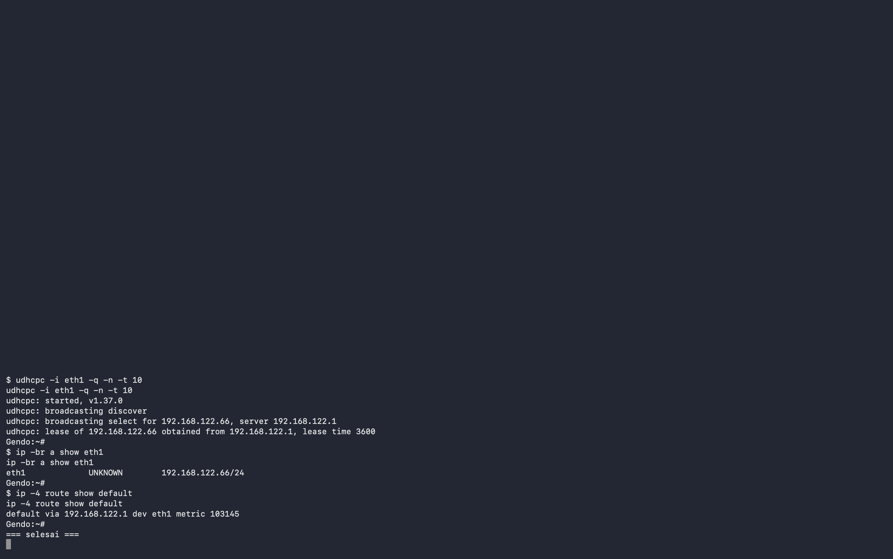

---

<a id="soal-6"></a>

## Soal 6: Alamat Permanen Host

**Deskripsi Soal:**
Alamat host dibuat permanen dengan script `/root/init.sh`. Script tersebut dipanggil otomatis oleh image container saat node dinyalakan atau di-restart.

**Hasil Pengerjaan:**
| Item | Hasil |
|---|---|
| Node non-router | **25/25** mendapat IP statis + gateway sesuai VLSM |
| Aturan alamat | gateway = IP usable pertama; host berikutnya berurutan sesuai urutan nama di switch |
| `ip -br` + default route | **25/25 sesuai rencana** |
| Ping ke gateway | **25/25 berhasil, 0% packet loss** |
| Unit-01 → gateway `192.235.4.65` | **4/4, 0% packet loss** |
| Uji restart 25 host | **25/25 konfigurasi kembali otomatis** |
| DNS & internet | tetap berhasil setelah restart |
| Soal 3, 4, 5 | diverifikasi ulang, tetap lolos |

**Aturan penomoran:**
Sesuai glosarium: gateway adalah IP usable pertama pada subnet, lalu node-node
di switch menerima IP usable berikutnya berurutan sesuai penulisan nama di
topologi (kiri → kanan). Ini sudah sesuai `vlsm_plan.json` yang dipakai sejak
soal 1.

Contoh:

| Node | IP | Gateway | Subnet |
|---|---|---|---|
| Unit-01 | `192.235.4.66/29` | `192.235.4.65` | `192.235.4.64/29` |
| Unit-02 | `192.235.4.67/29` | `192.235.4.65` | `192.235.4.64/29` |
| Quarters | `192.235.0.2/23` | `192.235.0.1` | `192.235.0.0/23` |
| Comm-Net | `192.235.2.2/24` | `192.235.2.1` | `192.235.2.0/24` |
| Magi-Casper | `192.235.4.58/29` | `192.235.4.57` | `192.235.4.56/29` |
| Armisael | `192.235.4.83/29` | `192.235.4.81` | `192.235.4.80/29` |

Tabel lengkap 25 node: `dokumen/soal6/verify/ip_br_all.txt`, salinan script per node:
`dokumen/soal6/configs/init_<nama>.sh`.

**Cara agar bertahan setelah restart:**
Image `alpinet`/`debinet` menjalankan `/etc/alpinet-init.sh` atau
`/etc/debinet-init.sh`, yang memanggil **`/root/init.sh`** jika ada dan executable.
Maka pada tiap host dibuat `/root/init.sh` berisi:

- `ip link set eth0 up`, `ip addr flush dev eth0`
- `ip addr add <IP>/<prefix> dev eth0`
- `ip route replace default via <gateway>`
- penulisan `/etc/resolv.conf` (DNS dari soal 4)
- penulisan blok statis `/etc/network/interfaces`

Script ini juga dijalankan sekali saat konfigurasi dipasang. Setelah itu seluruh
25 host di-**restart** lewat API GNS3 dan langsung diperiksa ulang: 25/25 IP,
gateway, dan `/root/init.sh` masih benar (`dokumen/soal6/verify/restart_hosts.txt`).

**Validasi:**
Dari konsol **Unit-01**:

```
ip -br a show eth0        → 192.235.4.66/29
ip route show default     → default via 192.235.4.65 dev eth0
ping -c 4 192.235.4.65    → 4/4, 0% packet loss
```

Log lain: `dokumen/soal6/verify/ping_gateway_all.txt` (25 host), `dokumen/soal6/verify/apply_hosts.txt`,
`dokumen/soal6/verify/restart_hosts.txt`, `dokumen/soal6/summary.json`.

**Galeri Bukti:**


---

<a id="soal-7"></a>

## Soal 7: Mengaktifkan MAGI

**Deskripsi Soal:**
Ketiga node MAGI diaktifkan dengan memasang `iptables` dan `netcat-traditional`. Listener kemudian disiapkan pada port yang diminta, lalu pesan dari Lilith dikirim ke masing-masing port.

**Hasil Pengerjaan:**
| Item | Hasil |
|---|---|
| Node MAGI | Casper, Balthasar, Melchior (Switch-Terminal) |
| Paket dipasang | **`iptables`** + **`netcat-traditional`** di ketiga node |
| Skrip instalasi | **`/root/<nama>.sh`** (mis. `/root/Magi-Casper.sh`) |
| Listener | Casper `:5000`; Balthasar `:5000` dan `:5001`; Melchior `:5000` |
| Pesan dari Lilith | **4/4 terkirim** |
| Pesan diterima | **4/4 terbaca di node tujuan** |

Sesuai glosarium: Casper 5000, Balthasar 5000 + 5001, Melchior 5000.

**Konfigurasi:**
Tiap node MAGI mendapat `/root/<nama>.sh` yang:

1. `apt-get update` + `apt-get install -y iptables netcat-traditional`
   (`DEBIAN_FRONTEND=noninteractive`).
2. Memilih biner `nc.traditional` (fallback `nc`).
3. Membersihkan listener lama, lalu membuat loop listener dengan
   `nohup sh -c 'while true; do nc.traditional -l -p <port> >> /root/magi_<port>.log 2>&1; done' &`.
4. Mencetak `ss -ltnp` sebagai pembuktian port aktif.

`nc.traditional` dipakai karena listener OpenBSD `nc` akan berhenti setelah
satu koneksi; loop `while true` menjaga listener tetap hidup untuk pengiriman
berikutnya.

Salinan skrip: `dokumen/soal7/configs/Magi-Casper.sh`, `dokumen/soal7/configs/Magi-Balthasar.sh`,
`dokumen/soal7/configs/Magi-Melchior.sh`.

**Pengiriman dari Lilith:**
| Tujuan | Port | Pesan | Status |
|---|---|---|---|
| Magi-Casper | 5000 | `HALO CASPER DARI LILITH` | diterima |
| Magi-Balthasar | 5000 | `HALO BALTHASAR PORT 5000 DARI LILITH` | diterima |
| Magi-Balthasar | 5001 | `HALO BALTHASAR PORT 5001 DARI LILITH` | diterima |
| Magi-Melchior | 5000 | `HALO MELCHIOR DARI LILITH` | diterima |

Log lengkap: `dokumen/soal7/verify/install.txt`, `dokumen/soal7/verify/listeners.txt`, `dokumen/soal7/verify/send.txt`,
`dokumen/soal7/verify/received.txt`, ringkasan: `dokumen/soal7/summary.json`.

**Galeri Bukti:**


---

<a id="soal-8"></a>

## Soal 8: Kondisi Normal Pen-Pen dan Tokyo3-Core

**Deskripsi Soal:**
Sebelum adanya perusakan, layanan pada Pen-Pen dan Tokyo3-Core diperiksa dalam kondisi normal. Pengujian dilakukan dari Lilith ke port yang dilayani dan ke port yang tidak dilayani.

**Hasil Pengerjaan:**
| Item | Hasil |
|---|---|
| Pen-Pen `:80` | `Welcome to Pen-Pen` |
| Tokyo3-Core `:80` | `Welcome to Tokyo3-Core` |
| Tokyo3-Core `:8080` | `syifa imutz` |
| `nc` dari Lilith ke 3 port | **3/3 berhasil** |
| Port `:22` (tidak dilayani) | **Connection refused, ±0.006 detik** |
| Skrip listener | `/root/Pen-Pen.sh`, `/root/Tokyo3-Core.sh` |

Kondisi ini diambil sebelum perusakan pada soal 9 dan 10, ketika kedua node masih
melayani tanpa proteksi.

**Konfigurasi:**
Tiap node menjalankan `/root/<nama>.sh` yang memasang listener `nc` berulang:

```sh
start_listener() {
  port=$1
  text=$2
  nohup sh -c "while true; do printf '%s\n' \"$text\" | nc -N -l $port; done" >/dev/null 2>&1 &
}
start_listener 80 "Welcome to $(hostname)"
# Tokyo3-Core juga:
start_listener 8080 "syifa imutz"
```

`nc -N` menutup koneksi setelah stdin habis, sehingga setiap `nc` dari Lilith
mendapat satu baris jawaban lalu selesai. Loop `while true` membuat listener
tetap hidup untuk koneksi berikutnya. Salinan skrip: `dokumen/soal8/configs/`.

**Validasi:**
| Perintah | Jawaban |
|---|---|
| `nc -w 3 192.235.3.194 80` | `Welcome to Pen-Pen` |
| `nc -w 3 192.235.4.106 80` | `Welcome to Tokyo3-Core` |
| `nc -w 3 192.235.4.106 8080` | `syifa imutz` |
| `nc -v -w 2 192.235.3.194 22` | `Connection refused`, `0.006 detik` |
| `nc -v -w 2 192.235.4.106 22` | `Connection refused`, `0.006 detik` |

Durasi ±0.006 detik (jauh di bawah `timeout 5`) membuktikan port tertutup
**langsung gagal**, bukan menggantung. Log: `dokumen/soal8/verify/nc_served.txt`,
`dokumen/soal8/verify/nc_closed.txt`, `dokumen/soal8/verify/servers.txt`, `dokumen/soal8/verify/listeners.txt`;
ringkasan: `dokumen/soal8/summary.json`.

**Galeri Bukti:**


---

<a id="soal-9"></a>

## Soal 9: Perbaikan Routing Shigeru

**Deskripsi Soal:**
Script perusakan dijalankan pada Shigeru. Setelah gejala muncul, kondisi routing diperiksa lalu diperbaiki melalui script perbaikan.

**Hasil Pengerjaan:**
| Item | Hasil |
|---|---|
| Eksekusi | dijalankan di **Shigeru**; muncul pesan `Script sudah dirusak` |
| Gejala | Lilith → Armisael **100% packet loss**; Armisael → gateway tetap **4/4** |
| Penyebab ditemukan | **4** (lihat tabel di bawah) |
| Perbaikan | `/root/soal9_fix.sh` |
| Setelah perbaikan | Lilith → Armisael **4/4, 0% loss**; Armisael → internet **4/4** |

**Gejala sebelum perbaikan:**
- `ping -c 4 192.235.4.83` dari Lilith → 4 terkirim, 0 diterima (100% loss).
- `ping -c 4 192.235.4.81` dari Armisael → 4/4 diterima (gateway masih hidup).
- `ping -c 4 8.8.8.8` dari Armisael → `Destination Host Unreachable` dari `192.235.4.81`.

Artinya LAN Switch-Monolith masih sehat, tetapi Shigeru gagal meneruskan/merutekan.

**Semua penyebab:**
| # | Kondisi yang ditemukan di Shigeru | Efek |
|---|---|---|
| 1 | `net.ipv4.ip_forward = 0` | Router tidak meneruskan paket antar interface → balasan Armisael tidak sampai ke Lilith. |
| 2 | `default via 192.235.4.162 dev eth2` | Default route mengarah ke **Makoto**, bukan ke Gendo (`192.235.4.129`). Traffic internet salah arah. |
| 3 | `blackhole 192.235.4.72/29` | Subnet Lilith sengaja di-blackhole → paket ke Lilith dibuang. |
| 4 | `ip rule 90: from all iif eth0 lookup 100` + `unreachable default` di **table 100** | Semua paket yang **masuk lewat eth0** (LAN tempat Armisael) kena lookup tabel 100 dan dijawab *unreachable*. Inilah sebabnya Armisael masih bisa ping gateway (tujuan lokal masuk tabel `local`, prioritas 0) tetapi gagal ke internet, dan balasannya ke Lilith juga gagal. |

Keempatnya saling memperparah; memperbaiki satu saja tidak cukup.

**Perbaikan:**
`/root/soal9_fix.sh` melakukan:

```sh
sysctl -w net.ipv4.ip_forward=1
ip route del blackhole 192.235.4.72/29
ip rule del iif eth0 lookup 100
ip route del default table 100
ip route replace default via 192.235.4.129 dev eth1
ip route replace 192.235.4.88/29 via 192.235.4.162 dev eth2
```

Rute Makoto (`192.235.4.88/29 via 192.235.4.162`) dipertahankan karena memang
rute bawah Shigeru dari soal 3. Salinan: `dokumen/soal9/configs/soal9_fix.sh`.

**Validasi:**
| Uji | Hasil |
|---|---|
| Lilith → Armisael `192.235.4.83` | **4/4, 0% packet loss** |
| Armisael → gateway `192.235.4.81` | **4/4, 0% packet loss** |
| Armisael → `8.8.8.8` | **4/4, 0% packet loss** |
| `ip rule` Shigeru | hanya `local`, `main`, `default` (_rule 100 hilang_) |
| `ip_forward` Shigeru | `1` |

Log: `dokumen/soal9/verify/break_run.txt`, `dokumen/soal9/verify/sabotage_state.txt`,
`dokumen/soal9/verify/repair_run.txt`, `dokumen/soal9/verify/final.txt`; ringkasan: `dokumen/soal9/summary.json`.

**Galeri Bukti:**


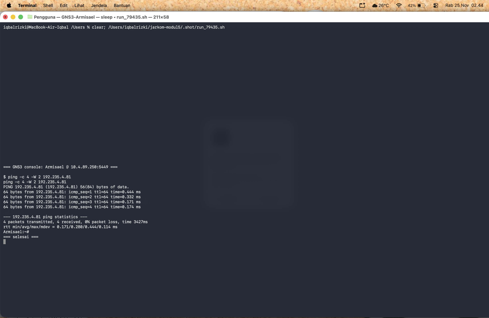


---

<a id="soal-10"></a>

## Soal 10: Perbaikan NAT Jaringan Cage

**Deskripsi Soal:**
Script perusakan dijalankan pada Misato dan Gendo. Gangguan ditelusuri dengan membandingkan hasil ping dari jaringan Cage dan dari jaringan Intel.

**Hasil Pengerjaan:**
| Item | Hasil |
|---|---|
| Eksekusi | dijalankan di **Misato** dan **Gendo** |
| Gejala | Unit-01/02/00 → `8.8.8.8` **100% loss**; Spy → `8.8.8.8` **4/4**; Unit-01 → Lilith dan gateway **normal** |
| Penyebab | **2** (satu di Misato, satu di Gendo) |
| Perbaikan | `/root/soal10_fix.sh` dijalankan di kedua router |
| Setelah perbaikan | Unit-01 → `8.8.8.8` **4/4**; counter MASQUERADE Gendo naik |
| NAT | dilakukan di **Gendo** (`POSTROUTING`, `-o eth1`, NAT1) |

**Gejala sebelum perbaikan:**
| Uji | Hasil |
|---|---|
| Unit-01 → `8.8.8.8` | 4 terkirim, 0 diterima (100% loss) |
| Unit-01 → Lilith `192.235.4.74` | 2/2, 0% loss → jalur internal sehat |
| Unit-01 → gateway Misato `192.235.4.65` | 2/2, 0% loss → LAN Cage sehat |
| Spy → `8.8.8.8` | 4/4, 0% loss → internet & NAT Gendo sehat |

Jadi masalahnya bukan routing internal/fisik, melainkan **translasi alamat sumber**.

**Semua penyebab:**
| # | Node | Aturan yang ditambahkan script | Efek |
|---|---|---|---|
| 1 | **Misato** | `-A POSTROUTING -s 192.235.4.64/29 ! -d 192.235.0.0/16 -o eth1 -j SNAT --to-source 172.31.99.1` | Setiap paket Cage yang keluar ke internet diubah sumbernya menjadi `172.31.99.1` **di router internal**. Gendo hanya mengizinkan dan melakukan NAT untuk sumber `192.235.0.0/16`, sehingga paket dengan sumber `172.31.99.1` ditolak / tidak diterjemahkan. |
| 2 | **Gendo** | `-A POSTROUTING -s 192.235.4.64/29 -o eth1 -j RETURN` | Khusus subnet Cage, aturan `RETURN` ini mengabaikan aturan `MASQUERADE` (`-s 192.235.0.0/16 -o eth1`) di bawahnya. Jadi walaupun SNAT Misato dihapus, Cage tetap tidak mendapat NAT di router keluar. |

Keduanya harus dihapus; menghapus salah satu saja tidak cukup.

**Kenapa Cage terdampak tetapi Intel tidak:**
- **Cage** (`192.235.4.64/29`) lewat **Misato → Gendo**. Kedua router disabotase: Misato mengganti sumber jadi `172.31.99.1`, Gendo mem-`RETURN`-kan subnet Cage sebelum `MASQUERADE`. Akibatnya tidak ada alamat publik yang sah untuk balasan, sehingga ping gagal.
- **Intel** (`192.235.4.48/29`) lewat **Kaji → Gendo**. Kaji **tidak** menjalankan script, jadi paket Spy sampai di Gendo dengan sumber awal `192.235.x.x` (masuk `192.235.0.0/16`). Firewall `FORWARD` mengizinkan dan aturan `MASQUERADE` di Gendo berfungsi normal. Itulah sebabnya Spy tetap bisa ping `8.8.8.8`.

Ping Cage → Lilith tetap normal karena tujuannya masih dalam `192.235.0.0/16`: aturan SNAT Misato memakai `! -d 192.235.0.0/16`, jadi tidak pernah kena untuk traffic internal.

**Perbaikan:**
`/root/soal10_fix.sh` (sama di kedua router, memilih tindakan lewat `hostname`):

```sh
# Misato
iptables -t nat -D POSTROUTING -s 192.235.4.64/29 ! -d 192.235.0.0/16 \
  -o eth1 -j SNAT --to-source 172.31.99.1

# Gendo
iptables -t nat -D POSTROUTING -s 192.235.4.64/29 -o eth1 -j RETURN
```

Aturan `MASQUERADE` Gendo untuk `192.235.0.0/16` sengaja **dipertahankan**. Salinan skrip: `dokumen/soal10/configs/soal10_fix.sh`.

**Validasi:**
| Uji | Hasil |
|---|---|
| Unit-01 → `8.8.8.8` | **4/4, 0% packet loss** |
| Spy → `8.8.8.8` | **4/4, 0% packet loss** |
| Unit-01 → Lilith | **4/4, 0% packet loss** (tanpa NAT) |
| Misato `POSTROUTING` | hanya `-P ACCEPT` (SNAT hilang) |
| Gendo `POSTROUTING` | `-A POSTROUTING -s 192.235.0.0/16 -o eth1 -j MASQUERADE` |
| Counter MASQUERADE Gendo | naik saat Unit-01 ping internet (lihat `dokumen/soal10/verify/final.txt` dan screenshot `12`) |

**Alamat sumber diterjemahkan di router Gendo**, pada antarmuka `eth1` (ke NAT1), oleh aturan `MASQUERADE`. Misato hanya merutekan, tidak boleh melakukan NAT.

Log: `dokumen/soal10/verify/baseline.txt`, `dokumen/soal10/verify/break_run.txt`, `dokumen/soal10/verify/sabotage_state.txt`,
`dokumen/soal10/verify/repair_run.txt`, `dokumen/soal10/verify/final.txt`; ringkasan: `dokumen/soal10/summary.json`.

**Galeri Bukti:**


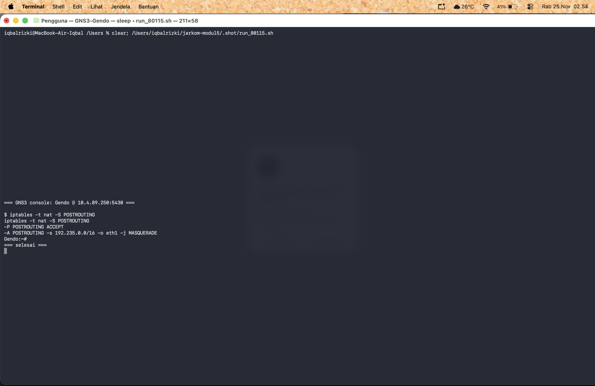


---

<a id="soal-11"></a>

## Soal 11 — Menyembunyikan Casper dari Ping

### 1. Penjelasan soal

Casper adalah MAGI paling rahasia. Tidak ada perangkat lain yang boleh mem-ping Casper, termasuk yang satu switch (Balthasar dan Melchior). Casper sendiri tetap boleh mem-ping siapa saja, dan layanan TCP 5000 harus tetap hidup.

### 2. Ringkasan

| Item | Hasil |
|---|---|
| Node | Magi-Casper (`192.235.4.58`, Switch-Terminal) |
| Aturan | `INPUT`: buang ICMP echo-request (type 8) |
| Ping Balthasar → Casper (satu switch) | **100% packet loss** |
| Ping Lilith → Casper | **100% packet loss** |
| Ping keluar dari Casper | **tetap berjalan** (lihat Soal 12: ping 8.8.8.8 berhasil saat rule ini aktif) |
| TCP 5000 Casper | **tetap hidup** (`nc` dari Lilith `RC=0`) |
| Skrip | `/root/soal11.sh` |

### 3. Konfigurasi

```sh
#!/bin/sh
iptables -D INPUT -p icmp --icmp-type echo-request -j DROP 2>/dev/null
iptables -I INPUT 1 -p icmp --icmp-type echo-request -j DROP
```

Hasil `iptables -S`:

```
-P INPUT ACCEPT
-P FORWARD ACCEPT
-P OUTPUT ACCEPT
-A INPUT -p icmp -m icmp --icmp-type 8 -j DROP
```

| Kebutuhan soal | Cara memenuhinya |
|---|---|
| Tidak ada perangkat yang boleh mem-ping Casper, termasuk yang satu switch | Rule dipasang di **Casper sendiri** (chain `INPUT`), sehingga berlaku untuk semua sumber. Balthasar dan Melchior satu switch dengan Casper dan tidak melewati router, jadi filter di router tidak akan cukup. |
| Casper tetap boleh mem-ping siapa saja | Yang dibuang hanya **echo-request** (type 8) yang masuk. Balasan ping (echo-reply, type 0) untuk ping yang dikirim Casper tidak tersentuh. |
| TCP 5000 tetap hidup | Rule hanya menyasar protokol ICMP. |
| Skrip aman dijalankan ulang | `-D` menghapus rule lama lebih dulu, baru `-I` memasangnya, sehingga rule tidak ganda. |

### 4. Pembuktian

| Uji | Hasil |
|---|---|
| Balthasar → Casper `ping -c3 -W2 192.235.4.58` | 3 terkirim, 0 diterima (100% loss) |
| Lilith → Casper `ping -c3 -W2 192.235.4.58` | 3 terkirim, 0 diterima (100% loss) |
| Casper `ss -ltnp \| grep 5000` | `LISTEN 0.0.0.0:5000` (`nc.traditional`) |
| Lilith → Casper `echo tes \| nc -w3 192.235.4.58 5000` | `RC=0` |

Kemampuan Casper mem-ping keluar terbukti pada Soal 12, ketika rule drop echo-request ini sudah aktif dan `ping -c3 8.8.8.8` dari Casper tetap berhasil 3/3.

### 5. Bukti screenshot

| File | Isi |
|---|---|
| `assets/soal11/01-casper-script-rule.png` | `soal11.sh` dijalankan dan `iptables -S` di Casper |
| `assets/soal11/02-balthasar-ping-casper-gagal.png` | Balthasar → Casper 100% loss |
| `assets/soal11/03-lilith-ping-casper-gagal.png` | Lilith → Casper 100% loss |
| `assets/soal11/04-casper-listener-5000.png` | listener TCP 5000 Casper aktif |
| `assets/soal11/05-lilith-nc-5000.png` | `nc` dari Lilith ke port 5000, `RC=0` |

### 6. Langkah pengerjaan

1. Di Magi-Casper buat `/root/soal11.sh` (isi di atas), lalu `sh /root/soal11.sh` dan `iptables -S`.
2. Dari Balthasar dan Lilith: `ping -c3 -W2 192.235.4.58` (harus gagal).
3. Di Casper: `ss -ltnp | grep 5000`. Dari Lilith: `echo tes | nc -w3 192.235.4.58 5000; echo RC=$?`.

---

### Galeri bukti screenshot

Semua gambar di bawah adalah **tangkapan layar asli** yang diambil saat pengerjaan (konsol node GNS3), bukan gambar generate.

#### 1. `soal11.sh` dan `iptables -S` di Casper

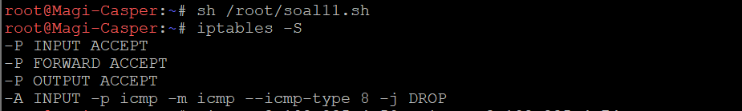

#### 2. Balthasar → Casper 100% loss

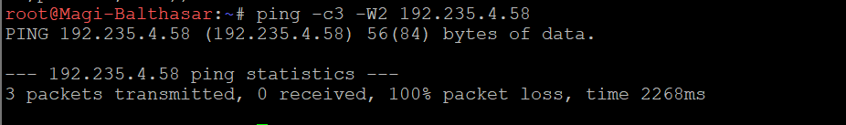

#### 3. Lilith → Casper 100% loss

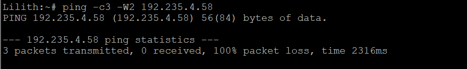

#### 4. Listener TCP 5000 Casper aktif

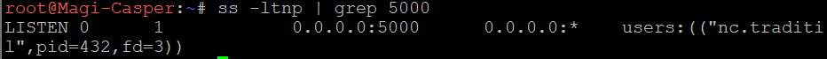

#### 5. `nc` dari Lilith ke port 5000, `RC=0`

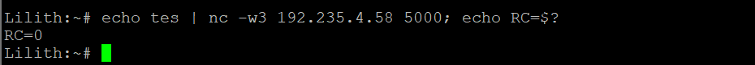

---

<a id="soal-12"></a>

## Soal 12 — Perbaikan Firewall Hardening Casper

### 1. Penjelasan soal

Seorang teknisi menjalankan script hardening di Casper lalu pulang tanpa mengecek. Akibatnya Casper tidak bisa ping 8.8.8.8 dan tidak bisa `apt-get update`, serta Unit-00 tidak bisa menyambung ke TCP 5000 Casper. Ping ke Casper tetap ditolak (itu benar). Tugasnya: menjalankan `break_fw.sh` di Magi-Casper tanpa membaca isinya, menemukan semua penyebab, lalu memperbaikinya **tanpa membatalkan tujuan hardening**: Casper tetap menolak semua lalu lintas masuk yang tidak diizinkan, dan policy `INPUT` tetap `DROP`.

### 2. Ringkasan

| Item | Hasil |
|---|---|
| Script sabotase | `break_fw.sh` dari asisten, dijalankan di **Magi-Casper** → `Script sudah dirusak` |
| Gejala | ping 8.8.8.8 gagal, `apt-get update` gagal, Unit-00 → Casper:5000 `RC=1` |
| Penyebab ditemukan | **4** (lihat tabel) |
| Perbaikan | `/root/soal12_fix.sh` (idempoten) |
| Policy `INPUT` setelah perbaikan | **tetap DROP** |
| Setelah perbaikan | `apt-get update` berhasil; ping 8.8.8.8 **3/3**; Unit-00 → Casper:5000 **RC=0**; ping ke Casper tetap **100% loss** |

### 3. Gejala sebelum perbaikan

| Uji | Hasil |
|---|---|
| Casper `ping -c3 -W2 8.8.8.8` | 3 terkirim, 0 diterima (100% loss) |
| Casper `apt-get update` | `Temporary failure resolving 'deb.debian.org'` |
| Unit-00 `nc -w3 192.235.4.58 5000` | `RC=1` |

### 4. Semua penyebab

State Casper setelah `break_fw.sh` (`iptables -S` filter, nat, mangle, lalu `ip route` dan `resolv.conf`):

```
-P INPUT DROP
-P FORWARD ACCEPT
-P OUTPUT ACCEPT
-A INPUT -i lo -j ACCEPT
-A INPUT -p icmp -j DROP
-A OUTPUT -p udp -m udp --dport 53 -j DROP
```

Tabel `nat` dan `mangle` kosong. Default route (`via 192.235.4.57 dev eth0`) dan `/etc/resolv.conf` (`8.8.8.8`, `1.1.1.1`) normal, sehingga bukan penyebab.

| # | Kondisi di Casper | Efek |
|---|---|---|
| 1 | `-P INPUT DROP` **tanpa** rule `ESTABLISHED,RELATED` | Semua balasan untuk koneksi yang Casper mulai (balasan ping, SYN-ACK, balasan DNS dan HTTP) ikut dibuang. |
| 2 | `-A INPUT -p icmp -j DROP` | Membuang **semua** ICMP, bukan hanya echo-request, termasuk echo-reply dari 8.8.8.8, sehingga ping keluar tidak pernah mendapat jawaban. |
| 3 | `-A OUTPUT -p udp --dport 53 -j DROP` | Query DNS dibuang, sehingga `apt-get update` gagal me-resolve `deb.debian.org`. |
| 4 | Tidak ada izin TCP 5000 di `INPUT` | SYN dari Unit-00 dibuang policy `DROP`, sehingga `nc` gagal walaupun listener tetap hidup. |

Keempatnya saling memperparah, jadi memperbaiki satu saja tidak cukup.

### 5. Perbaikan tanpa membatalkan tujuan hardening

`/root/soal12_fix.sh`:

```sh
#!/bin/sh
iptables -P INPUT DROP
iptables -P OUTPUT ACCEPT
iptables -F INPUT
iptables -F OUTPUT
iptables -A INPUT -i lo -j ACCEPT
iptables -A INPUT -m conntrack --ctstate ESTABLISHED,RELATED -j ACCEPT
iptables -A INPUT -p icmp --icmp-type echo-request -j DROP
iptables -A INPUT -p tcp --dport 5000 -j ACCEPT
```

| Baris | Fungsi |
|---|---|
| `-P INPUT DROP` | Tujuan hardening dipertahankan: semua lalu lintas masuk yang tidak diizinkan ditolak. |
| `-P OUTPUT ACCEPT` dan `-F OUTPUT` | Menghapus rule DROP UDP 53 sehingga DNS jalan lagi. |
| `-F INPUT` | Membersihkan rule rusak sekaligus membuat skrip aman dijalankan ulang. |
| `-i lo` | Loopback tetap hidup. |
| `ESTABLISHED,RELATED` | Balasan untuk koneksi yang Casper mulai bisa masuk (ping 8.8.8.8, DNS, HTTP untuk apt). |
| `--icmp-type echo-request -j DROP` | Ping **masuk** ke Casper tetap ditolak (sesuai Soal 11), tetapi echo-reply untuk ping keluar tidak ikut dibuang. |
| `tcp --dport 5000 -j ACCEPT` | Unit-00 dan klien lain bisa menyambung ke layanan TCP 5000. |

Hasil `iptables -S` setelah perbaikan:

```
-P INPUT DROP
-P FORWARD ACCEPT
-P OUTPUT ACCEPT
-A INPUT -i lo -j ACCEPT
-A INPUT -m conntrack --ctstate RELATED,ESTABLISHED -j ACCEPT
-A INPUT -p icmp -m icmp --icmp-type 8 -j DROP
-A INPUT -p tcp -m tcp --dport 5000 -j ACCEPT
```

### 6. Pembuktian akhir

| Uji | Hasil |
|---|---|
| Casper `apt-get update` | `Hit:1`, `Hit:2`, `Hit:3` (berhasil) |
| Casper `ping -c3 8.8.8.8` | **3/3, 0% packet loss** |
| Unit-00 → Casper `nc -w3 192.235.4.58 5000` | **RC=0** |
| Lilith → Casper `ping -c3 -W2 192.235.4.58` | **100% packet loss** (ditolak, sesuai tujuan) |
| `iptables -S` Casper | `-P INPUT DROP` |

### 7. Bukti screenshot

| File | Isi |
|---|---|
| `assets/soal12/01-break-fw-run.png` | eksekusi `break_fw.sh` di Casper |
| `assets/soal12/02-gejala-casper.png` | ping 8.8.8.8 dan `apt-get update` gagal |
| `assets/soal12/03-gejala-unit00-nc.png` | Unit-00 → Casper:5000 `RC=1` |
| `assets/soal12/04-state-rusak.png` | `iptables -S` (filter, nat, mangle), `ip route`, `resolv.conf` saat rusak |
| `assets/soal12/05-fix-script-state.png` | isi `soal12_fix.sh`, eksekusi, dan `iptables -S` setelah perbaikan |
| `assets/soal12/06-casper-apt-ok.png` | `apt-get update` dan ping 8.8.8.8 berhasil |
| `assets/soal12/07-unit00-nc-ok.png` | Unit-00 → Casper:5000 `RC=0` |
| `assets/soal12/08-lilith-ping-tetap-gagal.png` | ping ke Casper tetap ditolak |

Script sabotase dari asisten tidak dibaca isinya. Diagnosis dilakukan dari gejala dan state firewall yang terlihat di Casper.

### 8. Langkah pengerjaan

1. Di Magi-Casper: `sh /root/break_fw.sh` (sabotase dari asisten).
2. Catat gejala: `ping -c3 -W2 8.8.8.8`, `apt-get update`, dan dari Unit-00 `echo tes | nc -w3 192.235.4.58 5000; echo RC=$?`.
3. Cari penyebab: `iptables -S; iptables -t nat -S; iptables -t mangle -S`, lalu `ip route; cat /etc/resolv.conf`.
4. Buat `/root/soal12_fix.sh` (isi di atas), lalu `sh /root/soal12_fix.sh` dan `iptables -S`.
5. Uji ulang: `apt-get update; ping -c3 8.8.8.8` di Casper, nc dari Unit-00, dan ping dari Lilith ke Casper.

---

### Galeri bukti screenshot

Semua gambar di bawah adalah **tangkapan layar asli** yang diambil saat pengerjaan (konsol node GNS3), bukan gambar generate.

#### 1. Eksekusi `break_fw.sh` di Casper


#### 2. Gejala di Casper

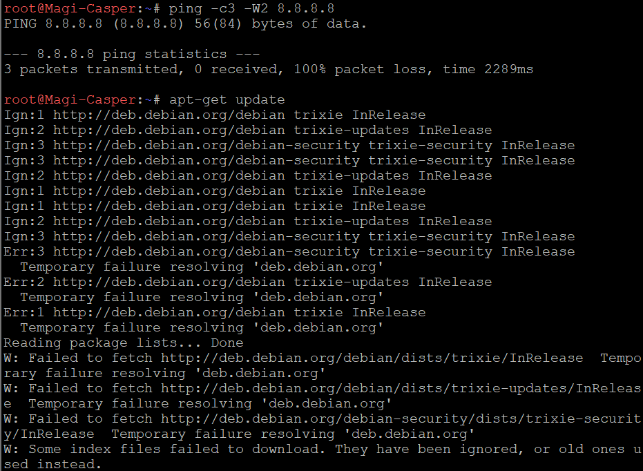

#### 3. Gejala `nc` dari Unit-00

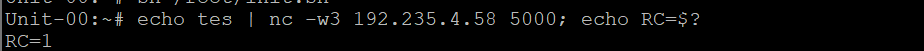

#### 4. State firewall, route, dan resolv.conf saat rusak

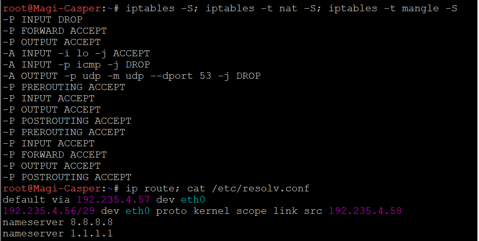

#### 5. `soal12_fix.sh` dan `iptables -S` setelah perbaikan

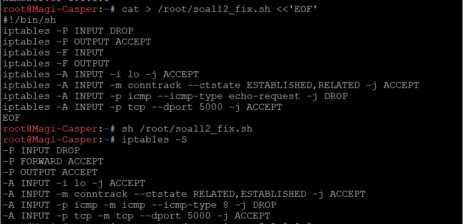

#### 6. `apt-get update` dan ping 8.8.8.8 berhasil

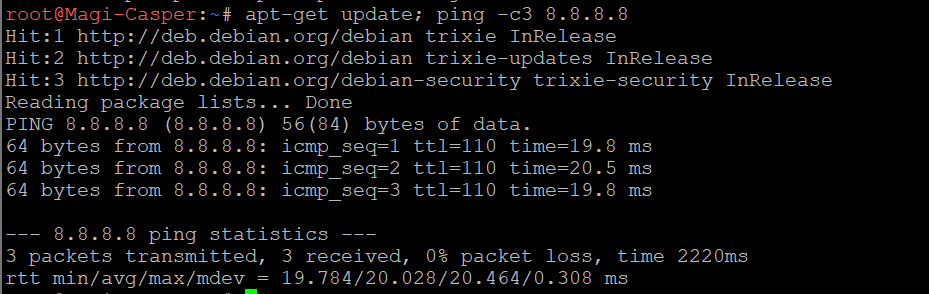

#### 7. Unit-00 → Casper:5000 `RC=0`

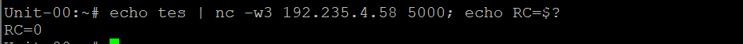

#### 8. Ping ke Casper tetap ditolak

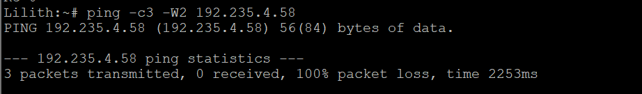

---

<a id="soal-13"></a>

## Soal 13 — Pembatasan Akses Port Balthasar

### 1. Penjelasan soal

Balthasar menyimpan seluruh data Geofront, tetapi terlalu banyak yang bisa mengetuk pintunya, termasuk tetangga satu switch. Hanya Casper dan semua Pilot yang boleh menyambung ke TCP 5000 dan 5001. Node lain, termasuk yang satu switch, harus **langsung ditolak** (bukan menggantung sampai timeout). Lalu lintas lain tidak boleh terganggu, dan Balthasar tetap harus bisa ping 8.8.8.8.

### 2. Ringkasan

| Item | Hasil |
|---|---|
| Node | Magi-Balthasar (`192.235.4.59`, Switch-Terminal) |
| Port dijaga | TCP **5000** dan **5001** |
| Sumber yang diizinkan | Casper (`192.235.4.58`) dan semua Pilot: Unit-01 (`.66`), Unit-02 (`.67`), Unit-00 (`.68`), Sachiel (`192.235.3.130`) |
| Sumber lain (termasuk satu switch) | **langsung ditolak** (`REJECT --reject-with tcp-reset`) |
| Policy `INPUT` | tidak diubah (**ACCEPT**), lalu lintas lain tidak terganggu |
| Unit-01 → 5000 dan 5001 | **RC=0** |
| Lilith dan Melchior → 5000 dan 5001 | **RC=1** dalam 0.003–0.004 detik |
| Skrip | `/root/soal13.sh` |

### 3. Konfigurasi

```sh
#!/bin/sh
ALLOW="192.235.4.58 192.235.4.66 192.235.4.67 192.235.4.68 192.235.3.130"
iptables -N BRANKAS 2>/dev/null || iptables -F BRANKAS
for ip in $ALLOW; do iptables -A BRANKAS -s $ip -j ACCEPT; done
iptables -A BRANKAS -p tcp -j REJECT --reject-with tcp-reset
iptables -D INPUT -p tcp -m multiport --dports 5000,5001 -j BRANKAS 2>/dev/null
iptables -I INPUT 1 -p tcp -m multiport --dports 5000,5001 -j BRANKAS
```

Hasil `iptables -S`:

```
-P INPUT ACCEPT
-P FORWARD ACCEPT
-P OUTPUT ACCEPT
-N BRANKAS
-A INPUT -p tcp -m multiport --dports 5000,5001 -j BRANKAS
-A BRANKAS -s 192.235.4.58/32 -j ACCEPT
-A BRANKAS -s 192.235.4.66/32 -j ACCEPT
-A BRANKAS -s 192.235.4.67/32 -j ACCEPT
-A BRANKAS -s 192.235.4.68/32 -j ACCEPT
-A BRANKAS -s 192.235.3.130/32 -j ACCEPT
-A BRANKAS -p tcp -j REJECT --reject-with tcp-reset
```

| Kebutuhan soal | Cara memenuhinya |
|---|---|
| Hanya Casper dan Pilot yang boleh ke 5000 dan 5001 | Chain `BRANKAS` meng-ACCEPT lima alamat: Casper dan keempat Pilot. |
| Node lain, termasuk satu switch, ditolak seketika | `REJECT --reject-with tcp-reset` membalas TCP reset langsung. Berbeda dengan `DROP`, penolak tidak menunggu sampai timeout. |
| Lalu lintas lain tidak terganggu | Chain hanya dipanggil untuk TCP port 5000 dan 5001. Policy `INPUT` tetap ACCEPT. |
| Balthasar tetap bisa ping 8.8.8.8 | Policy `INPUT` dan `OUTPUT` tetap ACCEPT, sehingga balasan tetap diterima. |
| Skrip aman dijalankan ulang | Chain dibuat atau dikosongkan dulu, dan pemanggilan di `INPUT` dihapus sebelum dipasang lagi. |

### 4. Pembuktian

| Uji | Hasil |
|---|---|
| Unit-01 → `192.235.4.59` port 5000 | **RC=0** |
| Unit-01 → `192.235.4.59` port 5001 | **RC=0** |
| Lilith → port 5000 dan 5001 | **RC=1**, `real 0m0.003s` |
| Melchior → port 5000 dan 5001 | **RC=1**, `real 0m0.004s` |
| Balthasar `ping -c3 8.8.8.8` | **3/3, 0% packet loss** |

Waktu 0.003–0.004 detik (jauh di bawah `-w 3`) membuktikan penolakan terjadi **seketika**.

Counter chain `BRANKAS` (`iptables -L BRANKAS -v -n -x`):

| Rule | Paket | Byte |
|---|---:|---:|
| `ACCEPT` `192.235.4.58` (Casper) | 0 | 0 |
| `ACCEPT` `192.235.4.66` (Unit-01) | **10** | 544 |
| `ACCEPT` `192.235.4.67` / `.68` / `192.235.3.130` | 0 | 0 |
| `REJECT tcp-reset` | **4** | 240 |

Empat paket yang ditolak berasal dari Lilith dan Melchior, masing-masing dua percobaan (port 5000 dan 5001). Hanya Unit-01 yang menembus rule `ACCEPT`.

### 5. Bukti screenshot

| File | Isi |
|---|---|
| `assets/soal13/01-balthasar-script-rule.png` | listener 5000 dan 5001, isi `soal13.sh`, dan `iptables -S` di Balthasar |
| `assets/soal13/02-unit01-5000-5001.png` | Unit-01 ke port 5000 dan 5001, `RC=0` |
| `assets/soal13/03-lilith-ditolak.png` | Lilith ditolak seketika di kedua port |
| `assets/soal13/04-melchior-ditolak.png` | Melchior ditolak seketika di kedua port |
| `assets/soal13/05-balthasar-ping-counter.png` | ping 8.8.8.8 dari Balthasar berhasil dan counter chain `BRANKAS` |

### 6. Langkah pengerjaan

1. Di Magi-Balthasar: `sh /root/Magi-Balthasar.sh` (listener 5000 dan 5001 dari Soal 7).
2. Buat `/root/soal13.sh` (isi di atas), lalu `sh /root/soal13.sh` dan `iptables -S`.
3. Uji: dari Unit-01, Lilith, dan Melchior jalankan `time (echo tes | nc -w3 192.235.4.59 5000); echo RC=$?` (ulangi untuk 5001).
4. Di Balthasar: `ping -c3 8.8.8.8` dan `iptables -L BRANKAS -v -n -x`.

---

### Galeri bukti screenshot

Semua gambar di bawah adalah **tangkapan layar asli** yang diambil saat pengerjaan (konsol node GNS3), bukan gambar generate.

#### 1. Listener, `soal13.sh`, dan `iptables -S` di Balthasar

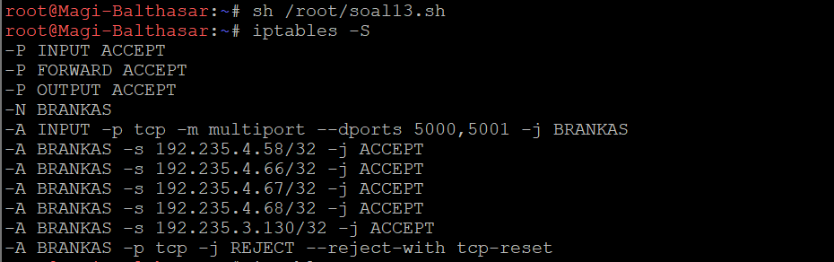

#### 2. Unit-01 ke port 5000 dan 5001, `RC=0`

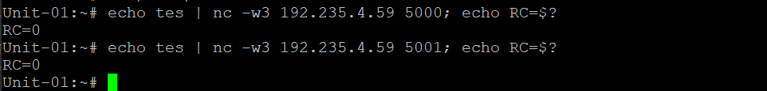

#### 3. Lilith ditolak seketika

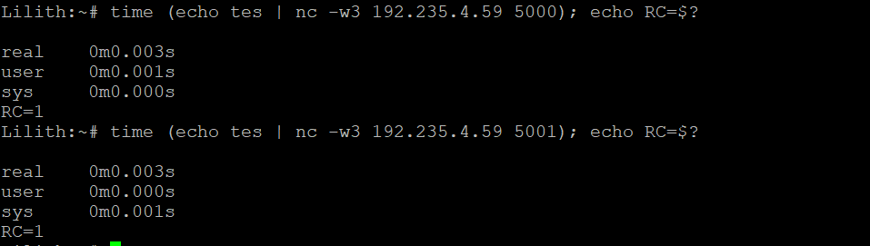

#### 4. Melchior ditolak seketika

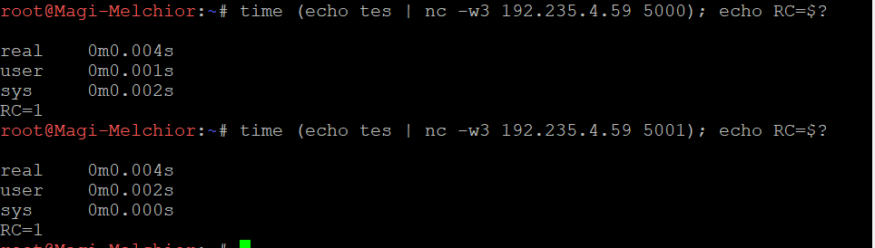

#### 5. Ping 8.8.8.8 dan counter chain `BRANKAS`

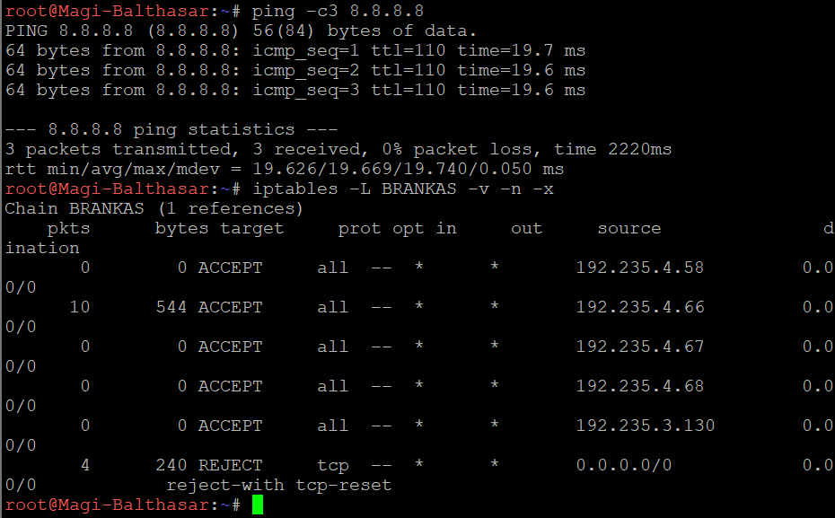

---

<a id="soal-14"></a>

## Soal 14 — Pembatasan Akses Pen-Pen Berdasarkan Jadwal

### 1. Penjelasan soal

Pen-Pen hanya boleh dihubungi sesuai jadwal, berlaku untuk **ping dan TCP 80**, dari mana pun asalnya. Jam komputer tidak boleh diubah.

| Kelompok | Jadwal | Keterangan |
|---|---|---|
| Pilot (Unit-01, Unit-02, Unit-00, Sachiel) | 08.00–16.00 WIB | Senin sampai Jumat |
| Staf Geofront (Lilith, Adam) | 17.00–23.00 WIB | setiap hari |
| Terduga Dummy System (Dummy-Plug, Entry-Plug, Spy) | tidak pernah | selalu ditolak |
| Lainnya | bebas | tanpa batasan |

Jadwal harus disimpan sebagai variabel di awal script Pen-Pen (`PILOT_START`, `PILOT_STOP`, `PILOT_DAYS`, `STAF_START`, `STAF_STOP`). Untuk uji, variabel diubah sampai jadwal cocok dengan jam sekarang, lalu sampai tidak cocok. `iptables` membaca jam **UTC** (WIB dikurangi 7 jam).

### 2. Ringkasan

| Item | Hasil |
|---|---|
| Node | Pen-Pen (`192.235.3.194`, Switch-Medic) |
| Layanan yang dijaga | ping (ICMP echo-request) dan TCP 80 |
| Pengaturan waktu | lima variabel di awal `/root/Pen-Pen.sh` |
| Jam sistem Pen-Pen | UTC (`date` dan `date -u` menampilkan jam yang sama) |
| Kondisi A (jadwal pilot cocok) | Unit-01 **berhasil**, Lilith **gagal**, Spy **gagal** |
| Kondisi B (jadwal staf cocok) | Unit-01 **gagal**, Lilith **berhasil**, Spy **gagal** |
| Terduga Dummy System | **selalu ditolak** di kedua kondisi |
| Skrip | `/root/Pen-Pen.sh` |

### 3. Konfigurasi

#### Konversi jadwal WIB → UTC

| Kelompok | Jadwal soal (WIB) | Nilai variabel (UTC) |
|---|---|---|
| Pilot | 08.00–16.00, Senin–Jumat | `PILOT_START=01:00`, `PILOT_STOP=09:00`, `PILOT_DAYS=Mon,Tue,Wed,Thu,Fri` |
| Staf Geofront | 17.00–23.00, setiap hari | `STAF_START=10:00`, `STAF_STOP=16:00` |
| Terduga Dummy System | tidak pernah | selalu `DROP` |
| Lainnya | bebas | tidak ada rule |

Kedua rentang waktu tidak menyeberang tengah malam UTC, sehingga hari pada `--weekdays` sama dengan hari WIB.

#### Isi `/root/Pen-Pen.sh`

```sh
#!/bin/sh
# ===== JADWAL (UTC = WIB - 7) =====
PILOT_START=01:00     # 08.00 WIB
PILOT_STOP=09:00      # 16.00 WIB
PILOT_DAYS=Mon,Tue,Wed,Thu,Fri
STAF_START=10:00      # 17.00 WIB
STAF_STOP=16:00       # 23.00 WIB
# ==================================
PILOT="192.235.4.66 192.235.4.67 192.235.4.68 192.235.3.130"
STAF="192.235.4.74 192.235.4.75"
DUMMY="192.235.4.51 192.235.4.50 192.235.4.102"

command -v iptables >/dev/null || apk add --no-cache iptables

# listener port 80 (soal 8)
pkill -f pp80-loop 2>/dev/null
nohup sh -c ': pp80-loop; while true; do printf "Welcome to %s\n" "$(hostname)" | nc -N -l 80; done' >/dev/null 2>&1 &

# firewall jadwal
iptables -N PENPEN 2>/dev/null || iptables -F PENPEN
for ip in $DUMMY; do iptables -A PENPEN -s $ip -j DROP; done
for ip in $PILOT; do
  iptables -A PENPEN -s $ip -m time --timestart $PILOT_START --timestop $PILOT_STOP --weekdays $PILOT_DAYS -j ACCEPT
  iptables -A PENPEN -s $ip -j DROP
done
for ip in $STAF; do
  iptables -A PENPEN -s $ip -m time --timestart $STAF_START --timestop $STAF_STOP -j ACCEPT
  iptables -A PENPEN -s $ip -j DROP
done
iptables -D INPUT -p icmp --icmp-type echo-request -j PENPEN 2>/dev/null
iptables -D INPUT -p tcp --dport 80 -j PENPEN 2>/dev/null
iptables -I INPUT 1 -p icmp --icmp-type echo-request -j PENPEN
iptables -I INPUT 1 -p tcp --dport 80 -j PENPEN
```

#### Alamat tiap kelompok

| Kelompok | Anggota | Alamat |
|---|---|---|
| Pilot | Unit-01, Unit-02, Unit-00, Sachiel | `192.235.4.66`, `.67`, `.68`, `192.235.3.130` |
| Staf Geofront | Lilith, Adam | `192.235.4.74`, `192.235.4.75` |
| Terduga Dummy System | Dummy-Plug, Entry-Plug, Spy | `192.235.4.51`, `192.235.4.50`, `192.235.4.102` |

#### Cara kerja rule

Hasil `iptables -S` pada jadwal default:

```
-P INPUT ACCEPT
-N PENPEN
-A INPUT -p tcp -m tcp --dport 80 -j PENPEN
-A INPUT -p icmp -m icmp --icmp-type 8 -j PENPEN
-A PENPEN -s 192.235.4.51/32 -j DROP
-A PENPEN -s 192.235.4.50/32 -j DROP
-A PENPEN -s 192.235.4.102/32 -j DROP
-A PENPEN -s 192.235.4.66/32 -m time --timestart 01:00:00 --timestop 09:00:00 --weekdays Mon,Tue,Wed,Thu,Fri --datestop 2038-01-19T03:14:07 -j ACCEPT
-A PENPEN -s 192.235.4.66/32 -j DROP
... (Unit-02, Unit-00, Sachiel memakai pola yang sama)
-A PENPEN -s 192.235.4.74/32 -m time --timestart 10:00:00 --timestop 16:00:00 --datestop 2038-01-19T03:14:07 -j ACCEPT
-A PENPEN -s 192.235.4.74/32 -j DROP
... (Adam memakai pola yang sama)
```

Parameter `--datestop 2038-01-19T03:14:07` ditambahkan otomatis oleh `iptables` sebagai batas tanggal bawaan modul `time`, bukan bagian dari konfigurasi kita.

| Kebutuhan soal | Cara memenuhinya |
|---|---|
| Berlaku untuk ping dan TCP 80, dari mana pun asalnya | Chain `PENPEN` dipanggil dari `INPUT` untuk ICMP echo-request dan TCP port 80, berdasarkan alamat sumber, tanpa membatasi jalur. |
| Dummy System selalu ditolak | Tiga alamat Dummy dibuang (`DROP`) di awal chain tanpa syarat waktu. |
| Pilot hanya 08.00–16.00 WIB, Senin–Jumat | `ACCEPT` bersyarat `-m time --timestart/--timestop --weekdays`; di luar jadwal paket jatuh ke `DROP` yang menyusul. |
| Staf 17.00–23.00 WIB, setiap hari | `ACCEPT` bersyarat waktu **tanpa** `--weekdays`, sehingga berlaku setiap hari. |
| Lainnya bebas | Tidak ada rule yang cocok, sehingga paket kembali ke `INPUT` dan diterima policy `ACCEPT`. |
| Jadwal berupa variabel di awal script | Kelima variabel di bagian atas; pengujian cukup mengubah variabel lalu menjalankan ulang script. |
| Jam komputer tidak diubah | Pengujian dilakukan dengan mengubah variabel, bukan `date`. |

Skrip aman dijalankan ulang: chain `PENPEN` dikosongkan (`-F`) dan pemanggilan di `INPUT` dihapus (`-D`) sebelum dipasang lagi. Listener port 80 dari Soal 8 tetap dijalankan dari skrip yang sama.

### 4. Pembuktian

Ping diuji dengan `ping -c3 -W2 192.235.3.194`.

#### Kondisi A: jadwal pilot cocok dengan jam sekarang

Waktu uji: **Rabu 16:19:29 UTC** (hari kerja, menurut `date -u` di Pen-Pen). Variabel diubah:

| Variabel | Nilai |
|---|---|
| `PILOT_START` / `PILOT_STOP` | `15:00` / `17:00` (mencakup jam uji) |
| `PILOT_DAYS` | `Mon,Tue,Wed,Thu,Fri` |
| `STAF_START` / `STAF_STOP` | `10:00` / `16:00` (di luar jam uji) |

| Dari | Hasil | Penjelasan |
|---|---|---|
| Unit-01 (pilot) | **3/3 diterima, 0% loss** | Rabu 16:19 UTC masuk jendela pilot 15:00–17:00. |
| Lilith (staf) | **100% packet loss** | 16:19 UTC sudah lewat jendela staf 10:00–16:00. |
| Spy (Dummy System) | **100% packet loss** | Selalu `DROP`. |

#### Kondisi B: jadwal staf cocok, pilot tidak cocok

Variabel diubah:

| Variabel | Nilai |
|---|---|
| `PILOT_START` / `PILOT_STOP` | `05:00` / `06:00` (di luar jam uji) |
| `STAF_START` / `STAF_STOP` | `00:00` / `23:59` (mencakup jam uji) |

| Dari | Hasil | Penjelasan |
|---|---|---|
| Unit-01 (pilot) | **100% packet loss** | Jam uji di luar jendela pilot 05:00–06:00. |
| Lilith (staf) | **3/3 diterima, 0% loss** | Jam uji masuk jendela staf 00:00–23:59. |
| Spy (Dummy System) | **100% packet loss** | Tetap `DROP` di kedua kondisi. |

Hasil kedua kondisi saling berkebalikan untuk pilot dan staf, sedangkan Spy selalu ditolak. Ini membuktikan bahwa keputusan benar-benar ditentukan oleh jadwal, bukan alamat sumber saja.

Setelah pengujian, variabel dikembalikan ke jadwal sebenarnya (`01:00`–`09:00` dan `10:00`–`16:00`) lalu `sh /root/Pen-Pen.sh` dijalankan ulang.

### 5. Bukti screenshot

| File | Isi |
|---|---|
| `assets/soal14/01-penpen-date-iptables.png` | `date`, `date -u`, `iptables -S`, dan `iptables -L PENPEN` pada jadwal default |
| `assets/soal14/02-kondisiA-variabel-rule.png` | perubahan variabel kondisi A, `date -u`, dan rule `PENPEN` |
| `assets/soal14/03-kondisiA-unit01-ok.png` | Unit-01 → Pen-Pen berhasil (kondisi A) |
| `assets/soal14/04-kondisiA-lilith-gagal.png` | Lilith → Pen-Pen gagal (kondisi A) |
| `assets/soal14/05-kondisiA-spy-gagal.png` | Spy → Pen-Pen gagal (kondisi A) |
| `assets/soal14/06-kondisiB-unit01-gagal.png` | Unit-01 → Pen-Pen gagal (kondisi B) |
| `assets/soal14/07-kondisiB-lilith-ok.png` | Lilith → Pen-Pen berhasil (kondisi B) |
| `assets/soal14/08-kondisiB-spy-gagal.png` | Spy → Pen-Pen gagal (kondisi B) |

### 6. Langkah pengerjaan

1. Di Pen-Pen buat `/root/Pen-Pen.sh` (isi di atas), lalu `sh /root/Pen-Pen.sh`, `date; date -u`, `iptables -S`, `iptables -L PENPEN -v -n`.
2. **Kondisi A:** `sed -i 's/^PILOT_START=.*/PILOT_START=15:00/; s/^PILOT_STOP=.*/PILOT_STOP=17:00/' /root/Pen-Pen.sh`, jalankan ulang script, lalu `ping -c3 -W2 192.235.3.194` dari Unit-01, Lilith, dan Spy.
3. **Kondisi B:** `sed -i 's/^PILOT_START=.*/PILOT_START=05:00/; s/^PILOT_STOP=.*/PILOT_STOP=06:00/; s/^STAF_START=.*/STAF_START=00:00/; s/^STAF_STOP=.*/STAF_STOP=23:59/' /root/Pen-Pen.sh`, jalankan ulang script, lalu ulangi ping dari ketiga node.
4. Kembalikan variabel ke jadwal sebenarnya dan jalankan ulang script.

---

### Galeri bukti screenshot

Semua gambar di bawah adalah **tangkapan layar asli** yang diambil saat pengerjaan (konsol node GNS3), bukan gambar generate.

#### 1. `date`, `date -u`, dan rule `PENPEN` pada jadwal default

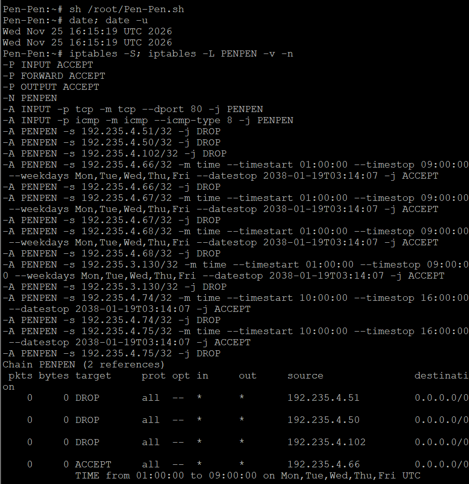

#### 2. Kondisi A: variabel, `date -u`, dan rule

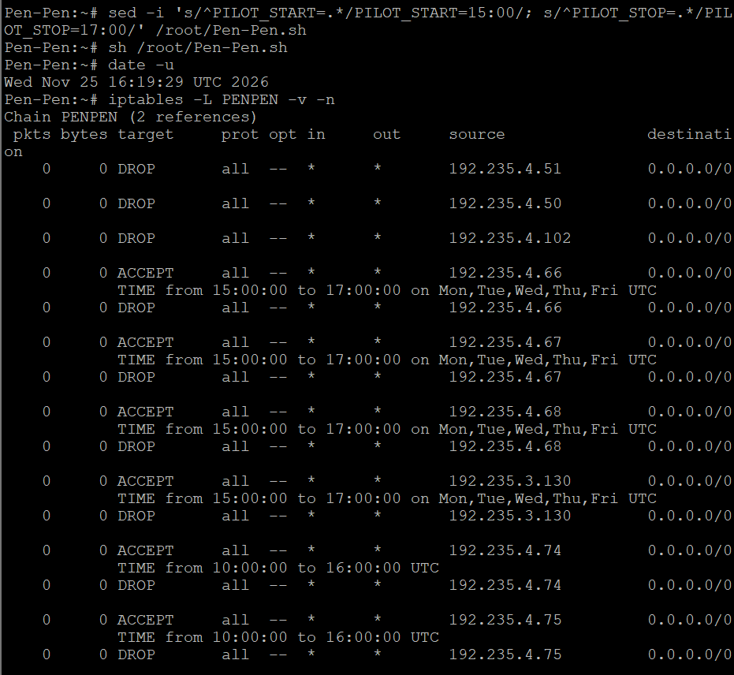

#### 3. Kondisi A: Unit-01 berhasil

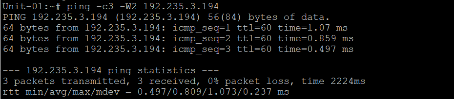

#### 4. Kondisi A: Lilith gagal

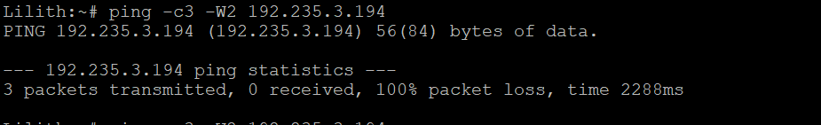

#### 5. Kondisi A: Spy gagal

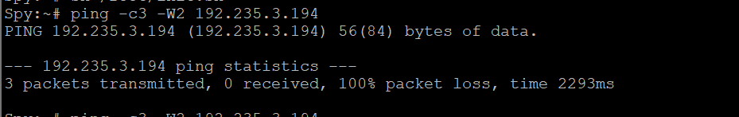

#### 6. Kondisi B: Unit-01 gagal

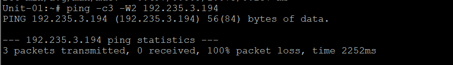

#### 7. Kondisi B: Lilith berhasil

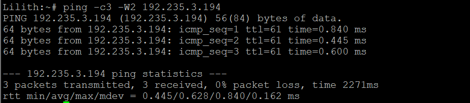

#### 8. Kondisi B: Spy gagal

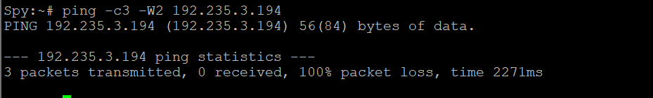

---

<a id="soal-15"></a>

## Soal 15 — Pembatasan Laju Ping ke Tokyo3-Core

### 1. Penjelasan soal

Semua orang berebut mem-ping Tokyo3-Core, dan banjir ping bisa melumpuhkannya. Tokyo3-Core harus hanya menjawab **maksimal 5 ping per detik** dan membuang kelebihannya. Aturan ini tidak boleh mengganggu ping di bawah batas, tidak boleh membatasi ping yang dikirim Tokyo3-Core sendiri, dan harus benar-benar mengenai paket yang dituju (periksa urutan rule dan jenis paket).

### 2. Ringkasan

| Item | Hasil |
|---|---|
| Node | Tokyo3-Core (`192.235.4.106`, Switch-Cmd) |
| Batas | **5 ping per detik** (`limit 5/second`, burst 5), kelebihan **dibuang** |
| Jenis paket yang dibatasi | hanya ICMP **echo-request masuk** (type 8) |
| Ping rapat Lilith (`-i 0.1 -c 50`) | 50 terkirim, **30 diterima, 40% packet loss** |
| Counter `ACCEPT` / `DROP` | **30** paket / **20** paket (total 50) |
| Ping biasa (jeda 3 detik) | **5/5 berhasil** |
| Skrip | `/root/soal15.sh` |

### 3. Konfigurasi

```sh
#!/bin/sh
command -v iptables >/dev/null || apk add --no-cache iptables
iptables -D INPUT -p icmp --icmp-type echo-request -m limit --limit 5/second --limit-burst 5 -j ACCEPT 2>/dev/null
iptables -D INPUT -p icmp --icmp-type echo-request -j DROP 2>/dev/null
iptables -A INPUT -p icmp --icmp-type echo-request -m limit --limit 5/second --limit-burst 5 -j ACCEPT
iptables -A INPUT -p icmp --icmp-type echo-request -j DROP
```

Hasil `iptables -S`:

```
-P INPUT ACCEPT
-P FORWARD ACCEPT
-P OUTPUT ACCEPT
-A INPUT -p icmp -m icmp --icmp-type 8 -m limit --limit 5/sec -j ACCEPT
-A INPUT -p icmp -m icmp --icmp-type 8 -j DROP
```

| Kebutuhan soal | Cara memenuhinya |
|---|---|
| Maksimal 5 ping per detik | Modul `limit` memakai token bucket: 5 token per detik dengan burst awal 5 paket. |
| Kelebihan dibuang | Rule `DROP` di bawahnya menangkap echo-request yang tidak lolos limit. |
| Tidak mengganggu ping di bawah batas | Ping yang masih dalam kuota selalu cocok dengan rule `ACCEPT` pertama. |
| Tidak membatasi ping yang dikirim Tokyo3-Core sendiri | Rule hanya cocok dengan echo-request di chain `INPUT` (type 8). Ping keluar Tokyo3-Core menghasilkan echo-reply (type 0) di `INPUT` yang tidak cocok dengan kedua rule, sedangkan echo-request keluar berada di `OUTPUT`. |
| Rule benar-benar mengenai paket yang dituju | Jenis paket dipilih tepat (`--icmp-type echo-request`) dan **urutannya** benar: `ACCEPT` berlimit di atas, `DROP` di bawah. Jika urutan dibalik, semua ping akan dibuang. |

### 4. Pembuktian

| Uji | Hasil |
|---|---|
| Lilith `ping -i 0.1 -c 50 192.235.4.106` | 50 terkirim, **30 diterima, 40% loss**, `time 5652ms` |
| Counter rule `ACCEPT` (limit) | **30 paket**, 2520 byte |
| Counter rule `DROP` | **20 paket**, 1680 byte |
| Lilith loop 5 ping dengan jeda 3 detik | **5/5 berhasil**, masing-masing 0% loss |

Counter di-nol-kan lebih dulu dengan `iptables -Z INPUT`, lalu dibaca setelah ping rapat dikirim dari Lilith. Perhitungannya: bucket awal 5 token ditambah pengisian 5 token per detik selama sekitar 5 detik menghasilkan sekitar 30 paket lolos, sesuai hasil uji. Counter `ACCEPT` ditambah `DROP` (30 + 20) sama dengan jumlah ping yang dikirim (50). Pada ping biasa, tiap paket terpisah 3 detik sehingga bucket selalu penuh dan semuanya lolos.

### 5. Bukti screenshot

| File | Isi |
|---|---|
| `assets/soal15/01-tokyocore-rule-counter.png` | `soal15.sh` dijalankan, `iptables -S`, `iptables -Z INPUT`, dan `iptables -L INPUT -v -n -x` |
| `assets/soal15/02-lilith-ping-rapat.png` | ping rapat dari Lilith, 40% loss |
| `assets/soal15/03-counter-drop-naik.png` | counter `ACCEPT` 30 dan `DROP` 20 |
| `assets/soal15/04-lilith-ping-biasa.png` | lima ping dengan jeda 3 detik, semuanya berhasil |

### 6. Langkah pengerjaan

1. Di Tokyo3-Core buat `/root/soal15.sh` (isi di atas), lalu `sh /root/soal15.sh`, `iptables -S`, `iptables -Z INPUT`.
2. Dari Lilith: `ping -i 0.1 -c 50 192.235.4.106`.
3. Di Tokyo3-Core: `iptables -L INPUT -v -n -x`.
4. Dari Lilith: `for i in 1 2 3 4 5; do ping -c1 -W2 192.235.4.106 | grep received; sleep 3; done`.

---

### Galeri bukti screenshot

Semua gambar di bawah adalah **tangkapan layar asli** yang diambil saat pengerjaan (konsol node GNS3), bukan gambar generate.

#### 1. `soal15.sh`, `iptables -S`, dan counter

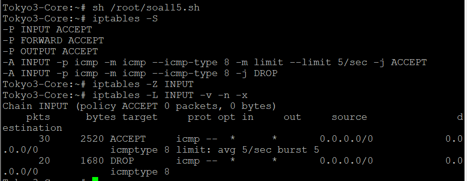

#### 2. Ping rapat dari Lilith

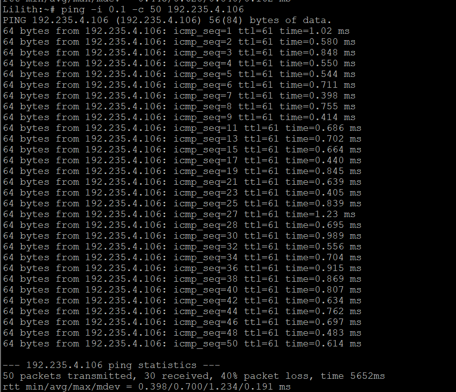

#### 3. Counter `ACCEPT` dan `DROP`

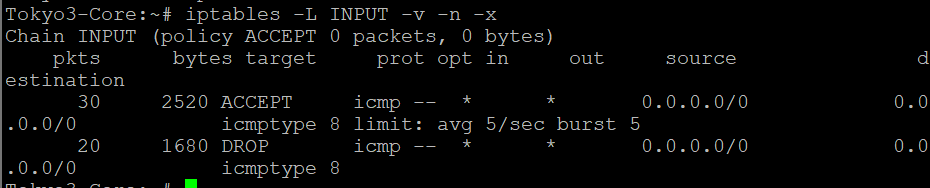

#### 4. Ping biasa dengan jeda 3 detik

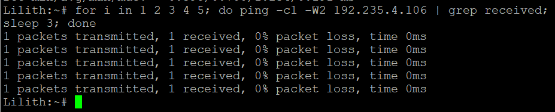

---

<a id="soal-16"></a>

## Soal 16 — Pencatatan dan Penolakan Pemindaian Port

### 1. Penjelasan soal

Dari Switch-Lab, Dummy-Plug mengetuk port sensitif Tokyo3-Core satu per satu. Setiap koneksi TCP dari Dummy-Plug ke port **22, 23, dan 3306** di Tokyo3-Core harus dicatat di log dengan prefix huruf besar `SCAN-NERV:` lalu ditolak seketika. Port 80 dan 8080 tetap bisa diakses dan klien lain tidak boleh terganggu. Karena log kernel sering tidak terlihat di container, bukti yang diminta adalah counter rule pencatatan.

### 2. Ringkasan

| Item | Hasil |
|---|---|
| Node | Tokyo3-Core (`192.235.4.106`) |
| Sasaran pengawasan | koneksi TCP baru (SYN) dari Dummy-Plug (`192.235.4.51`) ke port **22, 23, 3306** |
| Tindakan | dicatat dengan prefix `SCAN-NERV: ` lalu **ditolak seketika** (`REJECT --reject-with tcp-reset`) |
| Dummy-Plug → 22, 23, 3306 | **RC=1**, 0.002–0.004 detik |
| Dummy-Plug → 80 dan 8080 | **RC=0**, `Welcome to Tokyo3-Core` dan `syifa imutz` |
| Klien lain (Lilith) → 80 | **berhasil** |
| Counter rule `LOG` / `REJECT` | **3** paket / **3** paket |
| Skrip | `/root/soal16.sh` |

### 3. Konfigurasi

```sh
#!/bin/sh
iptables -N SCAN 2>/dev/null || iptables -F SCAN
iptables -A SCAN -j LOG --log-prefix "SCAN-NERV: "
iptables -A SCAN -p tcp -j REJECT --reject-with tcp-reset
iptables -D INPUT -s 192.235.4.51 -p tcp --syn -m multiport --dports 22,23,3306 -j SCAN 2>/dev/null
iptables -I INPUT 1 -s 192.235.4.51 -p tcp --syn -m multiport --dports 22,23,3306 -j SCAN
```

Hasil `iptables -S` (rule Soal 15 tetap utuh di bawahnya):

```
-P INPUT ACCEPT
-P FORWARD ACCEPT
-P OUTPUT ACCEPT
-N SCAN
-A INPUT -s 192.235.4.51/32 -p tcp -m tcp --tcp-flags FIN,SYN,RST,ACK SYN -m multiport --dports 22,23,3306 -j SCAN
-A INPUT -p icmp -m icmp --icmp-type 8 -m limit --limit 5/sec -j ACCEPT
-A INPUT -p icmp -m icmp --icmp-type 8 -j DROP
-A SCAN -j LOG --log-prefix "SCAN-NERV: "
-A SCAN -p tcp -j REJECT --reject-with tcp-reset
```

| Kebutuhan soal | Cara memenuhinya |
|---|---|
| Hanya koneksi dari Dummy-Plug ke port 22, 23, 3306 | Rule `INPUT` memfilter sumber `192.235.4.51`, TCP, dan `--dports 22,23,3306`. |
| Setiap koneksi dicatat dengan prefix `SCAN-NERV:` | Chain `SCAN` menjalankan `LOG` dengan `--log-prefix "SCAN-NERV: "` sebelum menolak. |
| Ditolak seketika | `REJECT --reject-with tcp-reset` membalas reset langsung, sehingga `nc` gagal tanpa menunggu timeout. |
| Hanya koneksi TCP baru | `--syn` hanya menangkap paket SYN (awal koneksi). |
| Port 80 dan 8080 tetap bisa diakses, klien lain tidak terganggu | Rule hanya cocok dengan sumber Dummy-Plug dan tiga port tersebut; selain itu paket tidak melewati chain `SCAN`. |
| Rule dibaca lebih dulu | `-I INPUT 1` menaruh rule di posisi paling atas. |

### 4. Pembuktian

Dari Dummy-Plug: `for p in 22 23 3306 80 8080; do time nc -w3 192.235.4.106 $p </dev/null; echo "port $p RC=$?"; done`

| Port | Hasil | Waktu |
|---|---|---|
| 22 | **RC=1** (ditolak) | `real 0m0.004s` |
| 23 | **RC=1** (ditolak) | `real 0m0.002s` |
| 3306 | **RC=1** (ditolak) | `real 0m0.002s` |
| 80 | **RC=0**, `Welcome to Tokyo3-Core` | `real 0m0.003s` |
| 8080 | **RC=0**, `syifa imutz` | `real 0m0.003s` |

Waktu 0.002–0.004 detik (jauh di bawah `-w 3`) membuktikan penolakan terjadi **seketika**.

Counter chain `SCAN` (`iptables -L SCAN -v -n -x`), diambil setelah `iptables -Z SCAN`:

| Rule | Paket | Byte |
|---|---:|---:|
| `LOG` prefix `SCAN-NERV: ` | **3** | 180 |
| `REJECT --reject-with tcp-reset` | **3** | 180 |

Tiga paket SYN (satu untuk tiap port 22, 23, dan 3306) melewati rule pencatatan lalu ditolak. `dmesg | grep SCAN-NERV` kosong karena log kernel tidak terlihat di dalam container (sesuai catatan di soal), sehingga counter rule `LOG` menjadi bukti pencatatan.

Klien lain tidak terganggu: dari Lilith, `nc -w3 192.235.4.106 80` menjawab `Welcome to Tokyo3-Core`.

### 5. Bukti screenshot

| File | Isi |
|---|---|
| `assets/soal16/01-tokyocore-rule-scan.png` | `soal16.sh` dijalankan dan `iptables -S` |
| `assets/soal16/02-dummyplug-nc-port.png` | `nc -w3` dari Dummy-Plug ke port 22, 23, 3306, 80, 8080 dengan `time` |
| `assets/soal16/03-counter-log-scan.png` | `iptables -Z SCAN`, counter chain `SCAN`, dan `dmesg \| grep SCAN-NERV` |
| `assets/soal16/04-lilith-tidak-terganggu.png` | Lilith → port 80 berhasil |

### 6. Langkah pengerjaan

1. Di Tokyo3-Core buat `/root/soal16.sh` (isi di atas), lalu `sh /root/soal16.sh` dan `iptables -S`.
2. Di Tokyo3-Core: `iptables -Z SCAN`.
3. Dari Dummy-Plug jalankan loop `nc` di atas.
4. Di Tokyo3-Core: `iptables -L SCAN -v -n -x` dan `dmesg | grep SCAN-NERV`.
5. Dari Lilith: `nc -w3 192.235.4.106 80`.

---

### Galeri bukti screenshot

Semua gambar di bawah adalah **tangkapan layar asli** yang diambil saat pengerjaan (konsol node GNS3), bukan gambar generate.

#### 1. `soal16.sh` dan `iptables -S`

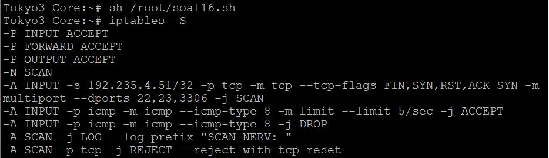

#### 2. `nc` dari Dummy-Plug ke lima port

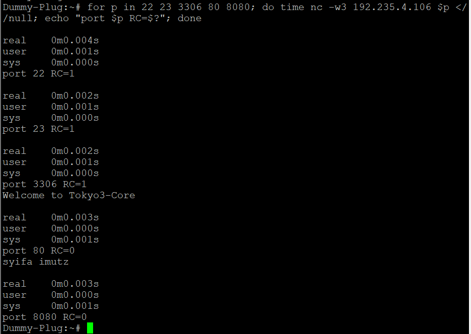

#### 3. Counter chain `SCAN`

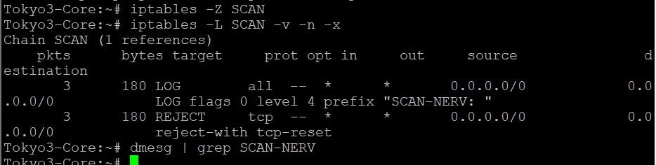

#### 4. Lilith tetap bisa mengakses port 80


---

<a id="soal-17"></a>

## Soal 17 — Pengalihan Koneksi TCP dengan DNAT di Fuyutsuki

### 1. Penjelasan soal

Paket dari Casper ke Zeruel tidak pernah sampai ke Zeruel, karena ada router yang diam-diam mengalihkannya. Clue-nya: "cari saja router yang menjadi gateway Switch-Terminal", yaitu **Fuyutsuki**. Di Fuyutsuki, setiap koneksi TCP dari Magi-Casper ke Zeruel harus dialihkan sehingga sampai di Pen-Pen. Casper tidak boleh sadar: balasan yang ia terima harus tetap terlihat datang dari Zeruel. Ping tidak dialihkan. Listener port 9000 dinyalakan di Pen-Pen dan Zeruel, pesan dikirim dari Casper ke IP Zeruel port 9000, lalu dibuktikan pesan muncul di Pen-Pen (bukan Zeruel) dan ditunjukkan tabel conntrack di Fuyutsuki.

### 2. Ringkasan

| Item | Hasil |
|---|---|
| Router pengalih | **Fuyutsuki** (gateway Switch-Terminal) |
| Aturan | `nat PREROUTING`: TCP dari Casper `192.235.4.58` ke Zeruel `192.235.4.82` di-DNAT ke Pen-Pen `192.235.3.194` |
| Ping | **tidak dialihkan** (rule hanya untuk `-p tcp`) |
| Listener port 9000 | Pen-Pen dan Zeruel |
| Pesan Casper → `192.235.4.82:9000` | **muncul di Pen-Pen**, log Zeruel **kosong** |
| Tabel conntrack Fuyutsuki | tujuan asli `192.235.4.82`, sisi balasan dari `192.235.3.194` |
| Skrip | `/root/soal17.sh` (Fuyutsuki) dan `/root/listen9000.sh` (Pen-Pen, Zeruel) |

### 3. Konfigurasi

#### Fuyutsuki

Interface Fuyutsuki (`ip -br a`):

| Interface | Alamat | Peran |
|---|---|---|
| `eth0` | `192.235.4.57/29` | LAN Switch-Terminal (tempat Casper) |
| `eth1` | `192.235.4.134/30` | ke Gendo |
| `eth2` | `192.235.4.165/30` | ke Maya (cabang Pen-Pen) |
| `eth3` | `192.235.4.169/30` | ke Toji |

`/root/soal17.sh`:

```sh
#!/bin/sh
iptables -t nat -D PREROUTING -i eth0 -s 192.235.4.58 -d 192.235.4.82 -p tcp -j DNAT --to-destination 192.235.3.194 2>/dev/null
iptables -t nat -A PREROUTING -i eth0 -s 192.235.4.58 -d 192.235.4.82 -p tcp -j DNAT --to-destination 192.235.3.194
```

Hasil `iptables -t nat -S`:

```
-P PREROUTING ACCEPT
-P INPUT ACCEPT
-P OUTPUT ACCEPT
-P POSTROUTING ACCEPT
-A PREROUTING -s 192.235.4.58/32 -d 192.235.4.82/32 -i eth0 -p tcp -j DNAT --to-destination 192.235.3.194
```

#### Listener port 9000 (Pen-Pen dan Zeruel)

```sh
#!/bin/sh
pkill -f listen9000-loop 2>/dev/null
nohup sh -c ': listen9000-loop; while true; do (nc -l -p 9000 || nc -l 9000) >> /root/pesan_9000.log 2>&1; done' >/dev/null 2>&1 &
```

Pesan yang diterima ditulis ke `/root/pesan_9000.log`.

| Kebutuhan soal | Cara memenuhinya |
|---|---|
| Router yang dituju adalah gateway Switch-Terminal | Fuyutsuki (`eth0` = `192.235.4.57/29`, LAN Terminal). |
| Hanya koneksi TCP dari Casper ke Zeruel | Rule memfilter `-s 192.235.4.58`, `-d 192.235.4.82`, `-p tcp`, dan `-i eth0`. |
| Sampai di Pen-Pen | `DNAT --to-destination 192.235.3.194` mengganti tujuan paket sebelum routing. Setelah itu tujuan masuk ke subnet `192.235.3.192/27` yang dirutekan lewat Maya (`via 192.235.4.166 dev eth2`). |
| Casper tidak boleh sadar, balasan terlihat datang dari Zeruel | Pen-Pen membalas melalui Maya lalu Fuyutsuki. Karena Fuyutsuki memegang entri DNAT, conntrack mengembalikan alamat sumber balasan menjadi `192.235.4.82` secara otomatis. Tidak diperlukan SNAT. |
| Ping tidak dialihkan | Rule hanya untuk `-p tcp`, sehingga ping Casper → Zeruel tetap dijawab Zeruel (lihat Soal 18). |

Firewall Pen-Pen dari Soal 14 hanya membatasi ICMP echo-request dan TCP 80, sehingga TCP 9000 tidak terpengaruh.

#### Catatan alat bantu conntrack

Fuyutsuki adalah router, dan konfigurasi DNS pada Soal 4 hanya dipasang di host. Agar `apk add` berjalan, `/etc/resolv.conf` Fuyutsuki diisi `8.8.8.8` dan `1.1.1.1` terlebih dahulu. Kernel node juga tidak menyediakan `/proc/net/nf_conntrack`, sehingga tabel dibaca dengan paket `conntrack-tools` (`conntrack -L`).

### 4. Pembuktian

| Uji | Hasil |
|---|---|
| Casper `echo "PESAN DARI CASPER" \| nc -w3 192.235.4.82 9000` | terkirim |
| Pen-Pen `cat /root/pesan_9000.log` | `PESAN DARI CASPER` |
| Zeruel `cat /root/pesan_9000.log` | **kosong** |

Tabel conntrack di Fuyutsuki (`conntrack -L -p tcp | grep 9000`):

```
tcp 6 116 TIME_WAIT src=192.235.4.58 dst=192.235.4.82 sport=37884 dport=9000 src=192.235.3.194 dst=192.235.4.58 sport=9000 dport=37884 [ASSURED] mark=0 use=1
tcp 6 39  TIME_WAIT src=192.235.4.58 dst=192.235.4.82 sport=56690 dport=9000 src=192.235.3.194 dst=192.235.4.58 sport=9000 dport=56690 [ASSURED] mark=0 use=1
```

Sisi kiri tiap entri menunjukkan arah awal: Casper mengirim ke **Zeruel** (`dst=192.235.4.82`). Sisi balasan menunjukkan paket kembali dari **Pen-Pen** (`src=192.235.3.194`). Pasangan ini adalah bukti terjadinya DNAT. Karena Casper melihat balasan sebagai bagian dari koneksi yang ia buka ke `192.235.4.82`, ia tidak menyadari pengalihannya.

### 5. Bukti screenshot

| File | Isi |
|---|---|
| `assets/soal17/01-fuyutsuki-dnat-rule.png` | `ip -br a`, isi `soal17.sh`, dan `iptables -t nat -S` di Fuyutsuki |
| `assets/soal17/02-penpen-listener-pesan.png` | listener di Pen-Pen dan log berisi `PESAN DARI CASPER` |
| `assets/soal17/03-zeruel-listener-kosong.png` | listener di Zeruel dan log kosong |
| `assets/soal17/04-casper-kirim.png` | Casper mengirim pesan ke `192.235.4.82:9000` |
| `assets/soal17/05-fuyutsuki-conntrack.png` | `ping 8.8.8.8`, `resolv.conf`, pemasangan `conntrack-tools`, dan `conntrack -L` |

### 6. Langkah pengerjaan

1. Di Pen-Pen dan Zeruel buat `/root/listen9000.sh` (isi di atas), lalu `sh /root/listen9000.sh`.
2. Di Fuyutsuki: `ip -br a`, buat `/root/soal17.sh` (isi di atas), `sh /root/soal17.sh`, lalu `iptables -t nat -S`.
3. Dari Casper: `echo "PESAN DARI CASPER" | nc -w3 192.235.4.82 9000`.
4. Di Pen-Pen dan Zeruel: `cat /root/pesan_9000.log`.
5. Di Fuyutsuki: `ping -c2 8.8.8.8`, isi `/etc/resolv.conf` dengan `8.8.8.8` dan `1.1.1.1`, `apk add --no-cache conntrack-tools`, lalu `conntrack -L -p tcp 2>/dev/null | grep 9000`.

---

### Galeri bukti screenshot

Semua gambar di bawah adalah **tangkapan layar asli** yang diambil saat pengerjaan (konsol node GNS3), bukan gambar generate.

#### 1. Rule DNAT di Fuyutsuki

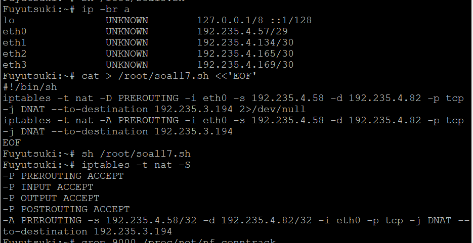

#### 2. Listener Pen-Pen dan pesan yang diterima

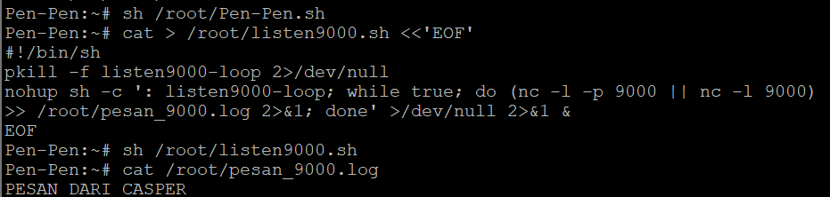

#### 3. Listener Zeruel, log kosong

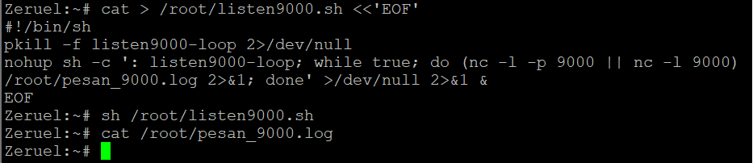

#### 4. Casper mengirim pesan


#### 5. Tabel conntrack di Fuyutsuki

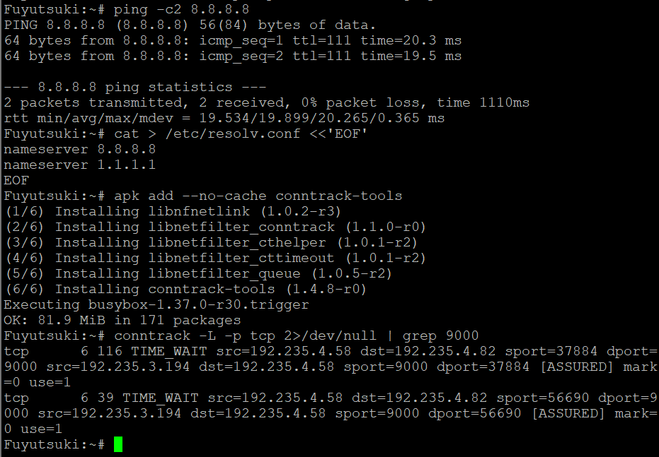

---

<a id="soal-18"></a>

## Soal 18 — Pengamanan Zona Monolith dan Radar

### 1. Penjelasan soal

Switch-Monolith dan Switch-Radar adalah zona sensitif yang dijaga Shigeru. Aturan di Shigeru: node di dalam zona boleh memulai koneksi ke mana saja dan balasannya tetap sampai; node di luar zona tidak boleh memulai koneksi ke dalam zona; satu pengecualian, ping dari subnet Terminal boleh masuk. Penolakan harus berdasarkan **arah datangnya** (semua yang datang dari sisi Shigeru yang menghadap Gendo), bukan menulis subnet luar satu per satu, supaya subnet baru langsung ikut terblokir.

### 2. Ringkasan

| Item | Hasil |
|---|---|
| Router | **Shigeru** |
| Zona sensitif | Switch-Monolith (`eth0`) dan Switch-Radar lewat Makoto (`eth2`) |
| Sisi luar | `eth1` (menghadap Gendo) |
| Aturan | `FORWARD -i eth1 -j ZONA`; chain `ZONA` menerima `ESTABLISHED,RELATED`, menerima ping dari subnet Terminal, dan membuang sisanya |
| Casper → Zeruel (ping) | **berhasil, 0% packet loss** |
| Lilith → Zeruel (ping) | **gagal, 100% packet loss** |
| Skrip | `/root/soal18.sh` |

### 3. Konfigurasi

Interface Shigeru (dari tabel rute Shigeru):

| Interface | Subnet | Peran |
|---|---|---|
| `eth0` | `192.235.4.80/29` (src `.81`) | Switch-Monolith (Zeruel, Armisael), **dalam zona** |
| `eth1` | `192.235.4.128/30` (src `.130`) | link ke Gendo, **sisi luar** |
| `eth2` | `192.235.4.160/30` (src `.161`) | link ke Makoto (Radar), **dalam zona**, dengan rute `192.235.4.88/29 via 192.235.4.162` |

`/root/soal18.sh`:

```sh
#!/bin/sh
iptables -N ZONA 2>/dev/null || iptables -F ZONA
iptables -A ZONA -m conntrack --ctstate ESTABLISHED,RELATED -j ACCEPT
iptables -A ZONA -s 192.235.4.56/29 -p icmp --icmp-type echo-request -j ACCEPT
iptables -A ZONA -j DROP
iptables -D FORWARD -i eth1 -j ZONA 2>/dev/null
iptables -A FORWARD -i eth1 -j ZONA
```

Hasil `iptables -S`:

```
-P INPUT ACCEPT
-P FORWARD ACCEPT
-P OUTPUT ACCEPT
-N ZONA
-A FORWARD -i eth1 -j ZONA
-A ZONA -m conntrack --ctstate RELATED,ESTABLISHED -j ACCEPT
-A ZONA -s 192.235.4.56/29 -p icmp -m icmp --icmp-type 8 -j ACCEPT
-A ZONA -j DROP
```

| Kebutuhan soal | Cara memenuhinya |
|---|---|
| Node di dalam zona boleh memulai koneksi ke mana saja | Paket dari `eth0` dan `eth2` tidak melewati `FORWARD -i eth1`, sehingga tidak difilter. |
| Balasannya tetap sampai | Balasan masuk lewat `eth1`, tetapi `ESTABLISHED,RELATED` di `ZONA` menerimanya. |
| Node di luar zona tidak boleh memulai koneksi ke dalam | Koneksi baru dari `eth1` jatuh ke `-A ZONA -j DROP`. |
| Satu pengecualian: ping dari subnet Terminal | `-s 192.235.4.56/29 -p icmp --icmp-type echo-request -j ACCEPT` (sebelum `DROP`). |
| Tolak berdasarkan arah, bukan daftar subnet luar | Filter memakai interface masuk (`-i eth1`) tanpa menyebut subnet luar satu per satu. Subnet baru di sisi Gendo otomatis ikut terblokir. |

### 4. Pembuktian

| Uji | Hasil |
|---|---|
| Casper → Zeruel `ping -c3 -W2 192.235.4.82` | **3/3, 0% packet loss** |
| Lilith → Zeruel `ping -c3 -W2 192.235.4.82` | **3 terkirim, 0 diterima (100% loss)** |

Counter chain `ZONA` (`iptables -L ZONA -v -n`):

| Rule | Paket | Byte |
|---|---:|---:|
| `ACCEPT` `ESTABLISHED,RELATED` | 2 | 168 |
| `ACCEPT` ICMP type 8 dari `192.235.4.56/29` | 1 | 84 |
| `DROP` | 3 | 252 |

Ping Casper terdiri dari tiga echo-request: yang pertama berstatus baru dan cocok dengan rule ICMP dari Terminal (1 paket), dua berikutnya sudah berstatus `ESTABLISHED` (2 paket). Tiga paket `DROP` adalah tiga ping dari Lilith. Balasan Zeruel keluar dari `eth0` menuju `eth1`, sehingga tidak melewati chain `ZONA`.

### 5. Bukti screenshot

| File | Isi |
|---|---|
| `assets/soal18/01-shigeru-script-rule.png` | isi `soal18.sh`, eksekusi, dan `iptables -S` |
| `assets/soal18/02-casper-ping-zeruel-ok.png` | Casper → Zeruel berhasil |
| `assets/soal18/03-lilith-ping-zeruel-gagal.png` | Lilith → Zeruel gagal |
| `assets/soal18/04-counter-zona.png` | counter chain `ZONA` |

### 6. Langkah pengerjaan

1. Di Shigeru buat `/root/soal18.sh` (isi di atas), lalu `sh /root/soal18.sh` dan `iptables -S`.
2. Dari Casper dan Lilith: `ping -c3 -W2 192.235.4.82`.
3. Di Shigeru: `iptables -L ZONA -v -n`.

---

### Galeri bukti screenshot

Semua gambar di bawah adalah **tangkapan layar asli** yang diambil saat pengerjaan (konsol node GNS3), bukan gambar generate.

#### 1. `soal18.sh` dan `iptables -S`

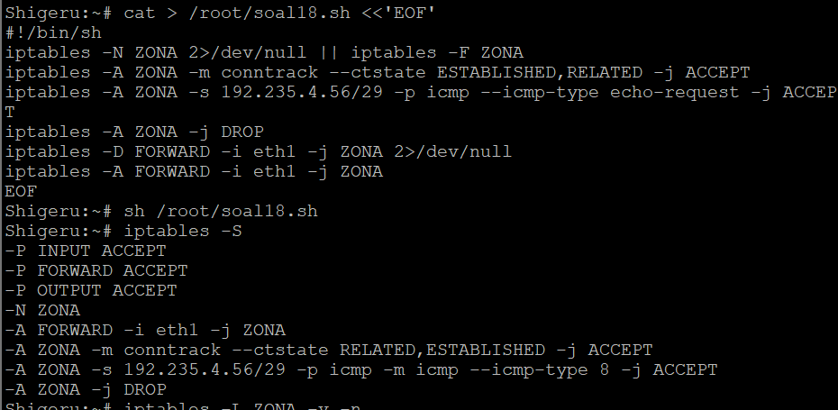

#### 2. Casper → Zeruel berhasil

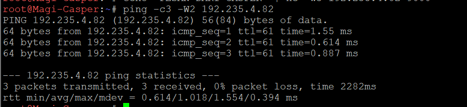

#### 3. Lilith → Zeruel gagal

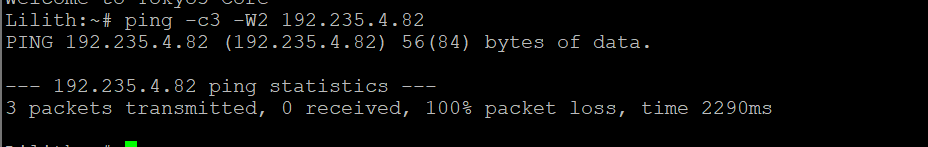

#### 4. Counter chain `ZONA`

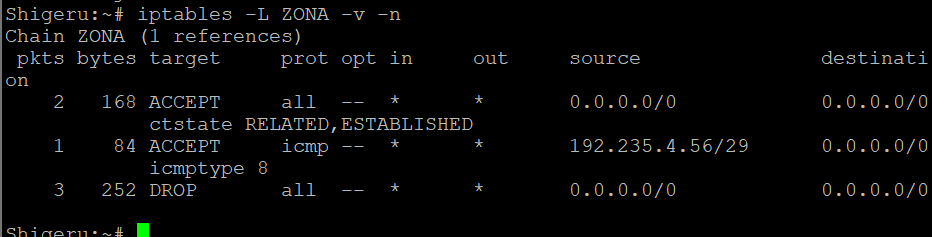

---

<a id="soal-19"></a>

## Soal 19 — Isolasi Armisael

### 1. Penjelasan soal

Armisael tidak boleh lagi bicara dengan siapa pun, tetapi Zeruel di sebelahnya tidak boleh ikut terhukum. Semua lalu lintas masuk dan keluar Armisael diblokir, termasuk ke gateway dan tetangga satu switch. **Isolasi tidak boleh dikerjakan di dalam Armisael.** Uji `nc` memakai listener TCP 9000 di Armisael, Zeruel, dan Lilith, dan ke Seele (`8.8.8.8`) memakai TCP 53. Ping dan `nc` dari Armisael ke Seele, Zeruel, dan Lilith harus gagal, sedangkan dari Zeruel ke Seele dan Lilith harus berhasil.

### 2. Ringkasan

| Item | Hasil |
|---|---|
| Target isolasi | Armisael `192.235.4.83` |
| Lokasi aturan | **Shigeru** (`INPUT`, `OUTPUT`, `FORWARD`) dan **Zeruel** (`INPUT`, `OUTPUT` khusus alamat Armisael); **tidak ada aturan di dalam Armisael** |
| Armisael → Seele, Zeruel, Lilith (ping dan nc) | **semua gagal** |
| Zeruel → Seele dan Lilith (ping dan nc) | **semua berhasil** |
| Skrip | `/root/soal19.sh` di Shigeru dan di Zeruel; `/root/listen9000.sh` di Armisael, Zeruel, Lilith |

### 3. Konfigurasi

#### Shigeru

```sh
#!/bin/sh
A=192.235.4.83
iptables -D INPUT -s $A -j DROP 2>/dev/null;    iptables -I INPUT 1 -s $A -j DROP
iptables -D OUTPUT -d $A -j DROP 2>/dev/null;   iptables -I OUTPUT 1 -d $A -j DROP
iptables -D FORWARD -s $A -j DROP 2>/dev/null;  iptables -I FORWARD 1 -s $A -j DROP
iptables -D FORWARD -d $A -j DROP 2>/dev/null;  iptables -I FORWARD 1 -d $A -j DROP
```

Hasil `iptables -S`:

```
-P INPUT ACCEPT
-P FORWARD ACCEPT
-P OUTPUT ACCEPT
-N ZONA
-A INPUT -s 192.235.4.83/32 -j DROP
-A FORWARD -d 192.235.4.83/32 -j DROP
-A FORWARD -s 192.235.4.83/32 -j DROP
-A FORWARD -i eth1 -j ZONA
-A OUTPUT -d 192.235.4.83/32 -j DROP
-A ZONA -m conntrack --ctstate RELATED,ESTABLISHED -j ACCEPT
-A ZONA -s 192.235.4.56/29 -p icmp -m icmp --icmp-type 8 -j ACCEPT
-A ZONA -j DROP
```

#### Zeruel

```sh
#!/bin/sh
command -v iptables >/dev/null || apk add --no-cache iptables
iptables -D INPUT -s 192.235.4.83 -j DROP 2>/dev/null;  iptables -I INPUT 1 -s 192.235.4.83 -j DROP
iptables -D OUTPUT -d 192.235.4.83 -j DROP 2>/dev/null; iptables -I OUTPUT 1 -d 192.235.4.83 -j DROP
```

Hasil `iptables -S`:

```
-P INPUT ACCEPT
-P FORWARD ACCEPT
-P OUTPUT ACCEPT
-A INPUT -s 192.235.4.83/32 -j DROP
-A OUTPUT -d 192.235.4.83/32 -j DROP
```

#### Listener TCP 9000

Skrip `/root/listen9000.sh` yang sama dengan Soal 17. Di Zeruel listener sudah dibuat pada Soal 17 (lihat `assets/soal17/03-zeruel-listener-kosong.png`), sedangkan di Armisael dan Lilith dibuat pada soal ini.

| Kebutuhan soal | Cara memenuhinya |
|---|---|
| Blokir semua lalu lintas masuk dan keluar Armisael | Di Shigeru, semua paket dari atau ke `192.235.4.83` dibuang di `FORWARD` (ke Gendo, Radar, dan LAN lain), serta di `INPUT` dan `OUTPUT` (untuk gateway Shigeru sendiri). |
| Termasuk ke gateway | Shigeru adalah gateway Armisael (`192.235.4.81`); rule `INPUT -s` dan `OUTPUT -d` memutus komunikasi Armisael dengannya. |
| Termasuk tetangga satu switch | Armisael dan Zeruel berada di Switch-Monolith yang sama. Lalu lintas di antara keduanya tidak melewati Shigeru, dan switch GNS3 tidak dapat memfilter paket, sehingga dibuang di sisi Zeruel (`INPUT -s` dan `OUTPUT -d` untuk alamat Armisael). |
| Tidak dikerjakan di dalam Armisael | Tidak ada rule apa pun di Armisael; isolasi dilakukan di Shigeru dan Zeruel. |
| Zeruel tidak ikut dihukum | Rule di Zeruel hanya cocok dengan sumber atau tujuan `192.235.4.83`, sehingga lalu lintas Zeruel ke Seele dan Lilith tidak tersentuh. |
| Rule Soal 18 tetap berlaku | Rule `DROP` untuk Armisael dipasang di posisi teratas (`-I`), dan chain `ZONA` tetap utuh di bawahnya. |

### 4. Pembuktian

Seele adalah `8.8.8.8` (ping dan `nc` ke TCP 53). Listener TCP 9000 aktif di Armisael, Zeruel, dan Lilith.

#### Dari Armisael (semua harus gagal)

| Uji | Hasil |
|---|---|
| `ping -c3 -W2 8.8.8.8` | 3 terkirim, 0 diterima (100% loss) |
| `ping -c3 -W2 192.235.4.82` (Zeruel) | 100% packet loss |
| `ping -c3 -W2 192.235.4.74` (Lilith) | 100% packet loss |
| `nc -w3 8.8.8.8 53` | **RC=1** |
| `nc -w3 192.235.4.82 9000` | **RC=1** |
| `nc -w3 192.235.4.74 9000` | **RC=1** |

#### Dari Zeruel (semua harus berhasil)

| Uji | Hasil |
|---|---|
| `ping -c3 8.8.8.8` | **3/3, 0% packet loss** |
| `ping -c3 192.235.4.74` (Lilith) | **3/3, 0% packet loss** |
| `nc -w3 8.8.8.8 53` | **RC=0** |
| `nc -w3 192.235.4.74 9000` | **RC=0** |

### 5. Bukti screenshot

| File | Isi |
|---|---|
| `assets/soal19/01-shigeru-rule-armisael.png` | `soal19.sh` dijalankan dan `iptables -S` di Shigeru |
| `assets/soal19/02-zeruel-rule-armisael.png` | `soal19.sh` dijalankan dan `iptables -S` di Zeruel |
| `assets/soal19/03-listener-armisael.png` | pembuatan listener 9000 di Armisael |
| `assets/soal19/04-listener-lilith.png` | pembuatan listener 9000 di Lilith |
| `assets/soal19/05-armisael-ping-nc-gagal.png` | ping dan `nc` dari Armisael ke Seele, Zeruel, Lilith gagal |
| `assets/soal19/06-zeruel-ping-nc-ok.png` | ping dan `nc` dari Zeruel ke Seele dan Lilith berhasil |

### 6. Langkah pengerjaan

1. Di Armisael dan Lilith buat `/root/listen9000.sh` (isi di Soal 17), lalu `sh /root/listen9000.sh`. Di Zeruel listener sudah aktif dari Soal 17.
2. Di Shigeru buat `/root/soal19.sh` (isi di atas), lalu `sh /root/soal19.sh` dan `iptables -S`.
3. Di Zeruel buat `/root/soal19.sh` (isi di atas), lalu `sh /root/soal19.sh` dan `iptables -S`.
4. Dari Armisael: ping dan `nc` ke `8.8.8.8` (port 53), `192.235.4.82` dan `192.235.4.74` (port 9000).
5. Dari Zeruel: ping dan `nc` ke `8.8.8.8` (port 53) dan `192.235.4.74` (port 9000).

---

### Galeri bukti screenshot

Semua gambar di bawah adalah **tangkapan layar asli** yang diambil saat pengerjaan (konsol node GNS3), bukan gambar generate.

#### 1. Rule isolasi di Shigeru

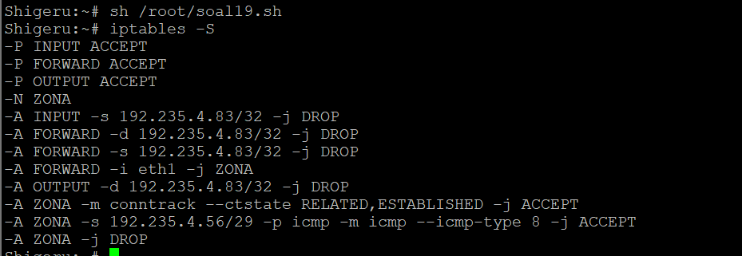

#### 2. Rule isolasi di Zeruel

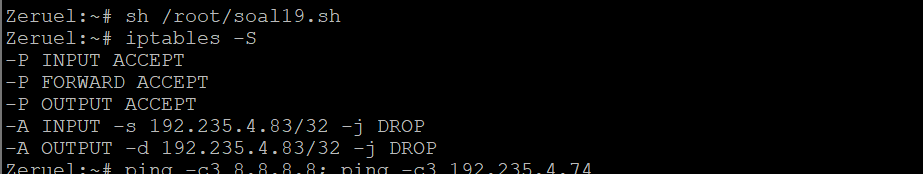

#### 3. Listener di Armisael

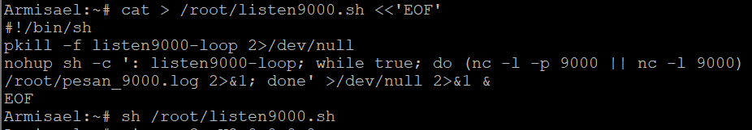

#### 4. Listener di Lilith

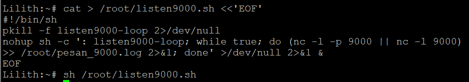

#### 5. Ping dan `nc` dari Armisael gagal

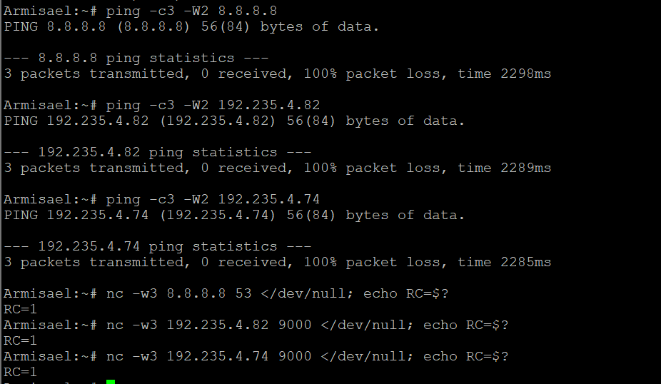

#### 6. Ping dan `nc` dari Zeruel berhasil

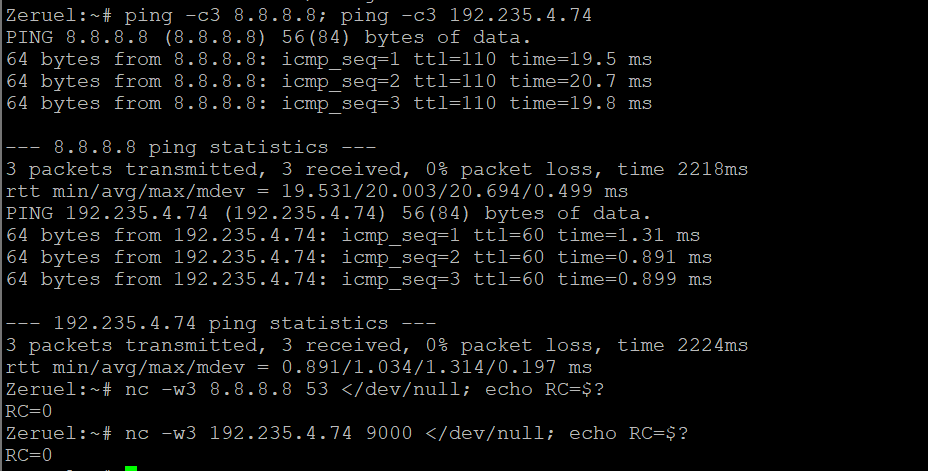

---

<a id="soal-20"></a>
 
## Soal 20 — Penyimpanan dan Pemulihan Rule dan Rute

### 1. Penjelasan soal

NERV harus bisa dibangun ulang dengan cepat. Dipilih tiga node (minimal satu router). Di tiap node: simpan rule dengan `iptables-save` ke `/root/<nama>.rules`; hapus semua rule iptables termasuk tabel nat; hapus rute yang ditambahkan sendiri; pulihkan rule dengan `iptables-restore` dan rute dengan `/root/<nama>.sh`; lakukan pemulihan **dua kali berturut-turut**. Hasilnya harus sama: rule dan rute tidak dobel. Dibuktikan dengan jumlah baris `iptables -S` dan `iptables -t nat -S` yang sama setelah pemulihan pertama dan kedua, serta node berfungsi kembali.

### 2. Ringkasan

| Item | Hasil |
|---|---|
| Node yang dipilih | **Shigeru** (router), **Fuyutsuki** (router), **Zeruel** (host) |
| Penyimpanan rule | `iptables-save` → `/root/<nama>.rules` |
| Pemulihan rule | `iptables-restore < /root/<nama>.rules` |
| Pemulihan rute | `/root/<nama>.sh` (dibuat dari rute statis yang ada) |
| Pemulihan | **dua kali berturut-turut** di tiap node |
| Jumlah baris `iptables -S` dan `iptables -t nat -S` setelah pemulihan pertama vs kedua | **sama** di ketiga node |
| Node berfungsi seperti semula | **ya** (lihat bagian 6) |

#### Alasan pemilihan node

| Node | Jenis | Isi yang diuji |
|---|---|---|
| Shigeru | router | tabel `filter` (rule isolasi Armisael Soal 19, chain `ZONA` Soal 18) dan dua rute statis |
| Fuyutsuki | router | tabel `nat` (DNAT Soal 17) dan tiga rute statis |
| Zeruel | host | tabel `filter` (blok Armisael Soal 19) dan satu default route |

### 3. Langkah dan perintah

Perintah yang sama dijalankan di setiap node. Nama file diambil dari `hostname`, sehingga menghasilkan `Shigeru`, `Fuyutsuki`, dan `Zeruel`.

#### a. Simpan rule dan buat skrip rute

```sh
N=$(hostname); echo "NODE: $N"
iptables-save > /root/$N.rules
{ echo '#!/bin/sh'; ip route show | grep -v 'proto kernel' | sed 's/^/ip route replace /'; } > /root/$N.sh
chmod +x /root/$N.sh
ls -l /root/$N.rules /root/$N.sh
cat /root/$N.sh
echo "AWAL  FILTER=$(iptables -S | wc -l)  NAT=$(iptables -t nat -S | wc -l)  ROUTE=$(ip route | wc -l)"
iptables -S; iptables -t nat -S; ip route
```

Rute bertanda `proto kernel` (rute otomatis dari alamat interface) sengaja tidak disimpan karena tidak ditambahkan manual. Hanya rute buatan sendiri yang masuk skrip, dengan `ip route replace` supaya aman dijalankan berulang.

Isi skrip rute yang dihasilkan:

`/root/Shigeru.sh`
```sh
#!/bin/sh
ip route replace default via 192.235.4.129 dev eth1
ip route replace 192.235.4.88/29 via 192.235.4.162 dev eth2
```

`/root/Fuyutsuki.sh`
```sh
#!/bin/sh
ip route replace default via 192.235.4.133 dev eth1
ip route replace 192.235.3.192/27 via 192.235.4.166 dev eth2
ip route replace 192.235.4.72/29 via 192.235.4.170 dev eth3
```

`/root/Zeruel.sh`
```sh
#!/bin/sh
ip route replace default via 192.235.4.81 dev eth0
```

Ukuran file hasil `ls -l`:

| Node | `.rules` | `.sh` |
|---|---:|---:|
| Shigeru | 533 byte | 124 byte |
| Fuyutsuki | 329 byte | 186 byte |
| Zeruel | 274 byte | 62 byte |

#### b. Hapus semua rule dan rute buatan sendiri

```sh
N=$(hostname)
iptables -P INPUT ACCEPT; iptables -P FORWARD ACCEPT; iptables -P OUTPUT ACCEPT
iptables -F; iptables -X; iptables -t nat -F; iptables -t nat -X
ip route show | grep -v 'proto kernel' | while read r; do ip route del $r; done
echo "SETELAH HAPUS  FILTER=$(iptables -S | wc -l)  NAT=$(iptables -t nat -S | wc -l)  ROUTE=$(ip route | wc -l)"
iptables -S; iptables -t nat -S; ip route
```

Policy dikembalikan ke `ACCEPT` lebih dulu supaya penghapusan rule tidak memutus akses. `-F` mengosongkan rule dan `-X` menghapus chain buatan sendiri (misalnya `ZONA`), baik di tabel `filter` maupun `nat`.

#### c. Pemulihan pertama

```sh
N=$(hostname)
iptables-restore < /root/$N.rules
sh /root/$N.sh
echo "RESTORE-1  FILTER=$(iptables -S | wc -l)  NAT=$(iptables -t nat -S | wc -l)  ROUTE=$(ip route | wc -l)"
iptables -S; iptables -t nat -S; ip route
```

#### d. Pemulihan kedua, langsung setelah yang pertama

```sh
N=$(hostname)
iptables-restore < /root/$N.rules
sh /root/$N.sh
echo "RESTORE-2  FILTER=$(iptables -S | wc -l)  NAT=$(iptables -t nat -S | wc -l)  ROUTE=$(ip route | wc -l)"
iptables -S; iptables -t nat -S; ip route
```

#### Mengapa hasilnya tidak ganda

| Komponen | Alasan tidak dobel |
|---|---|
| `iptables-restore` | Tanpa opsi `--noflush`, isi tabel yang dipulihkan **diganti seluruhnya** oleh isi file, bukan ditambahkan di atas rule yang ada. Pemulihan kedua menghasilkan keadaan yang sama dengan yang pertama. |
| `ip route replace` | Menambahkan rute bila belum ada dan memperbarui bila sudah ada, sehingga tidak muncul rute ganda atau error `File exists`. |

### 4. Hasil jumlah baris

Jumlah baris `iptables -S` (FILTER), `iptables -t nat -S` (NAT), dan `ip route` (ROUTE):

| Node | AWAL | SETELAH HAPUS | RESTORE-1 | RESTORE-2 |
|---|---|---|---|---|
| Shigeru | 12 / 4 / 5 | 3 / 4 / 3 | **12 / 4 / 5** | **12 / 4 / 5** |
| Fuyutsuki | 3 / 5 / 7 | 3 / 4 / 4 | **3 / 5 / 7** | **3 / 5 / 7** |
| Zeruel | 5 / 4 / 2 | 3 / 4 / 1 | **5 / 4 / 2** | **5 / 4 / 2** |

Keterangan angka:
- Tabel `filter` yang kosong menyisakan **3 baris** (policy `INPUT`, `FORWARD`, `OUTPUT`), sedangkan tabel `nat` yang kosong menyisakan **4 baris** (policy `PREROUTING`, `INPUT`, `OUTPUT`, `POSTROUTING`).
- Pada Fuyutsuki, tabel `nat` berubah dari 5 menjadi 4 karena rule DNAT Soal 17 dihapus, lalu kembali ke 5 setelah pemulihan.
- Angka `RESTORE-1` dan `RESTORE-2` identik dan sama dengan `AWAL` di ketiga node. Artinya rule dan rute tidak dobel, dan keadaan node kembali seperti semula.

Rute yang tersisa setelah penghapusan hanya rute `proto kernel`:

| Node | Rute setelah hapus |
|---|---|
| Shigeru | `192.235.4.80/29` (eth0), `192.235.4.128/30` (eth1), `192.235.4.160/30` (eth2) |
| Fuyutsuki | `192.235.4.56/29` (eth0), `192.235.4.132/30` (eth1), `192.235.4.164/30` (eth2), `192.235.4.168/30` (eth3) |
| Zeruel | `192.235.4.80/29` (eth0) |

### 5. Bukti screenshot

#### Shigeru

| File | Isi |
|---|---|
| `assets/soal20/shigeru-1-simpan.png` | `iptables-save`, `ls -l`, isi `Shigeru.sh`, angka `AWAL` |
| `assets/soal20/shigeru-2-hapus.png` | setelah semua rule dan rute dihapus |
| `assets/soal20/shigeru-3-restore1.png` | pemulihan pertama |
| `assets/soal20/shigeru-4-restore2.png` | pemulihan kedua |
| `assets/soal20/shigeru-5a-casper-ping-zeruel-ok.png` | Casper → Zeruel berhasil |
| `assets/soal20/shigeru-5b-lilith-ping-zeruel-gagal.png` | Lilith → Zeruel gagal |
| `assets/soal20/shigeru-5c-ping-gendo.png` | Shigeru → Gendo berhasil |

#### Fuyutsuki

| File | Isi |
|---|---|
| `assets/soal20/fuyutsuki-1-simpan.png` | `iptables-save`, `ls -l`, isi `Fuyutsuki.sh`, angka `AWAL` |
| `assets/soal20/fuyutsuki-2-hapus.png` | setelah semua rule dan rute dihapus |
| `assets/soal20/fuyutsuki-3-restore1.png` | pemulihan pertama |
| `assets/soal20/fuyutsuki-4-restore2.png` | pemulihan kedua |
| `assets/soal20/fuyutsuki-5a-casper-kirim.png` | Casper mengirim pesan setelah pemulihan |
| `assets/soal20/fuyutsuki-5b-penpen-log.png` | log Pen-Pen berisi pesan baru |
| `assets/soal20/fuyutsuki-5c-conntrack.png` | tabel conntrack Fuyutsuki |

#### Zeruel

| File | Isi |
|---|---|
| `assets/soal20/zeruel-1-simpan.png` | `iptables-save`, `ls -l`, isi `Zeruel.sh`, angka `AWAL` |
| `assets/soal20/zeruel-2-hapus.png` | setelah semua rule dan rute dihapus |
| `assets/soal20/zeruel-3-restore1.png` | pemulihan pertama |
| `assets/soal20/zeruel-4-restore2.png` | pemulihan kedua |
| `assets/soal20/zeruel-5a-ping-nc-ok.png` | Zeruel → 8.8.8.8 berhasil |
| `assets/soal20/zeruel-5b-armisael-ping-gagal.png` | Armisael → Zeruel tetap gagal |

### 6. Bukti node berfungsi kembali

#### Shigeru

| Uji | Hasil |
|---|---|
| Casper → Zeruel `ping -c3 -W2 192.235.4.82` | **3/3, 0% packet loss** (rute dan izin ping dari subnet Terminal pulih) |
| Lilith → Zeruel `ping -c3 -W2 192.235.4.82` | **100% packet loss** (chain `ZONA` pulih, dari luar zona tetap ditolak) |
| Shigeru → Gendo `ping -c2 192.235.4.129` | **2/2, 0% packet loss** (default route pulih) |

#### Fuyutsuki

| Uji | Hasil |
|---|---|
| Casper `echo "PESAN SETELAH RESTORE" \| nc -w3 192.235.4.82 9000` | terkirim |
| Pen-Pen `tail -n 2 /root/pesan_9000.log` | `PESAN DARI CASPER` dan `PESAN SETELAH RESTORE` |
| Fuyutsuki `conntrack -L -p tcp \| grep 9000` | `src=192.235.4.58 dst=192.235.4.82 sport=42526 dport=9000 src=192.235.3.194 dst=192.235.4.58 sport=9000 dport=42526` |

Pesan baru sampai di Pen-Pen (bukan Zeruel), dan entri conntrack menunjukkan tujuan asli Zeruel dengan balasan dari Pen-Pen. Artinya rule DNAT dan ketiga rute Fuyutsuki berfungsi setelah dipulihkan.

#### Zeruel

| Uji | Hasil |
|---|---|
| Zeruel `ping -c3 8.8.8.8` | **3/3, 0% packet loss** (default route pulih) |
| Zeruel `nc -w3 8.8.8.8 53` | **RC=0** |
| Armisael → Zeruel `ping -c3 -W2 192.235.4.82` | **100% packet loss** (rule blok Armisael pulih) |

### 7. Reproduksi

```sh
# di tiap node (Shigeru, Fuyutsuki, Zeruel)
N=$(hostname)
iptables-save > /root/$N.rules
{ echo '#!/bin/sh'; ip route show | grep -v 'proto kernel' | sed 's/^/ip route replace /'; } > /root/$N.sh
chmod +x /root/$N.sh

# hapus
iptables -P INPUT ACCEPT; iptables -P FORWARD ACCEPT; iptables -P OUTPUT ACCEPT
iptables -F; iptables -X; iptables -t nat -F; iptables -t nat -X
ip route show | grep -v 'proto kernel' | while read r; do ip route del $r; done

# pulihkan dua kali berturut-turut
iptables-restore < /root/$N.rules; sh /root/$N.sh
iptables -S | wc -l; iptables -t nat -S | wc -l
iptables-restore < /root/$N.rules; sh /root/$N.sh
iptables -S | wc -l; iptables -t nat -S | wc -l
```

---

### Galeri bukti screenshot

Semua gambar di bawah adalah **tangkapan layar asli** yang diambil saat pengerjaan (konsol node GNS3), bukan gambar generate.

#### Shigeru

##### 1. Simpan rule dan skrip rute

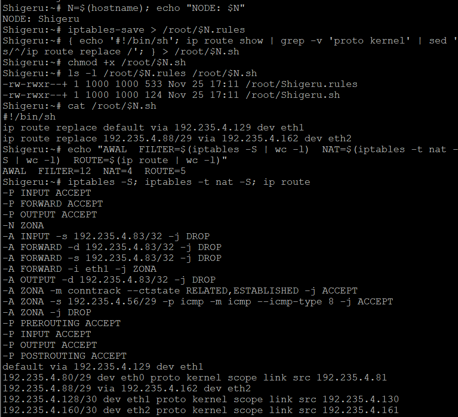

##### 2. Hapus semua rule dan rute


##### 3. Pemulihan pertama


##### 4. Pemulihan kedua


##### 5. Casper → Zeruel berhasil


##### 6. Lilith → Zeruel gagal


##### 7. Shigeru → Gendo berhasil


#### Fuyutsuki

##### 8. Simpan rule dan skrip rute


##### 9. Hapus semua rule dan rute


##### 10. Pemulihan pertama


##### 11. Pemulihan kedua


##### 12. Casper mengirim pesan setelah pemulihan


##### 13. Log Pen-Pen berisi pesan baru


##### 14. Tabel conntrack Fuyutsuki


#### Zeruel

##### 15. Simpan rule dan skrip rute


##### 16. Hapus semua rule dan rute


##### 17. Pemulihan pertama


##### 18. Pemulihan kedua


##### 19. Zeruel → 8.8.8.8 berhasil


##### 20. Armisael → Zeruel tetap gagal


