# PRAKTIKUM JARKOM MODUL 4 KELOMPOK 48

## Anggota Kelompok

| Nama | NRP |
| ---- | ---------- |
| Tafidah Hasna Mumtazah | 5027251025 |
| Iqbal Rizki Muhammad Fadhli | 5027251027 |

## Daftar isi

1. [Soal 1 — VLSM Operation Geofront (K-48)](#soal-1)
2. [Soal 2 — Membangun Geofront di GNS3 (K-48)](#soal-2)
3. [Soal 3 — Routing Statis Geofront (K-48)](#soal-3)
4. [Soal 4 — Akses Internet Geofront lewat Gendo (K-48)](#soal-4)
5. [Soal 5 — Mengunci Pintu NAT1 di Gendo (K-48)](#soal-5)
6. [Soal 6 — Alamat Permanen Semua Node Non-Router (K-48)](#soal-6)
7. [Soal 7 — Membangunkan MAGI (K-48)](#soal-7)
8. [Soal 8 — Kondisi Normal Pen-Pen & Tokyo3-Core (K-48)](#soal-8)
9. [Soal 9 — Jalur Belakang di Shigeru Disabotase (K-48)](#soal-9)
10. [Soal 10 — Para Pilot Terkunci di Dalam (K-48)](#soal-10)

---

<a id="soal-1"></a>

## Soal 1 — VLSM Operation Geofront (K-48)

### 1. Rekap pembagian

| Blok | Prefix | Jumlah |
|---|---|---|
| LAN Quarters | /23 | 512 |
| LAN Comm | /24 | 256 |
| LAN Hangar | /25 | 128 |
| LAN Bunker | /26 | 64 |
| LAN Medic, Relay, Garden | /27 | 3 × 32 |
| LAN Dock | /28 | 16 |
| LAN Lab, Terminal, Cage, Dogma, Monolith, Radar | /29 | 6 × 8 |
| LAN Archive, Intel, Cmd | /30 | 3 × 4 |
| 16 link router | /30 | 16 × 4 |

Total = **1196 alamat**, sehingga prefix kelompok minimal **/21**.
Dengan `192.235.0.0/16`, blok terpakai adalah
`192.235.0.0/21` (192.235.0.0 – 192.235.7.255),
dan alamat `192.235.4.172` – `192.235.255.255` masih bebas.

### 2. Hitungan satu subnet (Quarters)

1. Kebutuhan host: **500** container/host.
2. Tambah gateway: 500 + 1 = **501 usable**.
3. Cari prefix terkecil dengan `2^(32-p) - 2 ≥ 501`:
   - /24 → 254 (tidak muat)
   - /23 → **510 (muat)**
4. Network `192.235.0.0/23`, netmask `255.255.254.0`.
5. Gateway = usable pertama = **192.235.0.1**.
6. Broadcast = **192.235.1.255**.
7. Terpakai = 1 gateway + 500 host = **501**; sisa = 510 − 501 = **9**.
8. Host pertama (Quarters) = `192.235.0.2`.

Tabel lengkap: lihat `dokumen/soal1/tabel_vlsm.xlsx` (sheet **Tabel VLSM**, **Alamat Host**, **Alamat Link**)
atau `dokumen/soal1/tabel_subnet.csv`, `dokumen/soal1/alamat_host.csv`, `dokumen/soal1/alamat_link.csv`.

### 3. Pohon IP dan jalur Dummy-Plug → Armisael

Gambar: **`assets/soal1/pohon_ip.png`** (pohon alokasi prefix) dan **`assets/soal1/jalur_dummy_armisael.png`**
(diagram jalur hop-per-hop).

Jalur paket Dummy-Plug menuju Armisael melewati 5 subnet berikut (dilingkari merah):

| Urutan | Subnet | CIDR | Keterangan |
|---:|---|---|---|
| 1 | Switch-Lab | `192.235.4.48/29` | LAN asal Dummy-Plug (`192.235.4.51`) |
| 2 | Asuka–Ritsuko | `192.235.4.156/30` | Ritsuko → Asuka |
| 3 | Gendo–Asuka | `192.235.4.116/30` | Asuka → Gendo |
| 4 | Gendo–Shigeru | `192.235.4.128/30` | Gendo → Shigeru |
| 5 | Switch-Monolith | `192.235.4.80/29` | LAN Armisael (`192.235.4.83`) |

### Lampiran tabel

# VLSM Modul 5 — base `192.235.0.0/16`

### Tabel subnet (urut VLSM)

| No | Jenis | Subnet | Prefix | Network | Gateway | Broadcast | IP terpakai | Sisa |
|---:|:------|:-------|:------:|:--------|:--------|:----------|------------:|-----:|
| 1 | LAN | LAN Switch-Quarters (Rei) | /23 | 192.235.0.0 | 192.235.0.1 | 192.235.1.255 | 501 | 9 |
| 2 | LAN | LAN Switch-Comm (Hikari) | /24 | 192.235.2.0 | 192.235.2.1 | 192.235.2.255 | 201 | 53 |
| 3 | LAN | LAN Switch-Hangar (Yui) | /25 | 192.235.3.0 | 192.235.3.1 | 192.235.3.127 | 101 | 25 |
| 4 | LAN | LAN Switch-Bunker (Kensuke) | /26 | 192.235.3.128 | 192.235.3.129 | 192.235.3.191 | 56 | 6 |
| 5 | LAN | LAN Switch-Medic (Maya) | /27 | 192.235.3.192 | 192.235.3.193 | 192.235.3.223 | 27 | 3 |
| 6 | LAN | LAN Switch-Relay (Kaworu) | /27 | 192.235.3.224 | 192.235.3.225 | 192.235.3.255 | 26 | 4 |
| 7 | LAN | LAN Switch-Garden (Shinji) | /27 | 192.235.4.0 | 192.235.4.1 | 192.235.4.31 | 15 | 15 |
| 8 | LAN | LAN Switch-Dock (Mari) | /28 | 192.235.4.32 | 192.235.4.33 | 192.235.4.47 | 13 | 1 |
| 9 | LAN | LAN Switch-Lab (Ritsuko) | /29 | 192.235.4.48 | 192.235.4.49 | 192.235.4.55 | 6 | 0 |
| 10 | LAN | LAN Switch-Terminal (Fuyutsuki) | /29 | 192.235.4.56 | 192.235.4.57 | 192.235.4.63 | 4 | 2 |
| 11 | LAN | LAN Switch-Cage (Misato) | /29 | 192.235.4.64 | 192.235.4.65 | 192.235.4.71 | 4 | 2 |
| 12 | LAN | LAN Switch-Dogma (Toji) | /29 | 192.235.4.72 | 192.235.4.73 | 192.235.4.79 | 3 | 3 |
| 13 | LAN | LAN Switch-Monolith (Shigeru) | /29 | 192.235.4.80 | 192.235.4.81 | 192.235.4.87 | 3 | 3 |
| 14 | LAN | LAN Switch-Radar (Makoto) | /29 | 192.235.4.88 | 192.235.4.89 | 192.235.4.95 | 5 | 1 |
| 15 | LAN | LAN Switch-Archive (Asuka) | /30 | 192.235.4.96 | 192.235.4.97 | 192.235.4.99 | 2 | 0 |
| 16 | LAN | LAN Switch-Intel (Kaji) | /30 | 192.235.4.100 | 192.235.4.101 | 192.235.4.103 | 2 | 0 |
| 17 | LAN | LAN Switch-Cmd (Gendo) | /30 | 192.235.4.104 | 192.235.4.105 | 192.235.4.107 | 2 | 0 |
| 18 | Link | Link Gendo–Yui | /30 | 192.235.4.108 | 192.235.4.109 | 192.235.4.111 | 2 | 0 |
| 19 | Link | Link Gendo–Hikari | /30 | 192.235.4.112 | 192.235.4.113 | 192.235.4.115 | 2 | 0 |
| 20 | Link | Link Gendo–Asuka | /30 | 192.235.4.116 | 192.235.4.117 | 192.235.4.119 | 2 | 0 |
| 21 | Link | Link Gendo–Kaji | /30 | 192.235.4.120 | 192.235.4.121 | 192.235.4.123 | 2 | 0 |
| 22 | Link | Link Gendo–Misato | /30 | 192.235.4.124 | 192.235.4.125 | 192.235.4.127 | 2 | 0 |
| 23 | Link | Link Gendo–Shigeru | /30 | 192.235.4.128 | 192.235.4.129 | 192.235.4.131 | 2 | 0 |
| 24 | Link | Link Gendo–Fuyutsuki | /30 | 192.235.4.132 | 192.235.4.133 | 192.235.4.135 | 2 | 0 |
| 25 | Link | Link Yui–Rei | /30 | 192.235.4.136 | 192.235.4.137 | 192.235.4.139 | 2 | 0 |
| 26 | Link | Link Yui–Shinji | /30 | 192.235.4.140 | 192.235.4.141 | 192.235.4.143 | 2 | 0 |
| 27 | Link | Link Yui–Mari | /30 | 192.235.4.144 | 192.235.4.145 | 192.235.4.147 | 2 | 0 |
| 28 | Link | Link Hikari–Kaworu | /30 | 192.235.4.148 | 192.235.4.149 | 192.235.4.151 | 2 | 0 |
| 29 | Link | Link Asuka–Kensuke | /30 | 192.235.4.152 | 192.235.4.153 | 192.235.4.155 | 2 | 0 |
| 30 | Link | Link Asuka–Ritsuko | /30 | 192.235.4.156 | 192.235.4.157 | 192.235.4.159 | 2 | 0 |
| 31 | Link | Link Shigeru–Makoto | /30 | 192.235.4.160 | 192.235.4.161 | 192.235.4.163 | 2 | 0 |
| 32 | Link | Link Fuyutsuki–Maya | /30 | 192.235.4.164 | 192.235.4.165 | 192.235.4.167 | 2 | 0 |
| 33 | Link | Link Fuyutsuki–Toji | /30 | 192.235.4.168 | 192.235.4.169 | 192.235.4.171 | 2 | 0 |

### Alamat host per container

| Switch | Container | Host | IP | Gateway |
|:--|:--|--:|:--|:--|
| Switch-Quarters | Quarters | 500 | 192.235.0.2 | 192.235.0.1 |
| Switch-Comm | Comm-Net | 200 | 192.235.2.2 | 192.235.2.1 |
| Switch-Hangar | Hangar-Crew | 100 | 192.235.3.2 | 192.235.3.1 |
| Switch-Bunker | Sachiel | 55 | 192.235.3.130 | 192.235.3.129 |
| Switch-Medic | Pen-Pen | 1 | 192.235.3.194 | 192.235.3.193 |
| Switch-Medic | Medic-Bay | 25 | 192.235.3.195 | 192.235.3.193 |
| Switch-Relay | Relay-Node | 25 | 192.235.3.226 | 192.235.3.225 |
| Switch-Garden | Garden-Staff | 14 | 192.235.4.2 | 192.235.4.1 |
| Switch-Dock | Dock-Crew | 12 | 192.235.4.34 | 192.235.4.33 |
| Switch-Lab | Entry-Plug | 3 | 192.235.4.50 | 192.235.4.49 |
| Switch-Lab | Dummy-Plug | 2 | 192.235.4.51 | 192.235.4.49 |
| Switch-Terminal | Magi-Casper | 1 | 192.235.4.58 | 192.235.4.57 |
| Switch-Terminal | Magi-Balthasar | 1 | 192.235.4.59 | 192.235.4.57 |
| Switch-Terminal | Magi-Melchior | 1 | 192.235.4.60 | 192.235.4.57 |
| Switch-Cage | Unit-01 | 1 | 192.235.4.66 | 192.235.4.65 |
| Switch-Cage | Unit-02 | 1 | 192.235.4.67 | 192.235.4.65 |
| Switch-Cage | Unit-00 | 1 | 192.235.4.68 | 192.235.4.65 |
| Switch-Dogma | Lilith | 1 | 192.235.4.74 | 192.235.4.73 |
| Switch-Dogma | Adam | 1 | 192.235.4.75 | 192.235.4.73 |
| Switch-Monolith | Zeruel | 1 | 192.235.4.82 | 192.235.4.81 |
| Switch-Monolith | Armisael | 1 | 192.235.4.83 | 192.235.4.81 |
| Switch-Radar | Radar-Array | 4 | 192.235.4.90 | 192.235.4.89 |
| Switch-Archive | Archive-Vault | 1 | 192.235.4.98 | 192.235.4.97 |
| Switch-Intel | Spy | 1 | 192.235.4.102 | 192.235.4.101 |
| Switch-Cmd | Tokyo3-Core | 1 | 192.235.4.106 | 192.235.4.105 |

### Alamat interface link router

| Link | Network | Sisi parent | Sisi child |
|:--|:--|:--|:--|
| Gendo–Yui | 192.235.4.108/30 | Gendo = 192.235.4.109 | Yui = 192.235.4.110 |
| Gendo–Hikari | 192.235.4.112/30 | Gendo = 192.235.4.113 | Hikari = 192.235.4.114 |
| Gendo–Asuka | 192.235.4.116/30 | Gendo = 192.235.4.117 | Asuka = 192.235.4.118 |
| Gendo–Kaji | 192.235.4.120/30 | Gendo = 192.235.4.121 | Kaji = 192.235.4.122 |
| Gendo–Misato | 192.235.4.124/30 | Gendo = 192.235.4.125 | Misato = 192.235.4.126 |
| Gendo–Shigeru | 192.235.4.128/30 | Gendo = 192.235.4.129 | Shigeru = 192.235.4.130 |
| Gendo–Fuyutsuki | 192.235.4.132/30 | Gendo = 192.235.4.133 | Fuyutsuki = 192.235.4.134 |
| Yui–Rei | 192.235.4.136/30 | Yui = 192.235.4.137 | Rei = 192.235.4.138 |
| Yui–Shinji | 192.235.4.140/30 | Yui = 192.235.4.141 | Shinji = 192.235.4.142 |
| Yui–Mari | 192.235.4.144/30 | Yui = 192.235.4.145 | Mari = 192.235.4.146 |
| Hikari–Kaworu | 192.235.4.148/30 | Hikari = 192.235.4.149 | Kaworu = 192.235.4.150 |
| Asuka–Kensuke | 192.235.4.152/30 | Asuka = 192.235.4.153 | Kensuke = 192.235.4.154 |
| Asuka–Ritsuko | 192.235.4.156/30 | Asuka = 192.235.4.157 | Ritsuko = 192.235.4.158 |
| Shigeru–Makoto | 192.235.4.160/30 | Shigeru = 192.235.4.161 | Makoto = 192.235.4.162 |
| Fuyutsuki–Maya | 192.235.4.164/30 | Fuyutsuki = 192.235.4.165 | Maya = 192.235.4.166 |
| Fuyutsuki–Toji | 192.235.4.168/30 | Fuyutsuki = 192.235.4.169 | Toji = 192.235.4.170 |

Total terpakai: **1196 alamat** (`192.235.0.0` – `192.235.4.171`), sisa blok: **64340 alamat**.

---

<a id="soal-2"></a>

## Soal 2 — Membangun Geofront di GNS3 (K-48)


### 1. Ringkasan

| Item | Target | Hasil |
|---|---|---|
| Router | 17 | **17** |
| Ethernet switch | 17 | **17** |
| Container host | 25 | **25** |
| NAT | 1 (NAT1) | **1** |
| Total node | 60 | **60** |
| Total link | 59 | **59** |
| Router IP terpasang | 17 | **17 OK** |
| `ip_forward=1` | 17 | **17 OK** |
| Ping ujung link router–router | 16 | **16 OK, 0% loss** |
| Gendo DHCP dari NAT1 | ya | **ya** (`192.168.122.x`) |


### 2. Pembagian interface

| Peran | Interface | Keterangan |
|---|---|---|
| LAN router | `eth0` | gateway subnet LAN, IP usable pertama |
| Link ke router lain | `eth1`, `eth2`, … | /30, parent `.1`, child `.2` |
| Gendo → NAT1 | `eth1` | DHCP dari NAT1 |
| Gendo → anak | `eth2`–`eth8` | 7 link |
| Link LAN ke switch | router `eth0` ↔ switch port 0 | host di port 1, 2, 3 |

### 3. Konfigurasi

Script tiap router dikirim ke **`/root/soal2.sh`** di dalam container. Berikut isi script:

```sh
sysctl -w net.ipv4.ip_forward=1
grep -q '^net.ipv4.ip_forward=1' /etc/sysctl.conf || echo ... >> /etc/sysctl.conf
ip link set ethX up
ip addr flush dev ethX
ip addr add <ip>/<prefix> dev ethX
# khusus Gendo eth1:
udhcpc -i eth1 -q -n -t 10
```

### 4. Bukti ping antar-link

Semua 16 link diuji dari sisi parent ke IP child:

```
Gendo→Yui, Gendo→Hikari, Gendo→Asuka, Gendo→Kaji, Gendo→Misato,
Gendo→Shigeru, Gendo→Fuyutsuki, Yui→Rei, Yui→Shinji, Yui→Mari,
Hikari→Kaworu, Asuka→Kensuke, Asuka→Ritsuko, Shigeru→Makoto,
Fuyutsuki→Maya, Fuyutsuki→Toji
```

#### 1. pratinjau topologi (posisi sama dengan project)

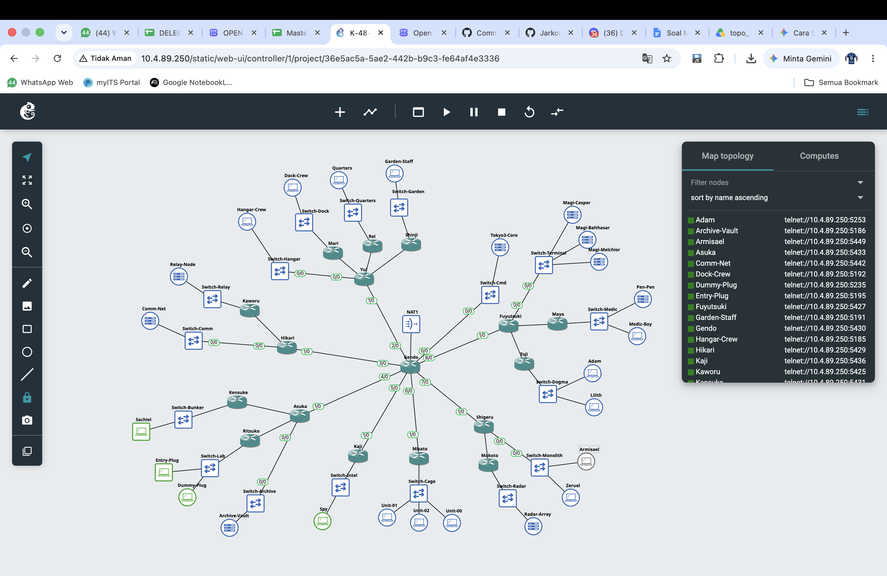

---

<a id="soal-3"></a>

## Soal 3 — Routing Statis Geofront (K-48)

### 1. Ringkasan

| Item | Hasil |
|---|---|
| Router dengan routing statis | 17/17 |
| Rute subnet statis | **31** |
| Default route statis | **16** (semua router kecuali Gendo) |
| Default Gendo | dari DHCP NAT1 (`192.168.122.1`) |
| Node uji ber-IP sementara | 4 (Armisael, Lilith, Sachiel, Comm-Net) |
| Armisael → Lilith / Sachiel / Comm-Net | **3/3 berhasil, 0% packet loss** |

Script: `/root/soal3.sh` di tiap router dan host uji. Salinan lokal:
`dokumen/soal3/configs/<router>.sh`, `dokumen/soal3/configs/host_<nama>.sh`.

### 2. Prinsip routing

- **Non-Gendo:** satu `default route` ke router induk + rute ke subnet di bawahnya.
- **Gendo:** rute ke semua cabang; default route tetap memakai DHCP dari NAT1
  (tidak ditulis statis agar tidak perlu diubah saat IP NAT1 berganti — dipakai lagi di soal 4).
- **Ringkasan (summarization):** blok-blok dalam satu cabang digabung hanya jika
  hasil penggabungannya **tepat** (pasangan sibling /30→/29, /29→/28, …).
  Penggabungan lintas cabang tidak dilakukan karena next-hop berbeda.

Contoh ringkasan yang benar-benar terjadi:

| Cabang | Blok asal | Ringkasan |
|---|---|---|
| Shigeru → Makoto | `192.235.4.80/29` + `192.235.4.88/29` | **`192.235.4.80/28`** |
| Yui (link ke Rei+Shinji) | `192.235.4.136/30` + `192.235.4.140/30` | **`192.235.4.136/29`** |
| Asuka (link ke Kensuke+Ritsuko) | `192.235.4.152/30` + `192.235.4.156/30` | **`192.235.4.152/29`** |
| Fuyutsuki (link ke Maya+Toji) | `192.235.4.164/30` + `192.235.4.168/30` | **`192.235.4.164/29`** |

### 3. Jumlah rute per router

| Router | Rute bawahan | Router | Rute bawahan |
|---|---:|---|---:|
| Gendo | 22 | Yui | 3 |
| Hikari | 1 | Asuka | 2 |
| Shigeru | 1 | Fuyutsuki | 2 |
| sisanya (11 router) | 0 | **total** | **31** |

Gendo memakai 22 rute untuk 7 cabang. Contoh:

```
default via 192.168.122.1 dev eth1        # DHCP NAT1
192.235.0.0/23     via 192.235.4.110      # cabang Yui
192.235.2.0/24     via 192.235.4.114      # cabang Hikari
192.235.3.128/26   via 192.235.4.118      # cabang Asuka
192.235.4.80/28    via 192.235.4.130      # Shigeru + Makoto (hasil ringkasan)
192.235.4.152/29   via 192.235.4.118      # 2 link di bawah Asuka (ringkasan)
...
```

Tabel lengkap: **`dokumen/soal3/ip_route_all.txt`**, per-router di `dokumen/soal3/verify/routes_*.txt`.

### 4. IP sementara node uji

| Node | IP | Gateway | Switch | Router |
|---|---|---|---|---|
| Armisael | `192.235.4.83/29` | `192.235.4.81` | Switch-Monolith | Shigeru |
| Lilith | `192.235.4.74/29` | `192.235.4.73` | Switch-Dogma | Toji |
| Sachiel | `192.235.3.130/26` | `192.235.3.129` | Switch-Bunker | Kensuke |
| Comm-Net | `192.235.2.2/24` | `192.235.2.1` | Switch-Comm | Hikari |

### 5. Pembuktian

Dari konsol **Armisael**:

```
ping -c 4 192.235.4.74    → 4/4, 0% packet loss  (Lilith)
ping -c 4 192.235.3.130   → 4/4, 0% packet loss  (Sachiel)
ping -c 4 192.235.2.2     → 4/4, 0% packet loss  (Comm-Net)
```

Log lengkap: `dokumen/soal3/verify/ping_armisael.txt`. Uji balik arah (target → Armisael):
`dokumen/soal3/verify/ping_balik.txt`.

Jalur paket contoh Armisael → Comm-Net:

```
Armisael → Shigeru → Gendo → Hikari → Comm-Net
           (default)  (rute /24)  (LAN)
```

### 6. Bukti screenshot (asli, diambil saat pengerjaan)

Semua file di folder **`bukti/`** adalah hasil tangkap layar langsung
(konsol GNS3 via Terminal dan Web UI GNS3), bukan gambar yang digambar/generate.

| File | Isi |
|---|---|
| `assets/soal3/01-topologi-gns3.png` | Web UI GNS3: 60 node & link, kanvas sudah terlihat |
| `assets/soal3/02-armisael-ip.png` | konsol Armisael: `ip -br a`, `ip route` |
| `assets/soal3/03-ping-lilith.png` | konsol Armisael: ping `192.235.4.74` 4/4 |
| `assets/soal3/04-ping-sachiel.png` | konsol Armisael: ping `192.235.3.130` 4/4 |
| `assets/soal3/05-ping-commnet.png` | konsol Armisael: ping `192.235.2.2` 4/4 |
| `assets/soal3/06-gendo-route.png` | `ip route` Gendo: 22 rute + default NAT1 |
| `assets/soal3/07-yui-route.png` | `ip route` Yui: default + 3 rute |
| `assets/soal3/08-hikari-route.png` | `ip route` Hikari: default + 1 rute |
| `assets/soal3/09-asuka-route.png` | `ip route` Asuka: default + 2 rute |
| `assets/soal3/10-shigeru-route.png` | `ip route` Shigeru: default + `192.235.4.88/29` |
| `assets/soal3/11-fuyutsuki-route.png` | `ip route` Fuyutsuki: default + 2 rute |
| `assets/soal3/12-makoto-default.png` | `ip route` Makoto: hanya default ke Shigeru |

Catatan kanvas: koordinat node digeser sebesar `(-1000, -500)` karena Web UI
GNS3 3.x memusatkan scene di (0,0). Sebelumnya node masih ada di project tetapi
berada di luar viewport sehingga kanvas terlihat kosong.

### 7. File lain

| File | Isi |
|---|---|
| `dokumen/soal3/configs/*.sh` | script tiap router + 4 host uji |
| `dokumen/soal3/verify/routes_*.txt` | `ip route` per router |
| `dokumen/soal3/verify/ping_armisael.txt` | bukti ping utama |
| `dokumen/soal3/verify/ping_balik.txt` | ping balik dari target |
| `dokumen/soal3/verify/hosts.txt` | IP & default host uji |
| `dokumen/soal3/summary.json` | ringkasan mesin (31 rute, 0 gagal) |

Regenerasi: `python3 build_soal3.py all` (atau `routes` / `hosts` / `verify`).
Screenshot: `./capture_bukti.sh <file.png> <nama-node> "<perintah>"`.

---

### Galeri bukti screenshot

Semua gambar di bawah adalah **tangkapan layar asli** yang diambil
saat pengerjaan (Web UI GNS3 dan konsol node), bukan gambar generate.

#### 1. Web UI GNS3: 60 node & link, kanvas sudah terlihat


#### 2. konsol Armisael: `ip -br a`, `ip route`


#### 3. konsol Armisael: ping `192.235.4.74` 4/4


#### 4. konsol Armisael: ping `192.235.3.130` 4/4


#### 5. konsol Armisael: ping `192.235.2.2` 4/4


#### 6. `ip route` Gendo: 22 rute + default NAT1


#### 7. `ip route` Yui: default + 3 rute


#### 8. `ip route` Hikari: default + 1 rute


#### 9. `ip route` Asuka: default + 2 rute


#### 10. `ip route` Shigeru: default + `192.235.4.88/29`


#### 11. `ip route` Fuyutsuki: default + 2 rute


#### 12. `ip route` Makoto: hanya default ke Shigeru


---

<a id="soal-4"></a>

## Soal 4 — Akses Internet Geofront lewat Gendo (K-48)

### 1. Ringkasan

| Item | Hasil |
|---|---|
| Internet untuk seluruh jaringan | **aktif** lewat satu pintu (Gendo) |
| Aturan NAT | 1 rule MASQUERADE di Gendo, sumber `192.235.0.0/16`, keluar `eth1` |
| Ketergantungan pada IP NAT1 | **tidak ada** (interface diambil dari default route) |
| Traffic antar-LAN | source address asli tetap dipakai (counter NAT tidak naik) |
| DNS | 25 host non-router memakai resolver `8.8.8.8`, `1.1.1.1` |
| Node pemasang paket (Magi) | 3/3 bisa resolve `deb.debian.org` |
| Armisael & Lilith → `8.8.8.8` | **4/4, 0% packet loss** |
| Armisael & Lilith → `deb.debian.org` | **4/4, 0% packet loss** |
| Soal 2 + 3 setelah perubahan | tetap OK (16 link, 31 rute, 3 ping uji) |

Semua konfigurasi Gendo (soal 2 + 3 + 4) ada di satu file **`/root/gendo.sh`**;
salinan lokal: `dokumen/soal4/configs/gendo.sh`.

### 2. Rancangan NAT

Aturan yang dipasang:

```
iptables -t nat -F POSTROUTING
iptables -t nat -A POSTROUTING -s 192.235.0.0/16 -o "$NAT_IF" -j MASQUERADE
```

`NAT_IF` tidak ditulis tetap, melainkan dibaca dari default route:

```sh
NAT_IF=$(ip -4 route show default | awk '{for(i=1;i<=NF;i++) if($i=="dev"){print $(i+1); exit}}')
```

Konsekuensinya:

- Jika alamat NAT1 berganti, DHCP mengganti default route dan script memakai
  interface yang sama tanpa perlu diedit.
- Hanya paket yang **berasal dari prefix internal** dan **keluar lewat interface
  NAT1** yang diterjemahkan.
- Paket antar-LAN lewat interface router lain, sehingga tidak masuk rule ini dan
  alamat sumber aslinya tetap terbawa.

Bukti counter (diambil dari `dokumen/soal4/verify/nat_counter.txt`):

| Kondisi | Paket pada rule NAT |
|---|---:|
| Setelah `iptables -t nat -Z` | 0 |
| Setelah ping antar-LAN Armisael → Lilith | **0** (tidak berubah) |
| Setelah ping internet dari Armisael + Lilith | **naik** (> 0) |

### 3. DNS

`/root/soal4_dns.sh` ditaruh di **25 host non-router** dan menulis:

```
nameserver 8.8.8.8
nameserver 1.1.1.1
```

Resolver publik dipilih supaya konfigurasi host juga tidak bergantung pada alamat
NAT1. Karena node Magi belum mendapat IP permanen sampai soal 6, ketiganya diberi
IP sementara memakai nilai dari rencana VLSM (`192.235.4.58/29` … `.60/29`,
gateway `192.235.4.57`) agar resolusi bisa dibuktikan sekarang. IP permanen
menjadi permanen di soal 6.

Contoh hasil:

```
getent ahostsv4 deb.debian.org
→ 151.101.2.132 / 151.101.66.132 / 151.101.130.132 / 151.101.194.132
```

### 4. Pembuktian

Dari konsol **Armisael** dan **Lilith**, masing-masing:

```
ping -c 4 8.8.8.8          → 4/4, 0% packet loss
ping -c 4 deb.debian.org   → 4/4, 0% packet loss (resolved ke 151.101.x.x)
```

Log lengkap: `dokumen/soal4/verify/ping_internet.txt`, `dokumen/soal4/verify/nat_rules.txt`,
`dokumen/soal4/verify/nat_counter.txt`, `dokumen/soal4/verify/dns_hosts.txt`, `dokumen/soal4/summary.json`.

### 5. Bukti screenshot (asli, diambil saat pengerjaan)

| File | Isi |
|---|---|
| `assets/soal4/01-topologi-gns3.png` | Web UI GNS3, topologi 60 node |
| `assets/soal4/02-gendo-nat-rule.png` | `iptables -t nat -S/-L` di Gendo, rule MASQUERADE + default route |
| `assets/soal4/03-internal-no-nat.png` | counter NAT = 0 setelah ping antar-LAN |
| `assets/soal4/04-nat-counter.png` | counter NAT naik setelah ping internet |
| `assets/soal4/05-armisael-internet.png` | resolv.conf + ping `8.8.8.8` + ping `deb.debian.org` dari Armisael |
| `assets/soal4/06-lilith-internet.png` | resolv.conf + ping `8.8.8.8` + ping `deb.debian.org` dari Lilith |
| `assets/soal4/07-gendo-script.png` | potongan `/root/gendo.sh` berisi NAT berbasis interface |
| `assets/soal4/08-magi-dns.png` | IP sementara + `getent ahostsv4 deb.debian.org` di Magi-Casper |

Semua file di `bukti/` adalah tangkapan layar langsung dari Web UI GNS3 dan
sesi konsol node, bukan gambar yang digambar atau di-generate.

### 6. Reproduksi

```bash
python3 build_soal4.py all       # nat + dns + verify
./capture_bukti.sh <file.png> <node> "<perintah>"
```

File penting:

| File | Isi |
|---|---|
| `dokumen/soal4/configs/gendo.sh` | konfigurasi lengkap Gendo (soal 2+3+4) |
| `dokumen/soal4/configs/nat_only.sh` | bagian NAT saja |
| `dokumen/soal4/configs/soal4_dns.sh` | script resolver DNS |
| `dokumen/soal4/configs/host_Magi-*.sh` | IP sementara node pemasang paket |
| `dokumen/soal4/verify/` | log rule NAT, counter, ping, DNS |
| `dokumen/soal4/summary.json` | ringkasan mesin, `fail: []` |

---

### Galeri bukti screenshot

Semua gambar di bawah adalah **tangkapan layar asli** yang diambil
saat pengerjaan (Web UI GNS3 dan konsol node), bukan gambar generate.

#### 1. Web UI GNS3, topologi 60 node


#### 2. `iptables -t nat -S/-L` di Gendo, rule MASQUERADE + default route


#### 3. counter NAT = 0 setelah ping antar-LAN

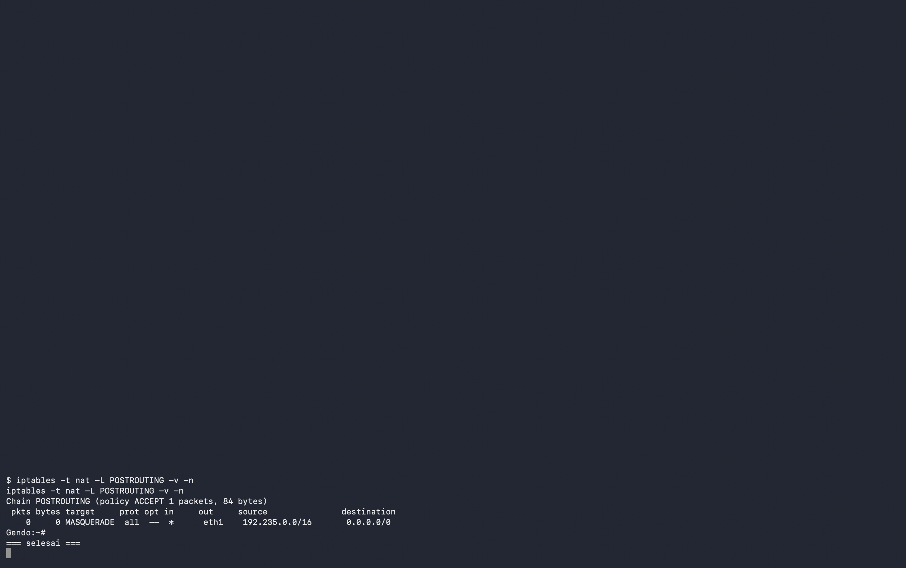

#### 4. counter NAT naik setelah ping internet

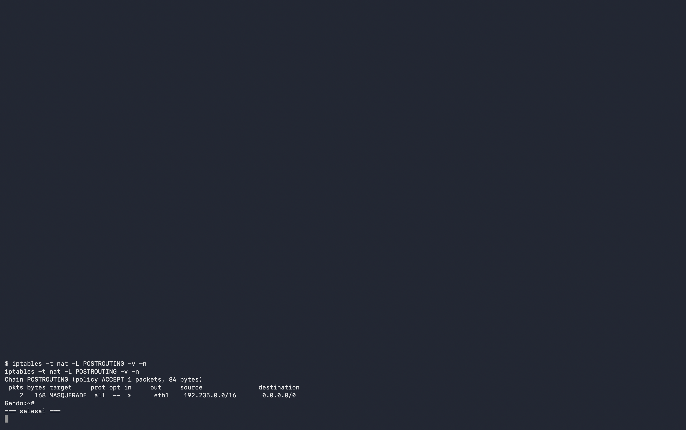

#### 5. resolv.conf + ping `8.8.8.8` + ping `deb.debian.org` dari Armisael


#### 6. resolv.conf + ping `8.8.8.8` + ping `deb.debian.org` dari Lilith


#### 7. potongan `/root/gendo.sh` berisi NAT berbasis interface


#### 8. IP sementara + `getent ahostsv4 deb.debian.org` di Magi-Casper


---

<a id="soal-5"></a>

## Soal 5 — Mengunci Pintu NAT1 di Gendo (K-48)

### 1. Ringkasan

| Item | Hasil |
|---|---|
| Policy `INPUT` | **DROP** |
| Policy `FORWARD` | **DROP** |
| Policy `OUTPUT` | ACCEPT (tidak diubah) |
| Aturan ACCEPT untuk sumber NAT1 | **tidak ada** |
| DHCP dari NAT1 setelah firewall | **berhasil** (lease `192.168.122.66`) |
| Armisael → `8.8.8.8` | **4/4, 0% packet loss** |
| Traffic antar-LAN & DNS | tetap berhasil |
| Soal 2 + 3 + 4 | tetap lolos verifikasi |
| Lokasi konfigurasi | **`/root/gendo.sh`** (salinan: `dokumen/soal5/configs/gendo.sh`) |

### 2. Aturan yang dipasang

Ringkas dari `iptables -S` di Gendo:

```
-P INPUT DROP
-P FORWARD DROP
-P OUTPUT ACCEPT
-A INPUT  -i lo -j ACCEPT
-A OUTPUT -o lo -j ACCEPT
-A INPUT  -m conntrack --ctstate RELATED,ESTABLISHED -j ACCEPT
-A FORWARD -m conntrack --ctstate RELATED,ESTABLISHED -j ACCEPT
-A INPUT  -p udp -m udp --sport 67 --dport 68 -j ACCEPT
-A OUTPUT -p udp -m udp --sport 68 --dport 67 -j ACCEPT
-A INPUT  -s 192.235.0.0/16 -j ACCEPT
-A FORWARD -s 192.235.0.0/16 -o eth1 -j ACCEPT
-A FORWARD -s 192.235.0.0/16 -d 192.235.0.0/16 -j ACCEPT
```

Tabel `nat` tetap berisi rule dari soal 4:

```
-A POSTROUTING -s 192.235.0.0/16 -o eth1 -j MASQUERADE
```

#### Penjelasan pengecualian

| Kebutuhan | Aturan |
|---|---|
| Loopback tetap hidup | `-i lo` / `-o lo` ACCEPT |
| (a) Balasan koneksi existing | `conntrack ESTABLISHED,RELATED` di INPUT & FORWARD |
| (b) Internal → internet | `FORWARD -s 192.235.0.0/16 -o $NAT_IF` ACCEPT |
| (c) Antar-LAN | `FORWARD -s 192.235.0.0/16 -d 192.235.0.0/16` ACCEPT |
| (d) Internal → Gendo sendiri | `INPUT -s 192.235.0.0/16` ACCEPT |
| DHCP NAT1 | UDP `67 → 68` / `68 → 67` ACCEPT |
| Koneksi baru dari NAT1 | tidak ada aturan ACCEPT → kena policy DROP |

`NAT_IF` tetap berasal dari default route (`eth1`), jadi firewall juga tidak
terikat pada alamat NAT1 tertentu. Semua blok ini ditulis di bagian akhir
`/root/gendo.sh` sehingga script bisa dijalankan ulang dengan aman.

### 3. Pembuktian

- `udhcpc -i eth1 -q -n -t 10` dijalankan **setelah** firewall aktif → lease
  `192.168.122.66` dari `192.168.122.1` tetap diperoleh, default route tetap ada.
- `ping -c 4 8.8.8.8` dari Armisael → 4/4, 0% packet loss.
- `ping -c 4 8.8.8.8` dari Lilith → 4/4, 0% packet loss.
- `ping -c 4 deb.debian.org` dari Armisael → 4/4, 0% packet loss.
- `ping -c 4 192.235.4.74` dan `192.235.3.130` dari Armisael → 4/4, 0% loss.
- `getent ahostsv4 deb.debian.org` di Magi-Casper → `151.101.x.x`.
- Verifikasi ulang Soal 3 (31 rute, 3 ping) dan Soal 4 (NAT counter) lolos.

Log: `dokumen/soal5/verify/iptables_S.txt`, `dokumen/soal5/verify/iptables_L.txt`,
`dokumen/soal5/verify/dhcp_after_firewall.txt`, `dokumen/soal5/verify/connectivity.txt`, `dokumen/soal5/summary.json`.

### 4. Bukti screenshot (asli, diambil saat pengerjaan)

| File | Isi |
|---|---|
| `assets/soal5/01-topologi-gns3.png` | Web UI GNS3 |
| `assets/soal5/02-gendo-iptables-S.png` | `iptables -S` + aturan NAT di Gendo |
| `assets/soal5/03-gendo-iptables-L.png` | policy DROP pada INPUT/FORWARD + counter |
| `assets/soal5/04-gendo-script.png` | bagian Soal 5 di `/root/gendo.sh` |
| `assets/soal5/05-armisael-internet.png` | ping `8.8.8.8` dari Armisael setelah firewall |
| `assets/soal5/06-armisael-lilith.png` | ping antar-LAN setelah firewall |
| `assets/soal5/07-magi-dns.png` | resolusi DNS node pemasang paket |
| `assets/soal5/08-gendo-dhcp.png` | DHCP ulang berhasil setelah firewall aktif |

Seluruh file di `bukti/` adalah tangkapan layar langsung dari Web UI GNS3 dan
konsol node, bukan gambar yang dibuat/generate.

### 5. Reproduksi

```bash
python3 build_soal5.py all
./capture_bukti.sh <file.png> <node> "<perintah>"
```

File penting: `dokumen/soal5/configs/gendo.sh`, `dokumen/soal5/configs/firewall_only.sh`, `dokumen/soal5/verify/`,
`dokumen/soal5/summary.json` (`fail: []`).

---

### Galeri bukti screenshot

Semua gambar di bawah adalah **tangkapan layar asli** yang diambil
saat pengerjaan (Web UI GNS3 dan konsol node), bukan gambar generate.

#### 1. Web UI GNS3


#### 2. `iptables -S` + aturan NAT di Gendo


#### 3. policy DROP pada INPUT/FORWARD + counter

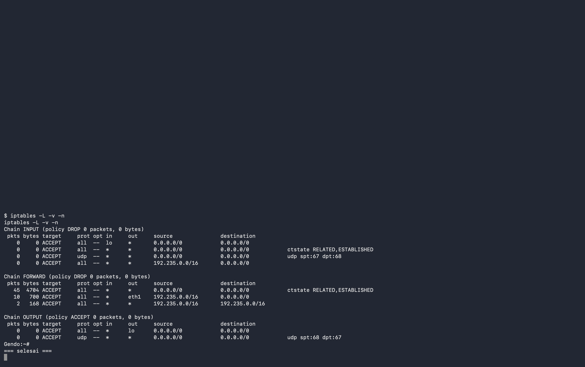

#### 4. bagian Soal 5 di `/root/gendo.sh`


#### 5. ping `8.8.8.8` dari Armisael setelah firewall


#### 6. ping antar-LAN setelah firewall

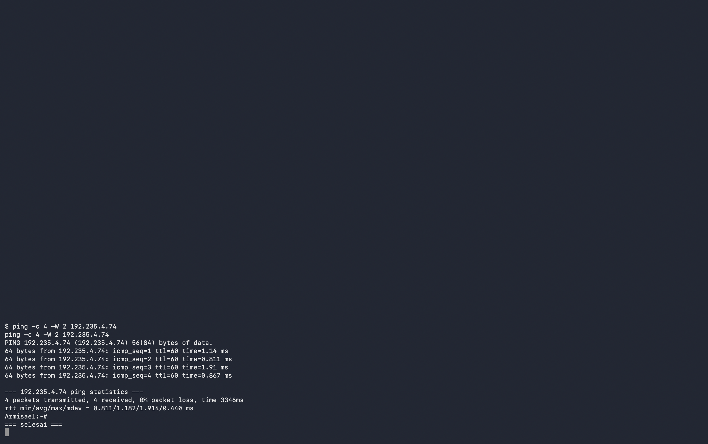

#### 7. resolusi DNS node pemasang paket


#### 8. DHCP ulang berhasil setelah firewall aktif


---

<a id="soal-6"></a>

## Soal 6 — Alamat Permanen Semua Node Non-Router (K-48)

### 1. Ringkasan

| Item | Hasil |
|---|---|
| Node non-router | **25/25** mendapat IP statis + gateway sesuai VLSM |
| Aturan alamat | gateway = IP usable pertama; host berikutnya berurutan sesuai urutan nama di switch |
| `ip -br` + default route | **25/25 sesuai rencana** |
| Ping ke gateway | **25/25 berhasil, 0% packet loss** |
| Unit-01 → gateway `192.235.4.65` | **4/4, 0% packet loss** |
| Uji restart 25 host | **25/25 konfigurasi kembali otomatis** |
| DNS & internet | tetap berhasil setelah restart |
| Soal 3, 4, 5 | diverifikasi ulang, tetap lolos |

### 2. Aturan penomoran

Sesuai glosarium: gateway adalah IP usable pertama pada subnet, lalu node-node
di switch menerima IP usable berikutnya berurutan sesuai penulisan nama di
topologi (kiri → kanan). Ini sudah sesuai `vlsm_plan.json` yang dipakai sejak
soal 1.

Contoh:

| Node | IP | Gateway | Subnet |
|---|---|---|---|
| Unit-01 | `192.235.4.66/29` | `192.235.4.65` | `192.235.4.64/29` |
| Unit-02 | `192.235.4.67/29` | `192.235.4.65` | `192.235.4.64/29` |
| Quarters | `192.235.0.2/23` | `192.235.0.1` | `192.235.0.0/23` |
| Comm-Net | `192.235.2.2/24` | `192.235.2.1` | `192.235.2.0/24` |
| Magi-Casper | `192.235.4.58/29` | `192.235.4.57` | `192.235.4.56/29` |
| Armisael | `192.235.4.83/29` | `192.235.4.81` | `192.235.4.80/29` |

Tabel lengkap 25 node: `dokumen/soal6/verify/ip_br_all.txt`, salinan script per node:
`dokumen/soal6/configs/init_<nama>.sh`.

### 3. Cara agar bertahan setelah restart

Image `alpinet`/`debinet` menjalankan `/etc/alpinet-init.sh` atau
`/etc/debinet-init.sh`, yang memanggil **`/root/init.sh`** jika ada dan executable.
Maka pada tiap host dibuat `/root/init.sh` berisi:

- `ip link set eth0 up`, `ip addr flush dev eth0`
- `ip addr add <IP>/<prefix> dev eth0`
- `ip route replace default via <gateway>`
- penulisan `/etc/resolv.conf` (DNS dari soal 4)
- penulisan blok statis `/etc/network/interfaces`

Script ini juga dijalankan sekali saat konfigurasi dipasang. Setelah itu seluruh
25 host di-**restart** lewat API GNS3 dan langsung diperiksa ulang: 25/25 IP,
gateway, dan `/root/init.sh` masih benar (`dokumen/soal6/verify/restart_hosts.txt`).

### 4. Pembuktian

Dari konsol **Unit-01**:

```
ip -br a show eth0        → 192.235.4.66/29
ip route show default     → default via 192.235.4.65 dev eth0
ping -c 4 192.235.4.65    → 4/4, 0% packet loss
```

Log lain: `dokumen/soal6/verify/ping_gateway_all.txt` (25 host), `dokumen/soal6/verify/apply_hosts.txt`,
`dokumen/soal6/verify/restart_hosts.txt`, `dokumen/soal6/summary.json`.

### 5. Bukti screenshot (asli, diambil saat pengerjaan)

| File | Isi |
|---|---|
| `assets/soal6/01-topologi-gns3.png` | Web UI GNS3 |
| `assets/soal6/02-unit01-ip-route.png` | `ip -br` + gateway Unit-01 |
| `assets/soal6/03-unit01-ping-gateway.png` | ping Unit-01 ke gateway `192.235.4.65` |
| `assets/soal6/04-unit01-init-script.png` | isi `/root/init.sh` Unit-01 |
| `assets/soal6/05-quarters-ip.png` | IP `/23` Quarters + gateway |
| `assets/soal6/06-magi-ip-dns.png` | IP Magi-Casper + resolusi DNS |
| `assets/soal6/07-armisael-after-restart.png` | IP Armisael masih benar setelah restart |
| `assets/soal6/08-commnet-ip.png` | IP `/24` Comm-Net + gateway |

Semuanya tangkapan layar langsung dari Web UI/konsol GNS3, bukan gambar generate.

### 6. Reproduksi

```bash
python3 build_soal6.py all       # apply + restart + verify
./capture_bukti.sh <file.png> <node> "<perintah>"
```

Ringkasan mesin: `dokumen/soal6/summary.json` (`fail: []`).

---

### Galeri bukti screenshot

Semua gambar di bawah adalah **tangkapan layar asli** yang diambil
saat pengerjaan (Web UI GNS3 dan konsol node), bukan gambar generate.

#### 1. Web UI GNS3


#### 2. `ip -br` + gateway Unit-01


#### 3. ping Unit-01 ke gateway `192.235.4.65`


#### 4. isi `/root/init.sh` Unit-01


#### 5. IP `/23` Quarters + gateway


#### 6. IP Magi-Casper + resolusi DNS

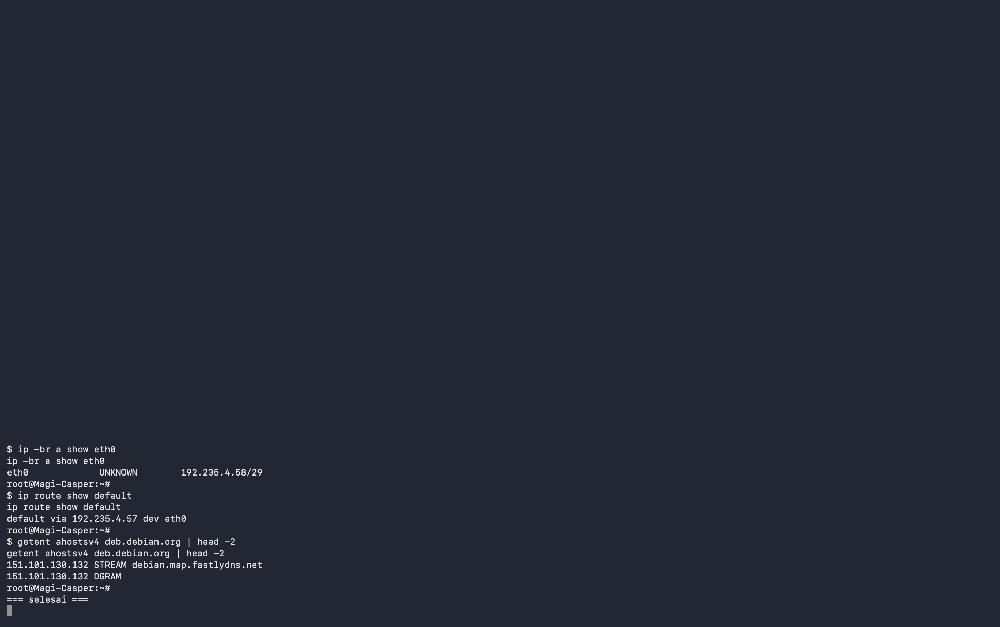

#### 7. IP Armisael masih benar setelah restart

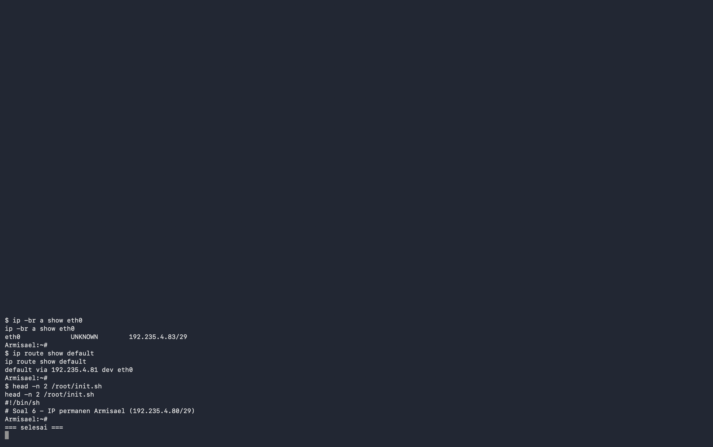

#### 8. IP `/24` Comm-Net + gateway


---

<a id="soal-7"></a>

## Soal 7 — Membangunkan MAGI (K-48)

### 1. Ringkasan

| Item | Hasil |
|---|---|
| Node MAGI | Casper, Balthasar, Melchior (Switch-Terminal) |
| Paket dipasang | **`iptables`** + **`netcat-traditional`** di ketiga node |
| Skrip instalasi | **`/root/<nama>.sh`** (mis. `/root/Magi-Casper.sh`) |
| Listener | Casper `:5000`; Balthasar `:5000` dan `:5001`; Melchior `:5000` |
| Pesan dari Lilith | **4/4 terkirim** (RC=0) |
| Pesan diterima | **4/4 terbaca di node tujuan** |
| `fail` | `[]` |

Sesuai glosarium: Casper 5000, Balthasar 5000 + 5001, Melchior 5000.

### 2. Konfigurasi

Tiap node MAGI mendapat `/root/<nama>.sh` yang:

1. `apt-get update` + `apt-get install -y iptables netcat-traditional`
   (`DEBIAN_FRONTEND=noninteractive`).
2. Memilih biner `nc.traditional` (fallback `nc`).
3. Membersihkan listener lama, lalu membuat loop listener dengan
   `nohup sh -c 'while true; do nc.traditional -l -p <port> >> /root/magi_<port>.log 2>&1; done' &`.
4. Mencetak `ss -ltnp` sebagai pembuktian port aktif.

`nc.traditional` dipakai karena listener OpenBSD `nc` akan berhenti setelah
satu koneksi; loop `while true` menjaga listener tetap hidup untuk pengiriman
berikutnya.

Salinan skrip: `dokumen/soal7/configs/Magi-Casper.sh`, `dokumen/soal7/configs/Magi-Balthasar.sh`,
`dokumen/soal7/configs/Magi-Melchior.sh`.

### 3. Pengiriman dari Lilith

| Tujuan | Port | Pesan | Status |
|---|---|---|---|
| Magi-Casper | 5000 | `HALO CASPER DARI LILITH` | diterima |
| Magi-Balthasar | 5000 | `HALO BALTHASAR PORT 5000 DARI LILITH` | diterima |
| Magi-Balthasar | 5001 | `HALO BALTHASAR PORT 5001 DARI LILITH` | diterima |
| Magi-Melchior | 5000 | `HALO MELCHIOR DARI LILITH` | diterima |

Log lengkap: `dokumen/soal7/verify/install.txt`, `dokumen/soal7/verify/listeners.txt`, `dokumen/soal7/verify/send.txt`,
`dokumen/soal7/verify/received.txt`, ringkasan: `dokumen/soal7/summary.json`.

### 4. Bukti screenshot (asli, diambil saat pengerjaan)

| File | Isi |
|---|---|
| `assets/soal7/01-topologi-gns3.png` | Web UI GNS3 |
| `assets/soal7/02-casper-install-listener.png` | paket terpasang + listener `:5000` di Casper |
| `assets/soal7/03-casper-pesan.png` | pesan diterima di Casper |
| `assets/soal7/04-balthasar-listener.png` | listener `:5000` dan `:5001` di Balthasar |
| `assets/soal7/05-balthasar-5000.png` | pesan diterima di Balthasar port 5000 |
| `assets/soal7/06-balthasar-5001.png` | pesan diterima di Balthasar port 5001 |
| `assets/soal7/07-melchior-pesan.png` | pesan diterima di Melchior |
| `assets/soal7/08-lilith-kirim.png` | keempat `nc` dari Lilith, `RC=0` |

Semua file di `bukti/` adalah tangkapan layar langsung dari Web UI GNS3 dan
konsol node GNS3 yang sedang berjalan, bukan gambar generate.

### 5. Reproduksi

```bash
python3 build_soal7.py all
./capture_bukti.sh <file.png> <node> "<perintah>"
```

---

### Galeri bukti screenshot

Semua gambar di bawah adalah **tangkapan layar asli** yang diambil
saat pengerjaan (Web UI GNS3 dan konsol node), bukan gambar generate.

#### 1. Web UI GNS3

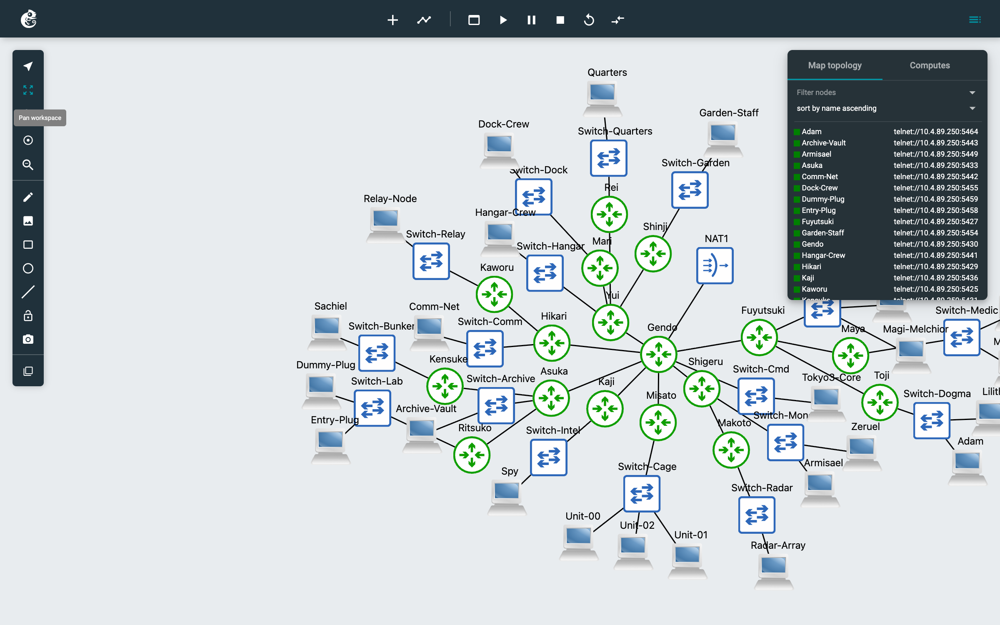

#### 2. paket terpasang + listener `:5000` di Casper


#### 3. pesan diterima di Casper


#### 4. listener `:5000` dan `:5001` di Balthasar


#### 5. pesan diterima di Balthasar port 5000

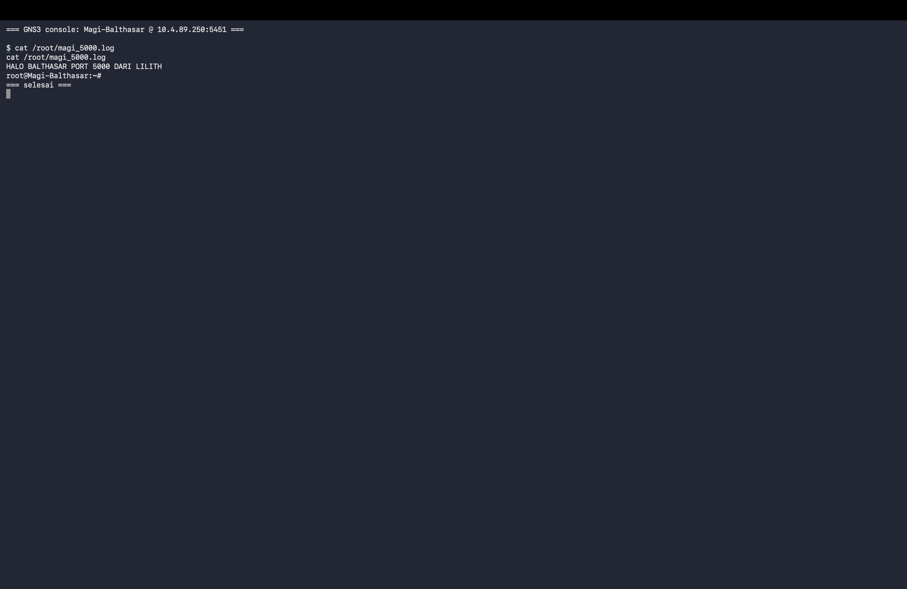

#### 6. pesan diterima di Balthasar port 5001


#### 7. pesan diterima di Melchior


#### 8. keempat `nc` dari Lilith, `RC=0`


---

<a id="soal-8"></a>

## Soal 8 — Kondisi Normal Pen-Pen & Tokyo3-Core (K-48)

### 1. Ringkasan

| Item | Hasil |
|---|---|
| Pen-Pen `:80` | `Welcome to Pen-Pen` |
| Tokyo3-Core `:80` | `Welcome to Tokyo3-Core` |
| Tokyo3-Core `:8080` | `syifa imutz` |
| `nc` dari Lilith ke 3 port | **3/3 berhasil, RC=0** |
| Port `:22` (tidak dilayani) | **Connection refused, RC=1, ±0.006 detik** |
| Skrip listener | `/root/Pen-Pen.sh`, `/root/Tokyo3-Core.sh` |
| `fail` | `[]` |

Ini adalah kondisi **sebelum** sabotase (soal 9/10/12), jadi kedua node sengaja
dibiarkan melayani tanpa proteksi.

### 2. Konfigurasi

Tiap node menjalankan `/root/<nama>.sh` yang memasang listener `nc` berulang:

```sh
start_listener() {
  port=$1
  text=$2
  nohup sh -c "while true; do printf '%s\n' \"$text\" | nc -N -l $port; done" >/dev/null 2>&1 &
}
start_listener 80 "Welcome to $(hostname)"
# Tokyo3-Core juga:
start_listener 8080 "syifa imutz"
```

`nc -N` menutup koneksi setelah stdin habis, sehingga setiap `nc` dari Lilith
mendapat satu baris jawaban lalu selesai. Loop `while true` membuat listener
tetap hidup untuk koneksi berikutnya. Salinan skrip: `dokumen/soal8/configs/`.

### 3. Pembuktian dari Lilith

| Perintah | Jawaban |
|---|---|
| `nc -w 3 192.235.3.194 80` | `Welcome to Pen-Pen` |
| `nc -w 3 192.235.4.106 80` | `Welcome to Tokyo3-Core` |
| `nc -w 3 192.235.4.106 8080` | `syifa imutz` |
| `nc -v -w 2 192.235.3.194 22` | `Connection refused`, `0.006 detik`, `RC=1` |
| `nc -v -w 2 192.235.4.106 22` | `Connection refused`, `0.006 detik`, `RC=1` |

Durasi ±0.006 detik (jauh di bawah `timeout 5`) membuktikan port tertutup
**langsung gagal**, bukan menggantung. Log: `dokumen/soal8/verify/nc_served.txt`,
`dokumen/soal8/verify/nc_closed.txt`, `dokumen/soal8/verify/servers.txt`, `dokumen/soal8/verify/listeners.txt`;
ringkasan: `dokumen/soal8/summary.json`.

### 4. Bukti screenshot (asli, diambil saat pengerjaan)

| File | Isi |
|---|---|
| `assets/soal8/01-topologi-gns3.png` | Web UI GNS3 |
| `assets/soal8/02-penpen-listener.png` | listener `:80` + skrip Pen-Pen |
| `assets/soal8/03-tokyocore-listener.png` | listener `:80` dan `:8080` Tokyo3-Core |
| `assets/soal8/04-lilith-penpen80.png` | `Welcome to Pen-Pen` dari Lilith |
| `assets/soal8/05-lilith-tokyocore80.png` | `Welcome to Tokyo3-Core` dari Lilith |
| `assets/soal8/06-lilith-tokyocore8080.png` | `syifa imutz` dari Lilith |
| `assets/soal8/07-lilith-port22.png` | `Connection refused` cepat di kedua node |
| `assets/soal8/08-tokyocore-script.png` | isi `/root/Tokyo3-Core.sh` |

Semua file di `bukti/` adalah tangkapan layar langsung dari Web UI GNS3 dan
konsol node yang sedang berjalan, bukan gambar generate.

### 5. Reproduksi

```bash
python3 build_soal8.py all
./capture_bukti.sh <file.png> <node> "<perintah>"
```

---

### Galeri bukti screenshot

Semua gambar di bawah adalah **tangkapan layar asli** yang diambil
saat pengerjaan (Web UI GNS3 dan konsol node), bukan gambar generate.

#### 1. Web UI GNS3

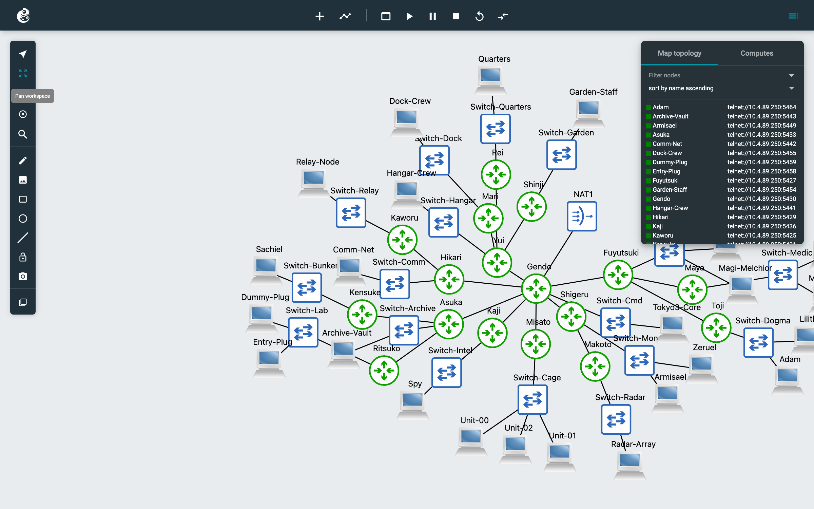

#### 2. listener `:80` + skrip Pen-Pen


#### 3. listener `:80` dan `:8080` Tokyo3-Core


#### 4. `Welcome to Pen-Pen` dari Lilith


#### 5. `Welcome to Tokyo3-Core` dari Lilith


#### 6. `syifa imutz` dari Lilith


#### 7. `Connection refused` cepat di kedua node


#### 8. isi `/root/Tokyo3-Core.sh`


---

<a id="soal-9"></a>

## Soal 9 — Jalur Belakang di Shigeru Disabotase (K-48)

### 1. Ringkasan

| Item | Hasil |
|---|---|
| Script sabotase | `break_routing.sh` dari asisten (Drive), SHA-256 `643d8498…5d68`, sama dengan file di `~/Downloads` |
| Eksekusi | dijalankan di **Shigeru** tanpa dibaca isinya → `Script sudah dirusak` |
| Gejala | Lilith → Armisael **100% packet loss**; Armisael → gateway tetap **4/4** |
| Penyebab ditemukan | **4** (lihat tabel di bawah) |
| Perbaikan | `/root/soal9_fix.sh` (idempoten) |
| Setelah perbaikan | Lilith → Armisael **4/4, 0% loss**; Armisael → internet **4/4** |
| `fail` | `[]` |

### 2. Gejala sebelum perbaikan

- `ping -c 4 192.235.4.83` dari Lilith → 4 terkirim, 0 diterima (100% loss).
- `ping -c 4 192.235.4.81` dari Armisael → 4/4 diterima (gateway masih hidup).
- `ping -c 4 8.8.8.8` dari Armisael → `Destination Host Unreachable` dari `192.235.4.81`.

Artinya LAN Switch-Monolith masih sehat, tetapi Shigeru gagal meneruskan/merutekan.

### 3. Semua penyebab

| # | Kondisi yang ditemukan di Shigeru | Efek |
|---|---|---|
| 1 | `net.ipv4.ip_forward = 0` | Router tidak meneruskan paket antar interface → balasan Armisael tidak sampai ke Lilith. |
| 2 | `default via 192.235.4.162 dev eth2` | Default route mengarah ke **Makoto**, bukan ke Gendo (`192.235.4.129`). Traffic internet salah arah. |
| 3 | `blackhole 192.235.4.72/29` | Subnet Lilith sengaja di-blackhole → paket ke Lilith dibuang. |
| 4 | `ip rule 90: from all iif eth0 lookup 100` + `unreachable default` di **table 100** | Semua paket yang **masuk lewat eth0** (LAN tempat Armisael) kena lookup tabel 100 dan dijawab *unreachable*. Inilah sebabnya Armisael masih bisa ping gateway (tujuan lokal masuk tabel `local`, prioritas 0) tetapi gagal ke internet, dan balasannya ke Lilith juga gagal. |

Keempatnya saling memperparah; memperbaiki satu saja tidak cukup.

### 4. Perbaikan

`/root/soal9_fix.sh` melakukan:

```sh
sysctl -w net.ipv4.ip_forward=1
ip route del blackhole 192.235.4.72/29
ip rule del iif eth0 lookup 100
ip route del default table 100
ip route replace default via 192.235.4.129 dev eth1
ip route replace 192.235.4.88/29 via 192.235.4.162 dev eth2
```

Rute Makoto (`192.235.4.88/29 via 192.235.4.162`) dipertahankan karena memang
rute bawah Shigeru dari soal 3. Salinan: `dokumen/soal9/configs/soal9_fix.sh`.

### 5. Pembuktian akhir

| Uji | Hasil |
|---|---|
| Lilith → Armisael `192.235.4.83` | **4/4, 0% packet loss** |
| Armisael → gateway `192.235.4.81` | **4/4, 0% packet loss** |
| Armisael → `8.8.8.8` | **4/4, 0% packet loss** |
| `ip rule` Shigeru | hanya `local`, `main`, `default` (_rule 100 hilang_) |
| `ip_forward` Shigeru | `1` |

Log: `dokumen/soal9/verify/break_run.txt`, `dokumen/soal9/verify/sabotage_state.txt`,
`dokumen/soal9/verify/repair_run.txt`, `dokumen/soal9/verify/final.txt`; ringkasan: `dokumen/soal9/summary.json`.

### 6. Bukti screenshot (asli, diambil saat pengerjaan)

| File | Isi |
|---|---|
| `assets/soal9/01-topologi-gns3.png` | Web UI GNS3 |
| `assets/soal9/02-break-script-run.png` | eksekusi `break_routing.sh` di Shigeru |
| `assets/soal9/03-sabotage-state.png` | blackhole, `ip_forward=0`, rule 90 + `unreachable default` table 100 |
| `assets/soal9/04-lilith-gagal.png` | Lilith → Armisael 100% loss saat sabotase |
| `assets/soal9/05-armisael-gateway-ok.png` | Armisael → gateway tetap 4/4 saat sabotase |
| `assets/soal9/06-fix-script.png` | isi `/root/soal9_fix.sh` |
| `assets/soal9/07-after-fix-state.png` | route + rule + `ip_forward` setelah perbaikan |
| `assets/soal9/08-lilith-pulih.png` | Lilith → Armisael 4/4, 0% loss |

Semuanya tangkapan layar langsung dari Web UI GNS3/konsol node, bukan gambar generate.
Script asisten tidak pernah dibaca isinya; diagnosis dilakukan murni dari gejala
dan state router.

### 7. Reproduksi

```bash
python3 build_soal9.py sabotage   # butuh break_routing.sh di workspace
python3 build_soal9.py diagnose
python3 build_soal9.py repair
python3 build_soal9.py verify
```

---

### Galeri bukti screenshot

Semua gambar di bawah adalah **tangkapan layar asli** yang diambil
saat pengerjaan (Web UI GNS3 dan konsol node), bukan gambar generate.

#### 1. Web UI GNS3


#### 2. eksekusi `break_routing.sh` di Shigeru


#### 3. blackhole, `ip_forward=0`, rule 90 + `unreachable default` table 100


#### 4. Lilith → Armisael 100% loss saat sabotase

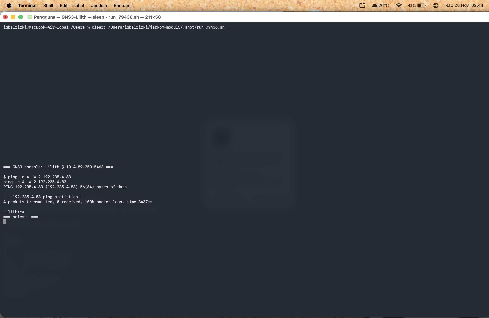

#### 5. Armisael → gateway tetap 4/4 saat sabotase


#### 6. isi `/root/soal9_fix.sh`


#### 7. route + rule + `ip_forward` setelah perbaikan


#### 8. Lilith → Armisael 4/4, 0% loss

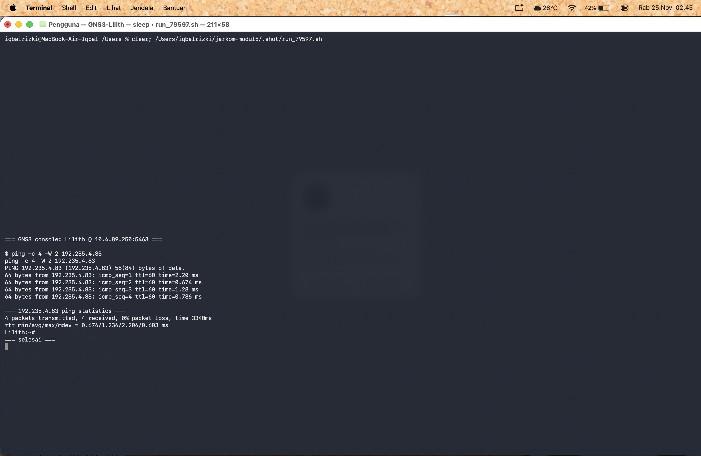

---

<a id="soal-10"></a>

## Soal 10 — Para Pilot Terkunci di Dalam (K-48)

### 1. Ringkasan

| Item | Hasil |
|---|---|
| Script sabotase | `break_nat.sh` dari asisten (`~/Downloads`), SHA-256 `cbadcd7e…47e9447e` |
| Eksekusi | dijalankan di **Misato** dan **Gendo** tanpa membaca isinya |
| Gejala | Unit-01/02/00 → `8.8.8.8` **100% loss**; Spy → `8.8.8.8` **4/4**; Unit-01 → Lilith dan gateway **normal** |
| Penyebab | **2** (satu di Misato, satu di Gendo) |
| Perbaikan | `/root/soal10_fix.sh` dijalankan di kedua router (idempoten) |
| Setelah perbaikan | Unit-01 → `8.8.8.8` **4/4**; counter MASQUERADE Gendo naik |
| Terjemahan sumber | terjadi di **Gendo** (`POSTROUTING`, `-o eth1`, NAT1) |
| `fail` | `[]` |

### 2. Gejala sebelum perbaikan

| Uji | Hasil |
|---|---|
| Unit-01 → `8.8.8.8` | 4 terkirim, 0 diterima (100% loss) |
| Unit-01 → Lilith `192.235.4.74` | 2/2, 0% loss → jalur internal sehat |
| Unit-01 → gateway Misato `192.235.4.65` | 2/2, 0% loss → LAN Cage sehat |
| Spy → `8.8.8.8` | 4/4, 0% loss → internet & NAT Gendo sehat |

Jadi masalahnya bukan routing internal/fisik, melainkan **translasi alamat sumber**.

### 3. Semua penyebab

| # | Node | Aturan yang ditambahkan script | Efek |
|---|---|---|---|
| 1 | **Misato** | `-A POSTROUTING -s 192.235.4.64/29 ! -d 192.235.0.0/16 -o eth1 -j SNAT --to-source 172.31.99.1` | Setiap paket Cage yang keluar ke internet diubah sumbernya menjadi `172.31.99.1` **di router internal**. Gendo hanya mengizinkan dan melakukan NAT untuk sumber `192.235.0.0/16`, sehingga paket dengan sumber `172.31.99.1` ditolak / tidak diterjemahkan. |
| 2 | **Gendo** | `-A POSTROUTING -s 192.235.4.64/29 -o eth1 -j RETURN` | Khusus subnet Cage, aturan `RETURN` ini mengabaikan aturan `MASQUERADE` (`-s 192.235.0.0/16 -o eth1`) di bawahnya. Jadi walaupun SNAT Misato dihapus, Cage tetap tidak mendapat NAT di router keluar. |

Keduanya harus dihapus; menghapus salah satu saja tidak cukup.

### 4. Kenapa Cage terdampak tetapi Intel tidak

- **Cage** (`192.235.4.64/29`) lewat **Misato → Gendo**. Kedua router disabotase: Misato mengganti sumber jadi `172.31.99.1`, Gendo mem-`RETURN`-kan subnet Cage sebelum `MASQUERADE`. Akibatnya tidak ada alamat publik yang sah untuk balasan, sehingga ping gagal.
- **Intel** (`192.235.4.48/29`) lewat **Kaji → Gendo**. Kaji **tidak** menjalankan script, jadi paket Spy sampai di Gendo dengan sumber asli `192.235.x.x` (masuk `192.235.0.0/16`). Firewall `FORWARD` mengizinkan dan aturan `MASQUERADE` di Gendo berfungsi normal. Itulah sebabnya Spy tetap bisa ping `8.8.8.8`.

Ping Cage → Lilith tetap normal karena tujuannya masih dalam `192.235.0.0/16`: aturan SNAT Misato memakai `! -d 192.235.0.0/16`, jadi tidak pernah kena untuk traffic internal.

### 5. Perbaikan

`/root/soal10_fix.sh` (sama di kedua router, memilih tindakan lewat `hostname`):

```sh
# Misato
iptables -t nat -D POSTROUTING -s 192.235.4.64/29 ! -d 192.235.0.0/16 \
  -o eth1 -j SNAT --to-source 172.31.99.1

# Gendo
iptables -t nat -D POSTROUTING -s 192.235.4.64/29 -o eth1 -j RETURN
```

Aturan `MASQUERADE` Gendo untuk `192.235.0.0/16` sengaja **dipertahankan**. Salinan skrip: `dokumen/soal10/configs/soal10_fix.sh`.

### 6. Pembuktian akhir & lokasi NAT

| Uji | Hasil |
|---|---|
| Unit-01 → `8.8.8.8` | **4/4, 0% packet loss** |
| Spy → `8.8.8.8` | **4/4, 0% packet loss** |
| Unit-01 → Lilith | **4/4, 0% packet loss** (tanpa NAT) |
| Misato `POSTROUTING` | hanya `-P ACCEPT` (SNAT hilang) |
| Gendo `POSTROUTING` | `-A POSTROUTING -s 192.235.0.0/16 -o eth1 -j MASQUERADE` |
| Counter MASQUERADE Gendo | naik saat Unit-01 ping internet (lihat `dokumen/soal10/verify/final.txt` dan screenshot `12`) |

**Alamat sumber diterjemahkan di router Gendo**, pada antarmuka `eth1` (ke NAT1), oleh aturan `MASQUERADE`. Misato hanya merutekan, tidak boleh melakukan NAT.

Log: `dokumen/soal10/verify/baseline.txt`, `dokumen/soal10/verify/break_run.txt`, `dokumen/soal10/verify/sabotage_state.txt`,
`dokumen/soal10/verify/repair_run.txt`, `dokumen/soal10/verify/final.txt`; ringkasan: `dokumen/soal10/summary.json`.

### 7. Bukti screenshot (asli, diambil saat pengerjaan)

| File | Isi |
|---|---|
| `assets/soal10/01-topologi-gns3.png` | Web UI GNS3 |
| `assets/soal10/02-break-misato.png` | eksekusi `break_nat.sh` di Misato |
| `assets/soal10/03-break-gendo.png` | eksekusi `break_nat.sh` di Gendo |
| `assets/soal10/04-state-misato.png` | SNAT `172.31.99.1` di Misato |
| `assets/soal10/05-state-gendo.png` | `RETURN` + `MASQUERADE` di Gendo |
| `assets/soal10/06-unit01-gagal.png` | Unit-01 → `8.8.8.8` 100% loss saat sabotase |
| `assets/soal10/07-spy-ok.png` | Spy → `8.8.8.8` tetap 4/4 saat sabotase |
| `assets/soal10/08-fix-script.png` | isi `/root/soal10_fix.sh` |
| `assets/soal10/09-after-fix-state.png` | Misato bersih setelah perbaikan |
| `assets/soal10/10-gendo-masquerade.png` | MASQUERADE Gendo tersisa |
| `assets/soal10/11-unit01-pulih.png` | Unit-01 → `8.8.8.8` 4/4 |
| `assets/soal10/12-nat-counter.png` | counter MASQUERADE naik sebelum/sesudah ping |

Semuanya tangkapan layar langsung dari Web UI GNS3/konsol node, bukan gambar generate.
Script asisten tidak dibaca isinya; diagnosis dilakukan dari gejala dan aturan yang
terlihat di router.

### 8. Reproduksi

```bash
python3 build_soal10.py sabotage   # butuh break_nat.sh di workspace
python3 build_soal10.py diagnose
python3 build_soal10.py repair
python3 build_soal10.py verify
```

---

### Galeri bukti screenshot

Semua gambar di bawah adalah **tangkapan layar asli** yang diambil
saat pengerjaan (Web UI GNS3 dan konsol node), bukan gambar generate.

#### 1. Web UI GNS3


#### 2. eksekusi `break_nat.sh` di Misato


#### 3. eksekusi `break_nat.sh` di Gendo


#### 4. SNAT `172.31.99.1` di Misato


#### 5. `RETURN` + `MASQUERADE` di Gendo


#### 6. Unit-01 → `8.8.8.8` 100% loss saat sabotase


#### 7. Spy → `8.8.8.8` tetap 4/4 saat sabotase


#### 8. isi `/root/soal10_fix.sh`


#### 9. Misato bersih setelah perbaikan

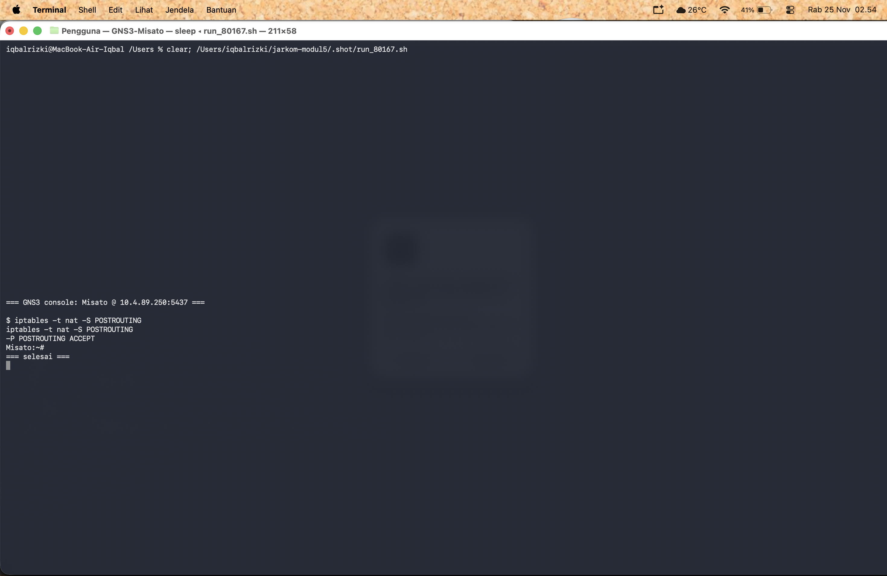

#### 10. MASQUERADE Gendo tersisa


#### 11. Unit-01 → `8.8.8.8` 4/4


#### 12. counter MASQUERADE naik sebelum/sesudah ping

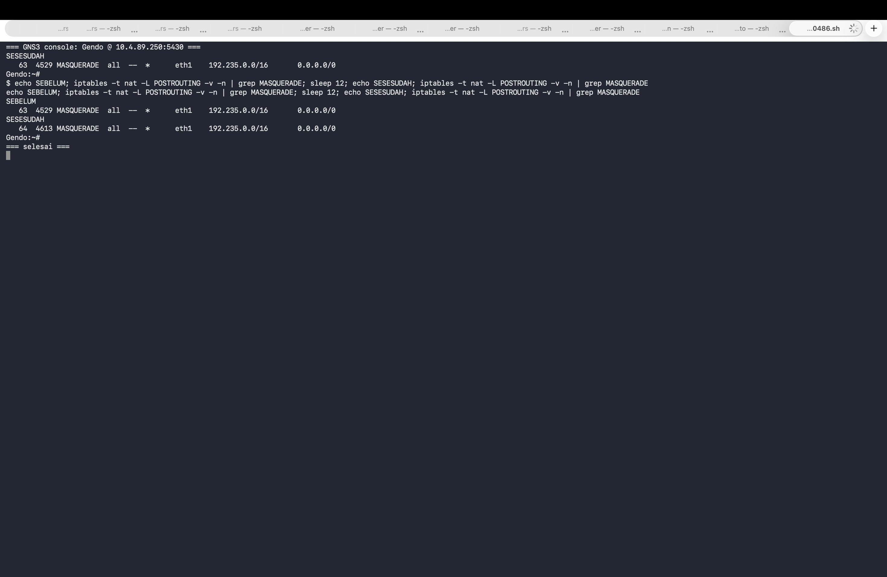

