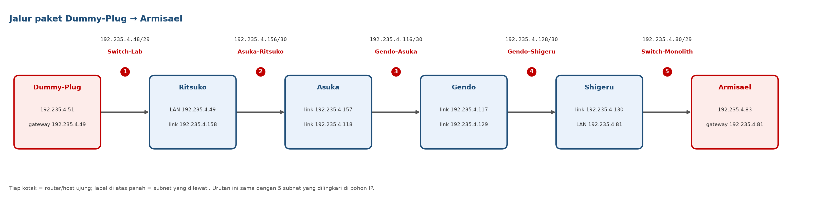
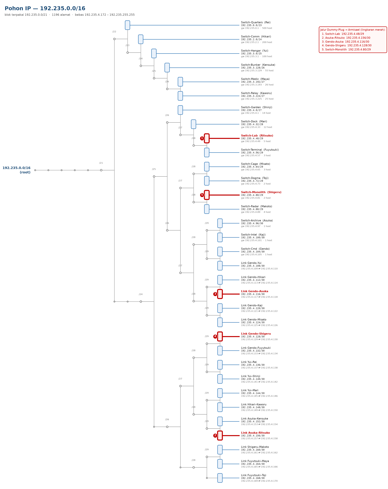

# Laporan Soal 1 — VLSM Operation Geofront (K-48)

## 1. Asumsi

- Prefix kelompok yang dipakai: **`192.235.0.0/16`** (interpretasi dari `192.235.x.x`;
  jika asisten memberi CIDR lain, jalankan `python3 generate_soal1.py <prefix/cidr>`,
  seluruh tabel dan gambar ikut berubah).
- Gateway setiap LAN = **IP usable pertama**.
- Host pada satu switch mendapat IP usable berikutnya, urut kiri→kanan sesuai gambar.
- Kebutuhan usable satu LAN = jumlah host + 1 gateway.
- Link router–router memakai **/30** (2 IP).
- Urutan VLSM: blok terbesar dulu; ukuran sama → LAN dulu, lalu urutan tabel.

## 2. Rekap pembagian

| Blok | Prefix | Jumlah |
|---|---|---|
| LAN Quarters | /23 | 512 |
| LAN Comm | /24 | 256 |
| LAN Hangar | /25 | 128 |
| LAN Bunker | /26 | 64 |
| LAN Medic, Relay, Garden | /27 | 3 × 32 |
| LAN Dock | /28 | 16 |
| LAN Lab, Terminal, Cage, Dogma, Monolith, Radar | /29 | 6 × 8 |
| LAN Archive, Intel, Cmd | /30 | 3 × 4 |
| 16 link router | /30 | 16 × 4 |

Total = **1196 alamat**, sehingga prefix kelompok minimal **/21**.
Dengan `192.235.0.0/16`, blok terpakai adalah
`192.235.0.0/21` (192.235.0.0 – 192.235.7.255),
dan alamat `192.235.4.172` – `192.235.255.255` masih bebas.

## 3. Contoh hitungan satu subnet (Quarters)

1. Kebutuhan host: **500** container/host.
2. Tambah gateway: 500 + 1 = **501 usable**.
3. Cari prefix terkecil dengan `2^(32-p) - 2 ≥ 501`:
   - /24 → 254 (tidak muat)
   - /23 → **510 (muat)**
4. Network `192.235.0.0/23`, netmask `255.255.254.0`.
5. Gateway = usable pertama = **192.235.0.1**.
6. Broadcast = **192.235.1.255**.
7. Terpakai = 1 gateway + 500 host = **501**; sisa = 510 − 501 = **9**.
8. Host pertama (Quarters) = `192.235.0.2`.

Contoh kasus batas:
- **Garden** 14 host → 14 + 1 = 15 usable. /28 hanya 14 → tidak muat, jadi **/27** (30 usable).
- **Lab** 5 host → 6 usable. /29 punya tepat 6 → **/29**, sisa 0.
- **Cmd** 1 host → 2 usable. /30 punya tepat 2 → **/30**, sisa 0.

Tabel lengkap: lihat `dokumen/soal1/tabel_vlsm.xlsx` (sheet **Tabel VLSM**, **Alamat Host**, **Alamat Link**)
atau `dokumen/soal1/tabel_subnet.csv`, `dokumen/soal1/alamat_host.csv`, `dokumen/soal1/alamat_link.csv`.

## 4. Pohon IP dan jalur Dummy-Plug → Armisael

Gambar: **`assets/soal1/pohon_ip.png`** (pohon alokasi prefix) dan **`assets/soal1/jalur_dummy_armisael.png`**
(diagram jalur hop-per-hop).

Jalur paket Dummy-Plug menuju Armisael melewati 5 subnet berikut (dilingkari merah):

| Urutan | Subnet | CIDR | Keterangan |
|---:|---|---|---|
| 1 | Switch-Lab | `192.235.4.48/29` | LAN asal Dummy-Plug (`192.235.4.51`) |
| 2 | Asuka–Ritsuko | `192.235.4.156/30` | Ritsuko → Asuka |
| 3 | Gendo–Asuka | `192.235.4.116/30` | Asuka → Gendo |
| 4 | Gendo–Shigeru | `192.235.4.128/30` | Gendo → Shigeru |
| 5 | Switch-Monolith | `192.235.4.80/29` | LAN Armisael (`192.235.4.83`) |

## 5. Verifikasi

- 33 blok (17 LAN + 16 link), tidak ada overlap, semuanya berada di dalam `192.235.0.0/16`.
- Setiap blok dialokasikan pada batas alignment prefix-nya.
- Jumlah alamat terpakai: **1196**; sisa pada /16: **64340**.

---

## Lampiran tabel

# VLSM Modul 5 — base `192.235.0.0/16`

## Tabel subnet (urut VLSM)

| No | Jenis | Subnet | Prefix | Network | Gateway | Broadcast | IP terpakai | Sisa |
|---:|:------|:-------|:------:|:--------|:--------|:----------|------------:|-----:|
| 1 | LAN | LAN Switch-Quarters (Rei) | /23 | 192.235.0.0 | 192.235.0.1 | 192.235.1.255 | 501 | 9 |
| 2 | LAN | LAN Switch-Comm (Hikari) | /24 | 192.235.2.0 | 192.235.2.1 | 192.235.2.255 | 201 | 53 |
| 3 | LAN | LAN Switch-Hangar (Yui) | /25 | 192.235.3.0 | 192.235.3.1 | 192.235.3.127 | 101 | 25 |
| 4 | LAN | LAN Switch-Bunker (Kensuke) | /26 | 192.235.3.128 | 192.235.3.129 | 192.235.3.191 | 56 | 6 |
| 5 | LAN | LAN Switch-Medic (Maya) | /27 | 192.235.3.192 | 192.235.3.193 | 192.235.3.223 | 27 | 3 |
| 6 | LAN | LAN Switch-Relay (Kaworu) | /27 | 192.235.3.224 | 192.235.3.225 | 192.235.3.255 | 26 | 4 |
| 7 | LAN | LAN Switch-Garden (Shinji) | /27 | 192.235.4.0 | 192.235.4.1 | 192.235.4.31 | 15 | 15 |
| 8 | LAN | LAN Switch-Dock (Mari) | /28 | 192.235.4.32 | 192.235.4.33 | 192.235.4.47 | 13 | 1 |
| 9 | LAN | LAN Switch-Lab (Ritsuko) | /29 | 192.235.4.48 | 192.235.4.49 | 192.235.4.55 | 6 | 0 |
| 10 | LAN | LAN Switch-Terminal (Fuyutsuki) | /29 | 192.235.4.56 | 192.235.4.57 | 192.235.4.63 | 4 | 2 |
| 11 | LAN | LAN Switch-Cage (Misato) | /29 | 192.235.4.64 | 192.235.4.65 | 192.235.4.71 | 4 | 2 |
| 12 | LAN | LAN Switch-Dogma (Toji) | /29 | 192.235.4.72 | 192.235.4.73 | 192.235.4.79 | 3 | 3 |
| 13 | LAN | LAN Switch-Monolith (Shigeru) | /29 | 192.235.4.80 | 192.235.4.81 | 192.235.4.87 | 3 | 3 |
| 14 | LAN | LAN Switch-Radar (Makoto) | /29 | 192.235.4.88 | 192.235.4.89 | 192.235.4.95 | 5 | 1 |
| 15 | LAN | LAN Switch-Archive (Asuka) | /30 | 192.235.4.96 | 192.235.4.97 | 192.235.4.99 | 2 | 0 |
| 16 | LAN | LAN Switch-Intel (Kaji) | /30 | 192.235.4.100 | 192.235.4.101 | 192.235.4.103 | 2 | 0 |
| 17 | LAN | LAN Switch-Cmd (Gendo) | /30 | 192.235.4.104 | 192.235.4.105 | 192.235.4.107 | 2 | 0 |
| 18 | Link | Link Gendo–Yui | /30 | 192.235.4.108 | 192.235.4.109 | 192.235.4.111 | 2 | 0 |
| 19 | Link | Link Gendo–Hikari | /30 | 192.235.4.112 | 192.235.4.113 | 192.235.4.115 | 2 | 0 |
| 20 | Link | Link Gendo–Asuka | /30 | 192.235.4.116 | 192.235.4.117 | 192.235.4.119 | 2 | 0 |
| 21 | Link | Link Gendo–Kaji | /30 | 192.235.4.120 | 192.235.4.121 | 192.235.4.123 | 2 | 0 |
| 22 | Link | Link Gendo–Misato | /30 | 192.235.4.124 | 192.235.4.125 | 192.235.4.127 | 2 | 0 |
| 23 | Link | Link Gendo–Shigeru | /30 | 192.235.4.128 | 192.235.4.129 | 192.235.4.131 | 2 | 0 |
| 24 | Link | Link Gendo–Fuyutsuki | /30 | 192.235.4.132 | 192.235.4.133 | 192.235.4.135 | 2 | 0 |
| 25 | Link | Link Yui–Rei | /30 | 192.235.4.136 | 192.235.4.137 | 192.235.4.139 | 2 | 0 |
| 26 | Link | Link Yui–Shinji | /30 | 192.235.4.140 | 192.235.4.141 | 192.235.4.143 | 2 | 0 |
| 27 | Link | Link Yui–Mari | /30 | 192.235.4.144 | 192.235.4.145 | 192.235.4.147 | 2 | 0 |
| 28 | Link | Link Hikari–Kaworu | /30 | 192.235.4.148 | 192.235.4.149 | 192.235.4.151 | 2 | 0 |
| 29 | Link | Link Asuka–Kensuke | /30 | 192.235.4.152 | 192.235.4.153 | 192.235.4.155 | 2 | 0 |
| 30 | Link | Link Asuka–Ritsuko | /30 | 192.235.4.156 | 192.235.4.157 | 192.235.4.159 | 2 | 0 |
| 31 | Link | Link Shigeru–Makoto | /30 | 192.235.4.160 | 192.235.4.161 | 192.235.4.163 | 2 | 0 |
| 32 | Link | Link Fuyutsuki–Maya | /30 | 192.235.4.164 | 192.235.4.165 | 192.235.4.167 | 2 | 0 |
| 33 | Link | Link Fuyutsuki–Toji | /30 | 192.235.4.168 | 192.235.4.169 | 192.235.4.171 | 2 | 0 |

## Alamat host per container

| Switch | Container | Host | IP | Gateway |
|:--|:--|--:|:--|:--|
| Switch-Quarters | Quarters | 500 | 192.235.0.2 | 192.235.0.1 |
| Switch-Comm | Comm-Net | 200 | 192.235.2.2 | 192.235.2.1 |
| Switch-Hangar | Hangar-Crew | 100 | 192.235.3.2 | 192.235.3.1 |
| Switch-Bunker | Sachiel | 55 | 192.235.3.130 | 192.235.3.129 |
| Switch-Medic | Pen-Pen | 1 | 192.235.3.194 | 192.235.3.193 |
| Switch-Medic | Medic-Bay | 25 | 192.235.3.195 | 192.235.3.193 |
| Switch-Relay | Relay-Node | 25 | 192.235.3.226 | 192.235.3.225 |
| Switch-Garden | Garden-Staff | 14 | 192.235.4.2 | 192.235.4.1 |
| Switch-Dock | Dock-Crew | 12 | 192.235.4.34 | 192.235.4.33 |
| Switch-Lab | Entry-Plug | 3 | 192.235.4.50 | 192.235.4.49 |
| Switch-Lab | Dummy-Plug | 2 | 192.235.4.51 | 192.235.4.49 |
| Switch-Terminal | Magi-Casper | 1 | 192.235.4.58 | 192.235.4.57 |
| Switch-Terminal | Magi-Balthasar | 1 | 192.235.4.59 | 192.235.4.57 |
| Switch-Terminal | Magi-Melchior | 1 | 192.235.4.60 | 192.235.4.57 |
| Switch-Cage | Unit-01 | 1 | 192.235.4.66 | 192.235.4.65 |
| Switch-Cage | Unit-02 | 1 | 192.235.4.67 | 192.235.4.65 |
| Switch-Cage | Unit-00 | 1 | 192.235.4.68 | 192.235.4.65 |
| Switch-Dogma | Lilith | 1 | 192.235.4.74 | 192.235.4.73 |
| Switch-Dogma | Adam | 1 | 192.235.4.75 | 192.235.4.73 |
| Switch-Monolith | Zeruel | 1 | 192.235.4.82 | 192.235.4.81 |
| Switch-Monolith | Armisael | 1 | 192.235.4.83 | 192.235.4.81 |
| Switch-Radar | Radar-Array | 4 | 192.235.4.90 | 192.235.4.89 |
| Switch-Archive | Archive-Vault | 1 | 192.235.4.98 | 192.235.4.97 |
| Switch-Intel | Spy | 1 | 192.235.4.102 | 192.235.4.101 |
| Switch-Cmd | Tokyo3-Core | 1 | 192.235.4.106 | 192.235.4.105 |

## Alamat interface link router

| Link | Network | Sisi parent | Sisi child |
|:--|:--|:--|:--|
| Gendo–Yui | 192.235.4.108/30 | Gendo = 192.235.4.109 | Yui = 192.235.4.110 |
| Gendo–Hikari | 192.235.4.112/30 | Gendo = 192.235.4.113 | Hikari = 192.235.4.114 |
| Gendo–Asuka | 192.235.4.116/30 | Gendo = 192.235.4.117 | Asuka = 192.235.4.118 |
| Gendo–Kaji | 192.235.4.120/30 | Gendo = 192.235.4.121 | Kaji = 192.235.4.122 |
| Gendo–Misato | 192.235.4.124/30 | Gendo = 192.235.4.125 | Misato = 192.235.4.126 |
| Gendo–Shigeru | 192.235.4.128/30 | Gendo = 192.235.4.129 | Shigeru = 192.235.4.130 |
| Gendo–Fuyutsuki | 192.235.4.132/30 | Gendo = 192.235.4.133 | Fuyutsuki = 192.235.4.134 |
| Yui–Rei | 192.235.4.136/30 | Yui = 192.235.4.137 | Rei = 192.235.4.138 |
| Yui–Shinji | 192.235.4.140/30 | Yui = 192.235.4.141 | Shinji = 192.235.4.142 |
| Yui–Mari | 192.235.4.144/30 | Yui = 192.235.4.145 | Mari = 192.235.4.146 |
| Hikari–Kaworu | 192.235.4.148/30 | Hikari = 192.235.4.149 | Kaworu = 192.235.4.150 |
| Asuka–Kensuke | 192.235.4.152/30 | Asuka = 192.235.4.153 | Kensuke = 192.235.4.154 |
| Asuka–Ritsuko | 192.235.4.156/30 | Asuka = 192.235.4.157 | Ritsuko = 192.235.4.158 |
| Shigeru–Makoto | 192.235.4.160/30 | Shigeru = 192.235.4.161 | Makoto = 192.235.4.162 |
| Fuyutsuki–Maya | 192.235.4.164/30 | Fuyutsuki = 192.235.4.165 | Maya = 192.235.4.166 |
| Fuyutsuki–Toji | 192.235.4.168/30 | Fuyutsuki = 192.235.4.169 | Toji = 192.235.4.170 |

Total terpakai: **1196 alamat** (`192.235.0.0` – `192.235.4.171`), sisa blok: **64340 alamat**.

---

## Galeri bukti screenshot

Semua gambar di bawah adalah **tangkapan layar asli** yang diambil
saat pengerjaan (Web UI GNS3 dan konsol node), bukan gambar generate.

### 1. Jalur dummy armisael

### 2. Pohon ip

