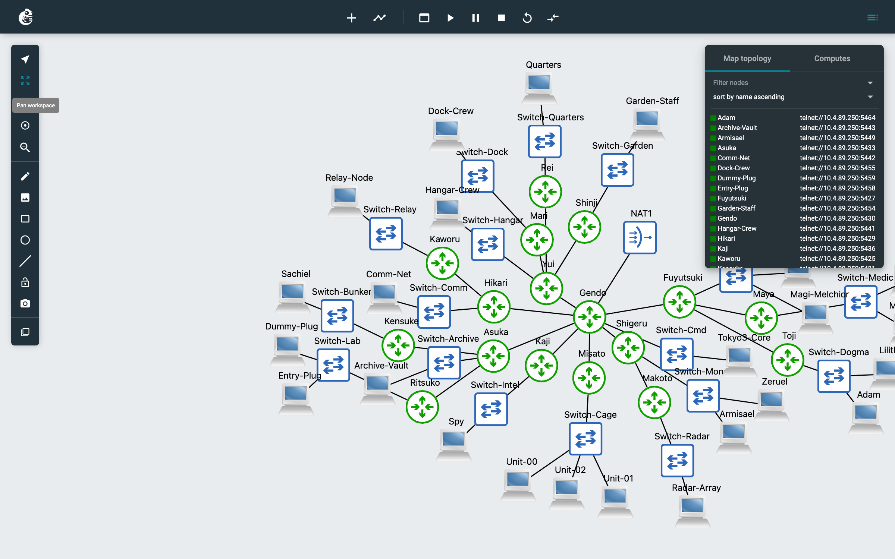
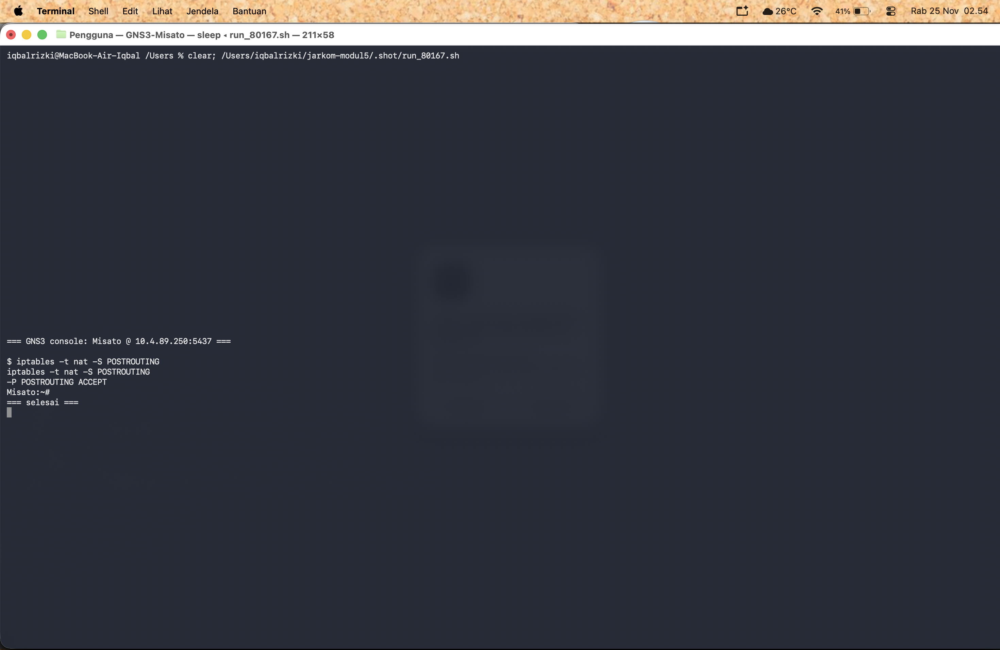
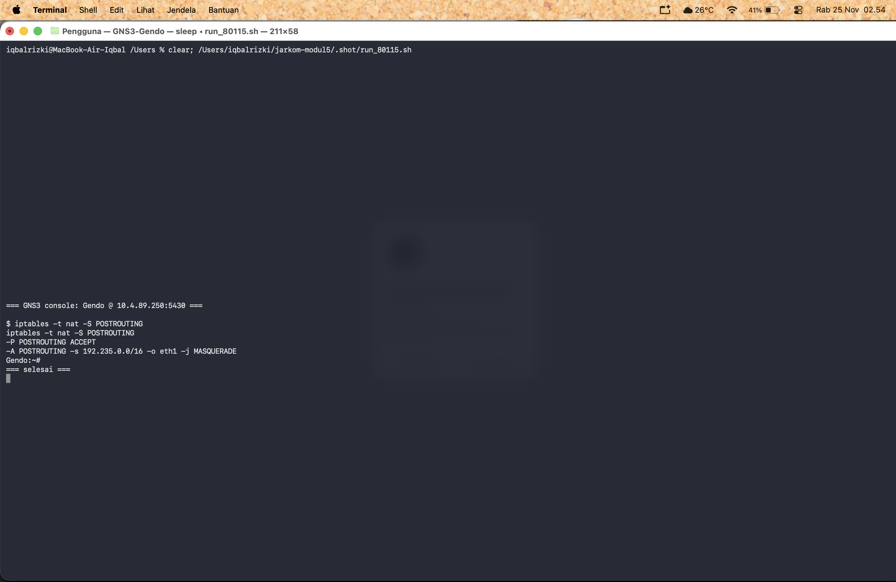
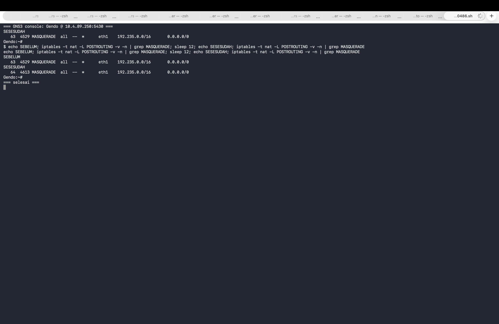

# Laporan Soal 10 — Para Pilot Terkunci di Dalam (K-48)

## 1. Ringkasan

| Item | Hasil |
|---|---|
| Script sabotase | `break_nat.sh` dari asisten (`~/Downloads`), SHA-256 `cbadcd7e…47e9447e` |
| Eksekusi | dijalankan di **Misato** dan **Gendo** tanpa membaca isinya |
| Gejala | Unit-01/02/00 → `8.8.8.8` **100% loss**; Spy → `8.8.8.8` **4/4**; Unit-01 → Lilith dan gateway **normal** |
| Penyebab | **2** (satu di Misato, satu di Gendo) |
| Perbaikan | `/root/soal10_fix.sh` dijalankan di kedua router (idempoten) |
| Setelah perbaikan | Unit-01 → `8.8.8.8` **4/4**; counter MASQUERADE Gendo naik |
| Terjemahan sumber | terjadi di **Gendo** (`POSTROUTING`, `-o eth1`, NAT1) |
| `fail` | `[]` |

## 2. Gejala sebelum perbaikan

| Uji | Hasil |
|---|---|
| Unit-01 → `8.8.8.8` | 4 terkirim, 0 diterima (100% loss) |
| Unit-01 → Lilith `192.235.4.74` | 2/2, 0% loss → jalur internal sehat |
| Unit-01 → gateway Misato `192.235.4.65` | 2/2, 0% loss → LAN Cage sehat |
| Spy → `8.8.8.8` | 4/4, 0% loss → internet & NAT Gendo sehat |

Jadi masalahnya bukan routing internal/fisik, melainkan **translasi alamat sumber**.

## 3. Semua penyebab

| # | Node | Aturan yang ditambahkan script | Efek |
|---|---|---|---|
| 1 | **Misato** | `-A POSTROUTING -s 192.235.4.64/29 ! -d 192.235.0.0/16 -o eth1 -j SNAT --to-source 172.31.99.1` | Setiap paket Cage yang keluar ke internet diubah sumbernya menjadi `172.31.99.1` **di router internal**. Gendo hanya mengizinkan dan melakukan NAT untuk sumber `192.235.0.0/16`, sehingga paket dengan sumber `172.31.99.1` ditolak / tidak diterjemahkan. |
| 2 | **Gendo** | `-A POSTROUTING -s 192.235.4.64/29 -o eth1 -j RETURN` | Khusus subnet Cage, aturan `RETURN` ini mengabaikan aturan `MASQUERADE` (`-s 192.235.0.0/16 -o eth1`) di bawahnya. Jadi walaupun SNAT Misato dihapus, Cage tetap tidak mendapat NAT di router keluar. |

Keduanya harus dihapus; menghapus salah satu saja tidak cukup.

## 4. Kenapa Cage terdampak tetapi Intel tidak

- **Cage** (`192.235.4.64/29`) lewat **Misato → Gendo**. Kedua router disabotase: Misato mengganti sumber jadi `172.31.99.1`, Gendo mem-`RETURN`-kan subnet Cage sebelum `MASQUERADE`. Akibatnya tidak ada alamat publik yang sah untuk balasan, sehingga ping gagal.
- **Intel** (`192.235.4.48/29`) lewat **Kaji → Gendo**. Kaji **tidak** menjalankan script, jadi paket Spy sampai di Gendo dengan sumber asli `192.235.x.x` (masuk `192.235.0.0/16`). Firewall `FORWARD` mengizinkan dan aturan `MASQUERADE` di Gendo berfungsi normal. Itulah sebabnya Spy tetap bisa ping `8.8.8.8`.

Ping Cage → Lilith tetap normal karena tujuannya masih dalam `192.235.0.0/16`: aturan SNAT Misato memakai `! -d 192.235.0.0/16`, jadi tidak pernah kena untuk traffic internal.

## 5. Perbaikan

`/root/soal10_fix.sh` (sama di kedua router, memilih tindakan lewat `hostname`):

```sh
# Misato
iptables -t nat -D POSTROUTING -s 192.235.4.64/29 ! -d 192.235.0.0/16 \
  -o eth1 -j SNAT --to-source 172.31.99.1

# Gendo
iptables -t nat -D POSTROUTING -s 192.235.4.64/29 -o eth1 -j RETURN
```

Aturan `MASQUERADE` Gendo untuk `192.235.0.0/16` sengaja **dipertahankan**. Salinan skrip: `dokumen/soal10/configs/soal10_fix.sh`.

## 6. Pembuktian akhir & lokasi NAT

| Uji | Hasil |
|---|---|
| Unit-01 → `8.8.8.8` | **4/4, 0% packet loss** |
| Spy → `8.8.8.8` | **4/4, 0% packet loss** |
| Unit-01 → Lilith | **4/4, 0% packet loss** (tanpa NAT) |
| Misato `POSTROUTING` | hanya `-P ACCEPT` (SNAT hilang) |
| Gendo `POSTROUTING` | `-A POSTROUTING -s 192.235.0.0/16 -o eth1 -j MASQUERADE` |
| Counter MASQUERADE Gendo | naik saat Unit-01 ping internet (lihat `dokumen/soal10/verify/final.txt` dan screenshot `12`) |

**Alamat sumber diterjemahkan di router Gendo**, pada antarmuka `eth1` (ke NAT1), oleh aturan `MASQUERADE`. Misato hanya merutekan, tidak boleh melakukan NAT.

Log: `dokumen/soal10/verify/baseline.txt`, `dokumen/soal10/verify/break_run.txt`, `dokumen/soal10/verify/sabotage_state.txt`,
`dokumen/soal10/verify/repair_run.txt`, `dokumen/soal10/verify/final.txt`; ringkasan: `dokumen/soal10/summary.json`.

## 7. Bukti screenshot (asli, diambil saat pengerjaan)

| File | Isi |
|---|---|
| `assets/soal10/01-topologi-gns3.png` | Web UI GNS3 |
| `assets/soal10/02-break-misato.png` | eksekusi `break_nat.sh` di Misato |
| `assets/soal10/03-break-gendo.png` | eksekusi `break_nat.sh` di Gendo |
| `assets/soal10/04-state-misato.png` | SNAT `172.31.99.1` di Misato |
| `assets/soal10/05-state-gendo.png` | `RETURN` + `MASQUERADE` di Gendo |
| `assets/soal10/06-unit01-gagal.png` | Unit-01 → `8.8.8.8` 100% loss saat sabotase |
| `assets/soal10/07-spy-ok.png` | Spy → `8.8.8.8` tetap 4/4 saat sabotase |
| `assets/soal10/08-fix-script.png` | isi `/root/soal10_fix.sh` |
| `assets/soal10/09-after-fix-state.png` | Misato bersih setelah perbaikan |
| `assets/soal10/10-gendo-masquerade.png` | MASQUERADE Gendo tersisa |
| `assets/soal10/11-unit01-pulih.png` | Unit-01 → `8.8.8.8` 4/4 |
| `assets/soal10/12-nat-counter.png` | counter MASQUERADE naik sebelum/sesudah ping |

Semuanya tangkapan layar langsung dari Web UI GNS3/konsol node, bukan gambar generate.
Script asisten tidak dibaca isinya; diagnosis dilakukan dari gejala dan aturan yang
terlihat di router.

## 8. Reproduksi

```bash
python3 build_soal10.py sabotage   # butuh break_nat.sh di workspace
python3 build_soal10.py diagnose
python3 build_soal10.py repair
python3 build_soal10.py verify
```

---

## Galeri bukti screenshot

Semua gambar di bawah adalah **tangkapan layar asli** yang diambil
saat pengerjaan (Web UI GNS3 dan konsol node), bukan gambar generate.

### 1. Web UI GNS3



### 2. eksekusi `break_nat.sh` di Misato


### 3. eksekusi `break_nat.sh` di Gendo


### 4. SNAT `172.31.99.1` di Misato


### 5. `RETURN` + `MASQUERADE` di Gendo


### 6. Unit-01 → `8.8.8.8` 100% loss saat sabotase


### 7. Spy → `8.8.8.8` tetap 4/4 saat sabotase


### 8. isi `/root/soal10_fix.sh`


### 9. Misato bersih setelah perbaikan



### 10. MASQUERADE Gendo tersisa



### 11. Unit-01 → `8.8.8.8` 4/4


### 12. counter MASQUERADE naik sebelum/sesudah ping



