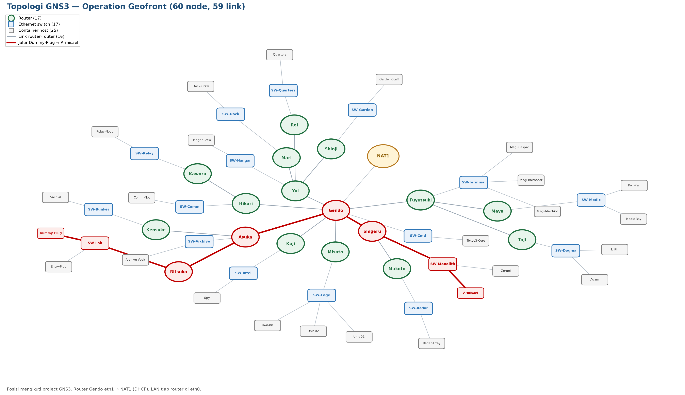

# Laporan Soal 2 — Membangun Geofront di GNS3 (K-48)

Project: `K-48-MODUL-5` (`36e5ac5a-5ae2-442b-b9c3-fe64af4e3336`)
Controller: `http://10.4.89.250:3080`

## 1. Ringkasan hasil

| Item | Target | Hasil |
|---|---|---|
| Router | 17 | **17** |
| Ethernet switch | 17 | **17** |
| Container host | 25 | **25** |
| NAT | 1 (NAT1) | **1** |
| Total node | 60 | **60** |
| Total link | 59 | **59** |
| Router IP terpasang | 17 | **17 OK** |
| `ip_forward=1` | 17 | **17 OK** |
| Ping ujung link router–router | 16 | **16 OK, 0% loss** |
| Gendo DHCP dari NAT1 | ya | **ya** (`192.168.122.x`) |

Tidak ada IP ganda di seluruh interface router (dicek otomatis dari `dokumen/soal2/ip_br.txt`).
Semua IP router cocok dengan `vlsm_plan.json` buatan Soal 1.

## 2. Pembagian interface

| Peran | Interface | Keterangan |
|---|---|---|
| LAN router | `eth0` | gateway subnet LAN, IP usable pertama |
| Link ke router lain | `eth1`, `eth2`, … | /30, parent `.1`, child `.2` |
| Gendo → NAT1 | `eth1` | DHCP dari NAT1 |
| Gendo → anak | `eth2`–`eth8` | 7 link |
| Link LAN ke switch | router `eth0` ↔ switch port 0 | host di port 1, 2, 3 |

Contoh Gendo (9 adapter):

```
eth0  192.235.4.105/30   Switch-Cmd (LAN)
eth1  192.168.122.66/24  NAT1 (DHCP)
eth2  192.235.4.109/30   Yui
eth3  192.235.4.113/30   Hikari
eth4  192.235.4.117/30   Asuka
eth5  192.235.4.121/30   Kaji
eth6  192.235.4.125/30   Misato
eth7  192.235.4.129/30   Shigeru
eth8  192.235.4.133/30   Fuyutsuki
```

`ip -br` seluruh router ada di **`dokumen/soal2/ip_br.txt`**.

## 3. Konfigurasi

Script tiap router dikirim ke **`/root/soal2.sh`** di dalam container (sesuai aturan
praktikum), lalu dijalankan. Isi script:

```sh
sysctl -w net.ipv4.ip_forward=1
grep -q '^net.ipv4.ip_forward=1' /etc/sysctl.conf || echo ... >> /etc/sysctl.conf
ip link set ethX up
ip addr flush dev ethX
ip addr add <ip>/<prefix> dev ethX
# khusus Gendo eth1:
udhcpc -i eth1 -q -n -t 10
```

Salinan script: **`dokumen/soal2/configs/<Router>.sh`**. Log eksekusi: **`dokumen/soal2/config_log.txt`**.

## 4. Bukti ping antar-link

Semua 16 link diuji dari sisi parent ke IP child:

```
Gendo→Yui, Gendo→Hikari, Gendo→Asuka, Gendo→Kaji, Gendo→Misato,
Gendo→Shigeru, Gendo→Fuyutsuki, Yui→Rei, Yui→Shinji, Yui→Mari,
Hikari→Kaworu, Asuka→Kensuke, Asuka→Ritsuko, Shigeru→Makoto,
Fuyutsuki→Maya, Fuyutsuki→Toji
```

Hasil lengkap: **`dokumen/soal2/ping_links.txt`** (semua `0% packet loss`, `__RC=0__`).

## 5. DHCP Gendo

```
eth1  UNKNOWN  192.168.122.66/24
default via 192.168.122.1 dev eth1
```

Bukti: **`dokumen/soal2/gendo_dhcp.txt`**. Hanya Gendo yang tersambung ke NAT1.

## 6. Catatan

- Host **belum** diberi IP permanen. Soal 2 hanya meminta IP interface router;
  soal 3–5 memakai IP sementara pada node uji, IP permanen baru di soal 6.
- Container host memakai `alpinet`, kecuali tiga node MAGI memakai `debinet`
  (butuh `apt-get` pada soal berikutnya).
- Router memakai `ardhptr21/alpinet:latest`, adapters disesuaikan jumlah link
  (Gendo 9, Yui 5, Asuka/Fuyutsuki 4, Hikari/Shigeru 3, sisanya 2).

## 7. File

| File | Isi |
|---|---|
| `assets/soal2/topologi_gns3.png` | pratinjau topologi (posisi sama dengan project) |
| `dokumen/soal2/ip_br.txt` | `ip -br a` + tabel route 17 router |
| `dokumen/soal2/ping_links.txt` | hasil ping 16 link |
| `dokumen/soal2/ip_forward.txt` | status `ip_forward` tiap router |
| `dokumen/soal2/gendo_dhcp.txt` | DHCP + route Gendo |
| `dokumen/soal2/configs/*.sh` | script tiap router (juga ada di `/root/soal2.sh`) |
| `dokumen/soal2/config_log.txt` | log eksekusi script |
| `dokumen/soal2/summary.json` | ringkasan mesin: node, link, ping gagal, forwarding |
| `dokumen/soal2/node_ids.json` | mapping nama node → node_id GNS3 |

Regenerasi: `python3 build_soal2.py all` (atau `clean` / `build` / `config`).

---

## Galeri bukti screenshot

Semua gambar di bawah adalah **tangkapan layar asli** yang diambil
saat pengerjaan (Web UI GNS3 dan konsol node), bukan gambar generate.

### 1. pratinjau topologi (posisi sama dengan project)



