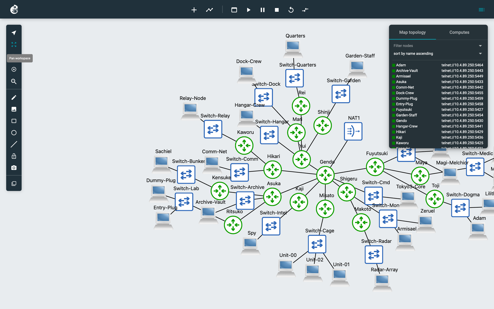

# Laporan Soal 3 — Routing Statis Geofront (K-48)

## 1. Ringkasan

| Item | Hasil |
|---|---|
| Router dengan routing statis | 17/17 |
| Rute subnet statis | **31** |
| Default route statis | **16** (semua router kecuali Gendo) |
| Default Gendo | dari DHCP NAT1 (`192.168.122.1`) |
| Node uji ber-IP sementara | 4 (Armisael, Lilith, Sachiel, Comm-Net) |
| Armisael → Lilith / Sachiel / Comm-Net | **3/3 berhasil, 0% packet loss** |

Script: `/root/soal3.sh` di tiap router dan host uji. Salinan lokal:
`dokumen/soal3/configs/<router>.sh`, `dokumen/soal3/configs/host_<nama>.sh`.

## 2. Prinsip routing

- **Non-Gendo:** satu `default route` ke router induk + rute ke subnet di bawahnya.
- **Gendo:** rute ke semua cabang; default route tetap memakai DHCP dari NAT1
  (tidak ditulis statis agar tidak perlu diubah saat IP NAT1 berganti — dipakai lagi di soal 4).
- **Ringkasan (summarization):** blok-blok dalam satu cabang digabung hanya jika
  hasil penggabungannya **tepat** (pasangan sibling /30→/29, /29→/28, …).
  Penggabungan lintas cabang tidak dilakukan karena next-hop berbeda.

Contoh ringkasan yang benar-benar terjadi:

| Cabang | Blok asal | Ringkasan |
|---|---|---|
| Shigeru → Makoto | `192.235.4.80/29` + `192.235.4.88/29` | **`192.235.4.80/28`** |
| Yui (link ke Rei+Shinji) | `192.235.4.136/30` + `192.235.4.140/30` | **`192.235.4.136/29`** |
| Asuka (link ke Kensuke+Ritsuko) | `192.235.4.152/30` + `192.235.4.156/30` | **`192.235.4.152/29`** |
| Fuyutsuki (link ke Maya+Toji) | `192.235.4.164/30` + `192.235.4.168/30` | **`192.235.4.164/29`** |

## 3. Jumlah rute per router

| Router | Rute bawahan | Router | Rute bawahan |
|---|---:|---|---:|
| Gendo | 22 | Yui | 3 |
| Hikari | 1 | Asuka | 2 |
| Shigeru | 1 | Fuyutsuki | 2 |
| sisanya (11 router) | 0 | **total** | **31** |

Gendo memakai 22 rute untuk 7 cabang. Contoh:

```
default via 192.168.122.1 dev eth1        # DHCP NAT1
192.235.0.0/23     via 192.235.4.110      # cabang Yui
192.235.2.0/24     via 192.235.4.114      # cabang Hikari
192.235.3.128/26   via 192.235.4.118      # cabang Asuka
192.235.4.80/28    via 192.235.4.130      # Shigeru + Makoto (hasil ringkasan)
192.235.4.152/29   via 192.235.4.118      # 2 link di bawah Asuka (ringkasan)
...
```

Tabel lengkap: **`dokumen/soal3/ip_route_all.txt`**, per-router di `dokumen/soal3/verify/routes_*.txt`.

## 4. IP sementara node uji

| Node | IP | Gateway | Switch | Router |
|---|---|---|---|---|
| Armisael | `192.235.4.83/29` | `192.235.4.81` | Switch-Monolith | Shigeru |
| Lilith | `192.235.4.74/29` | `192.235.4.73` | Switch-Dogma | Toji |
| Sachiel | `192.235.3.130/26` | `192.235.3.129` | Switch-Bunker | Kensuke |
| Comm-Net | `192.235.2.2/24` | `192.235.2.1` | Switch-Comm | Hikari |

## 5. Pembuktian

Dari konsol **Armisael**:

```
ping -c 4 192.235.4.74    → 4/4, 0% packet loss  (Lilith)
ping -c 4 192.235.3.130   → 4/4, 0% packet loss  (Sachiel)
ping -c 4 192.235.2.2     → 4/4, 0% packet loss  (Comm-Net)
```

Log lengkap: `dokumen/soal3/verify/ping_armisael.txt`. Uji balik arah (target → Armisael):
`dokumen/soal3/verify/ping_balik.txt`.

Jalur paket contoh Armisael → Comm-Net:

```
Armisael → Shigeru → Gendo → Hikari → Comm-Net
           (default)  (rute /24)  (LAN)
```

## 6. Bukti screenshot (asli, diambil saat pengerjaan)

Semua file di folder **`bukti/`** adalah hasil tangkap layar langsung
(konsol GNS3 via Terminal dan Web UI GNS3), bukan gambar yang digambar/generate.

| File | Isi |
|---|---|
| `assets/soal3/01-topologi-gns3.png` | Web UI GNS3: 60 node & link, kanvas sudah terlihat |
| `assets/soal3/02-armisael-ip.png` | konsol Armisael: `ip -br a`, `ip route` |
| `assets/soal3/03-ping-lilith.png` | konsol Armisael: ping `192.235.4.74` 4/4 |
| `assets/soal3/04-ping-sachiel.png` | konsol Armisael: ping `192.235.3.130` 4/4 |
| `assets/soal3/05-ping-commnet.png` | konsol Armisael: ping `192.235.2.2` 4/4 |
| `assets/soal3/06-gendo-route.png` | `ip route` Gendo: 22 rute + default NAT1 |
| `assets/soal3/07-yui-route.png` | `ip route` Yui: default + 3 rute |
| `assets/soal3/08-hikari-route.png` | `ip route` Hikari: default + 1 rute |
| `assets/soal3/09-asuka-route.png` | `ip route` Asuka: default + 2 rute |
| `assets/soal3/10-shigeru-route.png` | `ip route` Shigeru: default + `192.235.4.88/29` |
| `assets/soal3/11-fuyutsuki-route.png` | `ip route` Fuyutsuki: default + 2 rute |
| `assets/soal3/12-makoto-default.png` | `ip route` Makoto: hanya default ke Shigeru |

Catatan kanvas: koordinat node digeser sebesar `(-1000, -500)` karena Web UI
GNS3 3.x memusatkan scene di (0,0). Sebelumnya node masih ada di project tetapi
berada di luar viewport sehingga kanvas terlihat kosong.

## 7. File lain

| File | Isi |
|---|---|
| `dokumen/soal3/configs/*.sh` | script tiap router + 4 host uji |
| `dokumen/soal3/verify/routes_*.txt` | `ip route` per router |
| `dokumen/soal3/verify/ping_armisael.txt` | bukti ping utama |
| `dokumen/soal3/verify/ping_balik.txt` | ping balik dari target |
| `dokumen/soal3/verify/hosts.txt` | IP & default host uji |
| `dokumen/soal3/summary.json` | ringkasan mesin (31 rute, 0 gagal) |

Regenerasi: `python3 build_soal3.py all` (atau `routes` / `hosts` / `verify`).
Screenshot: `./capture_bukti.sh <file.png> <nama-node> "<perintah>"`.

---

## Galeri bukti screenshot

Semua gambar di bawah adalah **tangkapan layar asli** yang diambil
saat pengerjaan (Web UI GNS3 dan konsol node), bukan gambar generate.

### 1. Web UI GNS3: 60 node & link, kanvas sudah terlihat



### 2. konsol Armisael: `ip -br a`, `ip route`


### 3. konsol Armisael: ping `192.235.4.74` 4/4


### 4. konsol Armisael: ping `192.235.3.130` 4/4


### 5. konsol Armisael: ping `192.235.2.2` 4/4


### 6. `ip route` Gendo: 22 rute + default NAT1


### 7. `ip route` Yui: default + 3 rute


### 8. `ip route` Hikari: default + 1 rute


### 9. `ip route` Asuka: default + 2 rute


### 10. `ip route` Shigeru: default + `192.235.4.88/29`


### 11. `ip route` Fuyutsuki: default + 2 rute


### 12. `ip route` Makoto: hanya default ke Shigeru


