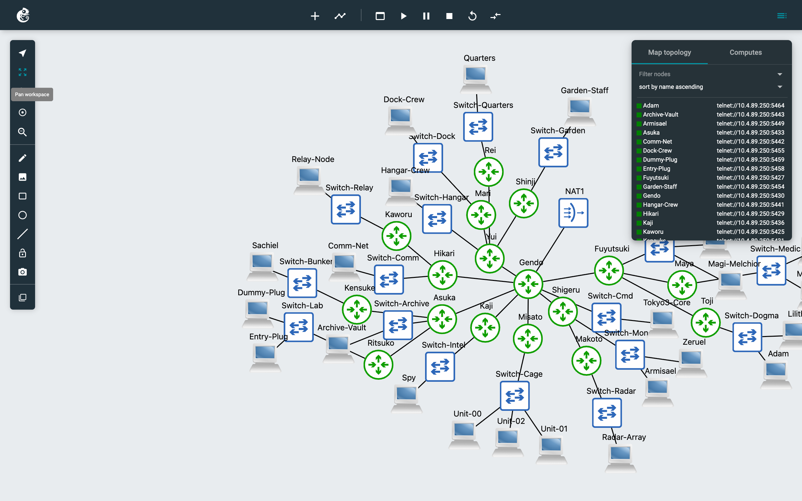
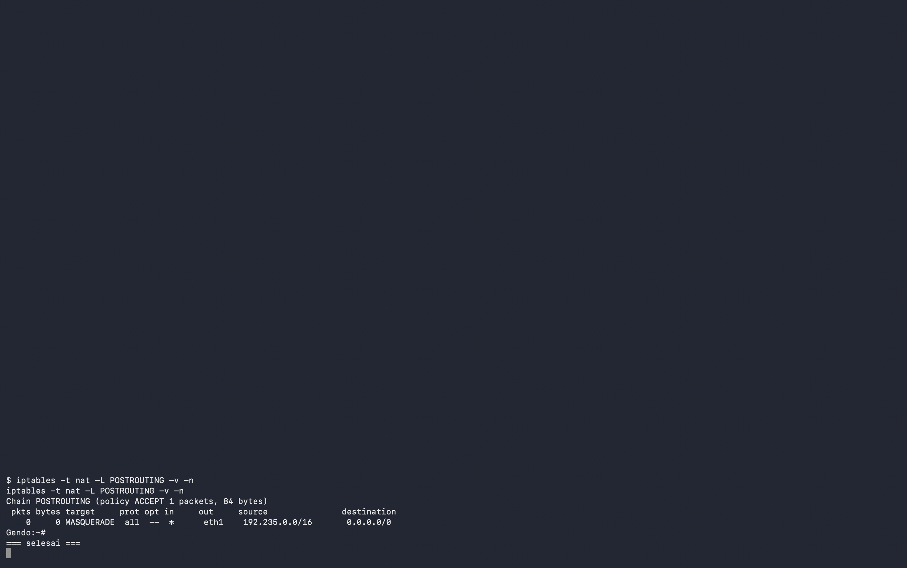
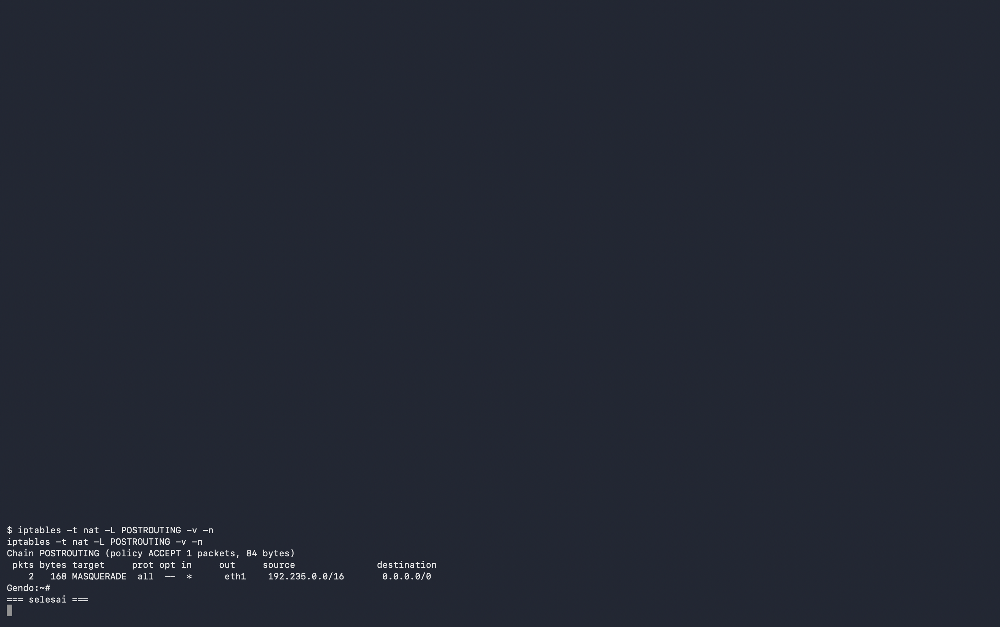

# Laporan Soal 4 — Akses Internet Geofront lewat Gendo (K-48)

## 1. Ringkasan

| Item | Hasil |
|---|---|
| Internet untuk seluruh jaringan | **aktif** lewat satu pintu (Gendo) |
| Aturan NAT | 1 rule MASQUERADE di Gendo, sumber `192.235.0.0/16`, keluar `eth1` |
| Ketergantungan pada IP NAT1 | **tidak ada** (interface diambil dari default route) |
| Traffic antar-LAN | source address asli tetap dipakai (counter NAT tidak naik) |
| DNS | 25 host non-router memakai resolver `8.8.8.8`, `1.1.1.1` |
| Node pemasang paket (Magi) | 3/3 bisa resolve `deb.debian.org` |
| Armisael & Lilith → `8.8.8.8` | **4/4, 0% packet loss** |
| Armisael & Lilith → `deb.debian.org` | **4/4, 0% packet loss** |
| Soal 2 + 3 setelah perubahan | tetap OK (16 link, 31 rute, 3 ping uji) |

Semua konfigurasi Gendo (soal 2 + 3 + 4) ada di satu file **`/root/gendo.sh`**;
salinan lokal: `dokumen/soal4/configs/gendo.sh`.

## 2. Rancangan NAT

Aturan yang dipasang:

```
iptables -t nat -F POSTROUTING
iptables -t nat -A POSTROUTING -s 192.235.0.0/16 -o "$NAT_IF" -j MASQUERADE
```

`NAT_IF` tidak ditulis tetap, melainkan dibaca dari default route:

```sh
NAT_IF=$(ip -4 route show default | awk '{for(i=1;i<=NF;i++) if($i=="dev"){print $(i+1); exit}}')
```

Konsekuensinya:

- Jika alamat NAT1 berganti, DHCP mengganti default route dan script memakai
  interface yang sama tanpa perlu diedit.
- Hanya paket yang **berasal dari prefix internal** dan **keluar lewat interface
  NAT1** yang diterjemahkan.
- Paket antar-LAN lewat interface router lain, sehingga tidak masuk rule ini dan
  alamat sumber aslinya tetap terbawa.

Bukti counter (diambil dari `dokumen/soal4/verify/nat_counter.txt`):

| Kondisi | Paket pada rule NAT |
|---|---:|
| Setelah `iptables -t nat -Z` | 0 |
| Setelah ping antar-LAN Armisael → Lilith | **0** (tidak berubah) |
| Setelah ping internet dari Armisael + Lilith | **naik** (> 0) |

## 3. DNS

`/root/soal4_dns.sh` ditaruh di **25 host non-router** dan menulis:

```
nameserver 8.8.8.8
nameserver 1.1.1.1
```

Resolver publik dipilih supaya konfigurasi host juga tidak bergantung pada alamat
NAT1. Karena node Magi belum mendapat IP permanen sampai soal 6, ketiganya diberi
IP sementara memakai nilai dari rencana VLSM (`192.235.4.58/29` … `.60/29`,
gateway `192.235.4.57`) agar resolusi bisa dibuktikan sekarang. IP permanen
menjadi permanen di soal 6.

Contoh hasil:

```
getent ahostsv4 deb.debian.org
→ 151.101.2.132 / 151.101.66.132 / 151.101.130.132 / 151.101.194.132
```

## 4. Pembuktian

Dari konsol **Armisael** dan **Lilith**, masing-masing:

```
ping -c 4 8.8.8.8          → 4/4, 0% packet loss
ping -c 4 deb.debian.org   → 4/4, 0% packet loss (resolved ke 151.101.x.x)
```

Log lengkap: `dokumen/soal4/verify/ping_internet.txt`, `dokumen/soal4/verify/nat_rules.txt`,
`dokumen/soal4/verify/nat_counter.txt`, `dokumen/soal4/verify/dns_hosts.txt`, `dokumen/soal4/summary.json`.

## 5. Bukti screenshot (asli, diambil saat pengerjaan)

| File | Isi |
|---|---|
| `assets/soal4/01-topologi-gns3.png` | Web UI GNS3, topologi 60 node |
| `assets/soal4/02-gendo-nat-rule.png` | `iptables -t nat -S/-L` di Gendo, rule MASQUERADE + default route |
| `assets/soal4/03-internal-no-nat.png` | counter NAT = 0 setelah ping antar-LAN |
| `assets/soal4/04-nat-counter.png` | counter NAT naik setelah ping internet |
| `assets/soal4/05-armisael-internet.png` | resolv.conf + ping `8.8.8.8` + ping `deb.debian.org` dari Armisael |
| `assets/soal4/06-lilith-internet.png` | resolv.conf + ping `8.8.8.8` + ping `deb.debian.org` dari Lilith |
| `assets/soal4/07-gendo-script.png` | potongan `/root/gendo.sh` berisi NAT berbasis interface |
| `assets/soal4/08-magi-dns.png` | IP sementara + `getent ahostsv4 deb.debian.org` di Magi-Casper |

Semua file di `bukti/` adalah tangkapan layar langsung dari Web UI GNS3 dan
sesi konsol node, bukan gambar yang digambar atau di-generate.

## 6. Reproduksi

```bash
python3 build_soal4.py all       # nat + dns + verify
./capture_bukti.sh <file.png> <node> "<perintah>"
```

File penting:

| File | Isi |
|---|---|
| `dokumen/soal4/configs/gendo.sh` | konfigurasi lengkap Gendo (soal 2+3+4) |
| `dokumen/soal4/configs/nat_only.sh` | bagian NAT saja |
| `dokumen/soal4/configs/soal4_dns.sh` | script resolver DNS |
| `dokumen/soal4/configs/host_Magi-*.sh` | IP sementara node pemasang paket |
| `dokumen/soal4/verify/` | log rule NAT, counter, ping, DNS |
| `dokumen/soal4/summary.json` | ringkasan mesin, `fail: []` |

---

## Galeri bukti screenshot

Semua gambar di bawah adalah **tangkapan layar asli** yang diambil
saat pengerjaan (Web UI GNS3 dan konsol node), bukan gambar generate.

### 1. Web UI GNS3, topologi 60 node



### 2. `iptables -t nat -S/-L` di Gendo, rule MASQUERADE + default route


### 3. counter NAT = 0 setelah ping antar-LAN



### 4. counter NAT naik setelah ping internet



### 5. resolv.conf + ping `8.8.8.8` + ping `deb.debian.org` dari Armisael


### 6. resolv.conf + ping `8.8.8.8` + ping `deb.debian.org` dari Lilith


### 7. potongan `/root/gendo.sh` berisi NAT berbasis interface


### 8. IP sementara + `getent ahostsv4 deb.debian.org` di Magi-Casper


