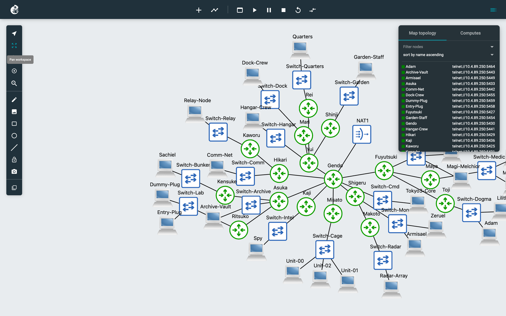
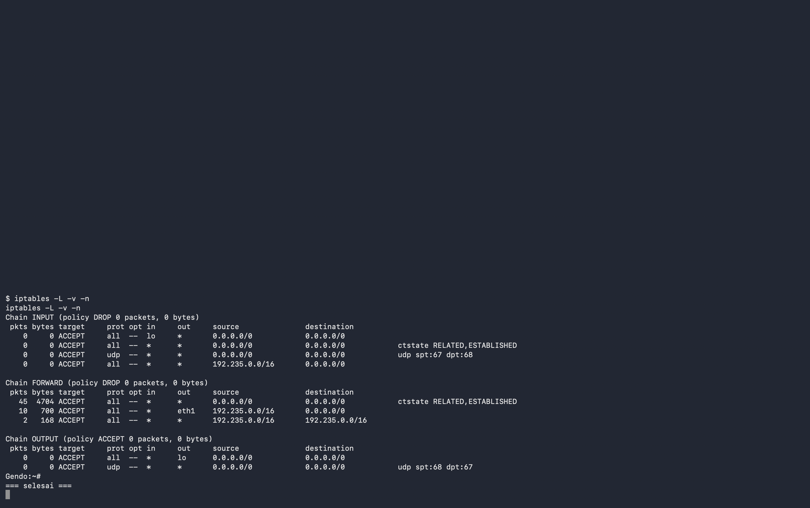
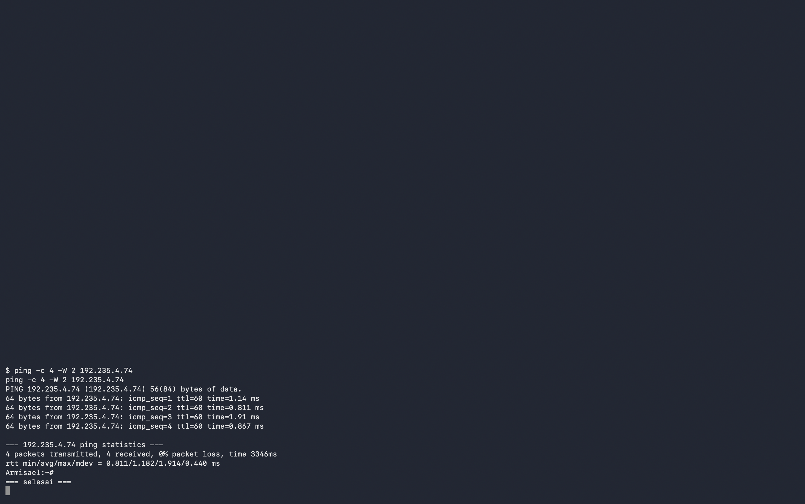
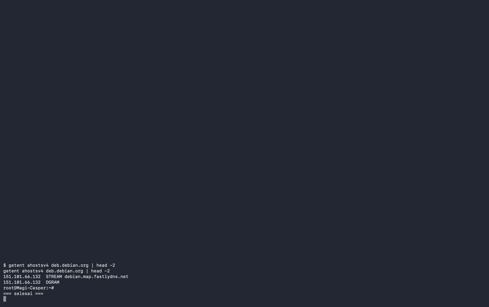
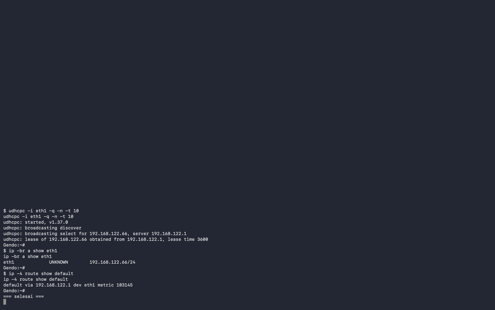

# Laporan Soal 5 — Mengunci Pintu NAT1 di Gendo (K-48)

## 1. Ringkasan

| Item | Hasil |
|---|---|
| Policy `INPUT` | **DROP** |
| Policy `FORWARD` | **DROP** |
| Policy `OUTPUT` | ACCEPT (tidak diubah) |
| Aturan ACCEPT untuk sumber NAT1 | **tidak ada** |
| DHCP dari NAT1 setelah firewall | **berhasil** (lease `192.168.122.66`) |
| Armisael → `8.8.8.8` | **4/4, 0% packet loss** |
| Traffic antar-LAN & DNS | tetap berhasil |
| Soal 2 + 3 + 4 | tetap lolos verifikasi |
| Lokasi konfigurasi | **`/root/gendo.sh`** (salinan: `dokumen/soal5/configs/gendo.sh`) |

## 2. Aturan yang dipasang

Ringkas dari `iptables -S` di Gendo:

```
-P INPUT DROP
-P FORWARD DROP
-P OUTPUT ACCEPT
-A INPUT  -i lo -j ACCEPT
-A OUTPUT -o lo -j ACCEPT
-A INPUT  -m conntrack --ctstate RELATED,ESTABLISHED -j ACCEPT
-A FORWARD -m conntrack --ctstate RELATED,ESTABLISHED -j ACCEPT
-A INPUT  -p udp -m udp --sport 67 --dport 68 -j ACCEPT
-A OUTPUT -p udp -m udp --sport 68 --dport 67 -j ACCEPT
-A INPUT  -s 192.235.0.0/16 -j ACCEPT
-A FORWARD -s 192.235.0.0/16 -o eth1 -j ACCEPT
-A FORWARD -s 192.235.0.0/16 -d 192.235.0.0/16 -j ACCEPT
```

Tabel `nat` tetap berisi rule dari soal 4:

```
-A POSTROUTING -s 192.235.0.0/16 -o eth1 -j MASQUERADE
```

### Penjelasan pengecualian

| Kebutuhan | Aturan |
|---|---|
| Loopback tetap hidup | `-i lo` / `-o lo` ACCEPT |
| (a) Balasan koneksi existing | `conntrack ESTABLISHED,RELATED` di INPUT & FORWARD |
| (b) Internal → internet | `FORWARD -s 192.235.0.0/16 -o $NAT_IF` ACCEPT |
| (c) Antar-LAN | `FORWARD -s 192.235.0.0/16 -d 192.235.0.0/16` ACCEPT |
| (d) Internal → Gendo sendiri | `INPUT -s 192.235.0.0/16` ACCEPT |
| DHCP NAT1 | UDP `67 → 68` / `68 → 67` ACCEPT |
| Koneksi baru dari NAT1 | tidak ada aturan ACCEPT → kena policy DROP |

`NAT_IF` tetap berasal dari default route (`eth1`), jadi firewall juga tidak
terikat pada alamat NAT1 tertentu. Semua blok ini ditulis di bagian akhir
`/root/gendo.sh` sehingga script bisa dijalankan ulang dengan aman.

## 3. Pembuktian

- `udhcpc -i eth1 -q -n -t 10` dijalankan **setelah** firewall aktif → lease
  `192.168.122.66` dari `192.168.122.1` tetap diperoleh, default route tetap ada.
- `ping -c 4 8.8.8.8` dari Armisael → 4/4, 0% packet loss.
- `ping -c 4 8.8.8.8` dari Lilith → 4/4, 0% packet loss.
- `ping -c 4 deb.debian.org` dari Armisael → 4/4, 0% packet loss.
- `ping -c 4 192.235.4.74` dan `192.235.3.130` dari Armisael → 4/4, 0% loss.
- `getent ahostsv4 deb.debian.org` di Magi-Casper → `151.101.x.x`.
- Verifikasi ulang Soal 3 (31 rute, 3 ping) dan Soal 4 (NAT counter) lolos.

Log: `dokumen/soal5/verify/iptables_S.txt`, `dokumen/soal5/verify/iptables_L.txt`,
`dokumen/soal5/verify/dhcp_after_firewall.txt`, `dokumen/soal5/verify/connectivity.txt`, `dokumen/soal5/summary.json`.

## 4. Bukti screenshot (asli, diambil saat pengerjaan)

| File | Isi |
|---|---|
| `assets/soal5/01-topologi-gns3.png` | Web UI GNS3 |
| `assets/soal5/02-gendo-iptables-S.png` | `iptables -S` + aturan NAT di Gendo |
| `assets/soal5/03-gendo-iptables-L.png` | policy DROP pada INPUT/FORWARD + counter |
| `assets/soal5/04-gendo-script.png` | bagian Soal 5 di `/root/gendo.sh` |
| `assets/soal5/05-armisael-internet.png` | ping `8.8.8.8` dari Armisael setelah firewall |
| `assets/soal5/06-armisael-lilith.png` | ping antar-LAN setelah firewall |
| `assets/soal5/07-magi-dns.png` | resolusi DNS node pemasang paket |
| `assets/soal5/08-gendo-dhcp.png` | DHCP ulang berhasil setelah firewall aktif |

Seluruh file di `bukti/` adalah tangkapan layar langsung dari Web UI GNS3 dan
konsol node, bukan gambar yang dibuat/generate.

## 5. Reproduksi

```bash
python3 build_soal5.py all
./capture_bukti.sh <file.png> <node> "<perintah>"
```

File penting: `dokumen/soal5/configs/gendo.sh`, `dokumen/soal5/configs/firewall_only.sh`, `dokumen/soal5/verify/`,
`dokumen/soal5/summary.json` (`fail: []`).

---

## Galeri bukti screenshot

Semua gambar di bawah adalah **tangkapan layar asli** yang diambil
saat pengerjaan (Web UI GNS3 dan konsol node), bukan gambar generate.

### 1. Web UI GNS3



### 2. `iptables -S` + aturan NAT di Gendo


### 3. policy DROP pada INPUT/FORWARD + counter



### 4. bagian Soal 5 di `/root/gendo.sh`


### 5. ping `8.8.8.8` dari Armisael setelah firewall


### 6. ping antar-LAN setelah firewall



### 7. resolusi DNS node pemasang paket



### 8. DHCP ulang berhasil setelah firewall aktif



