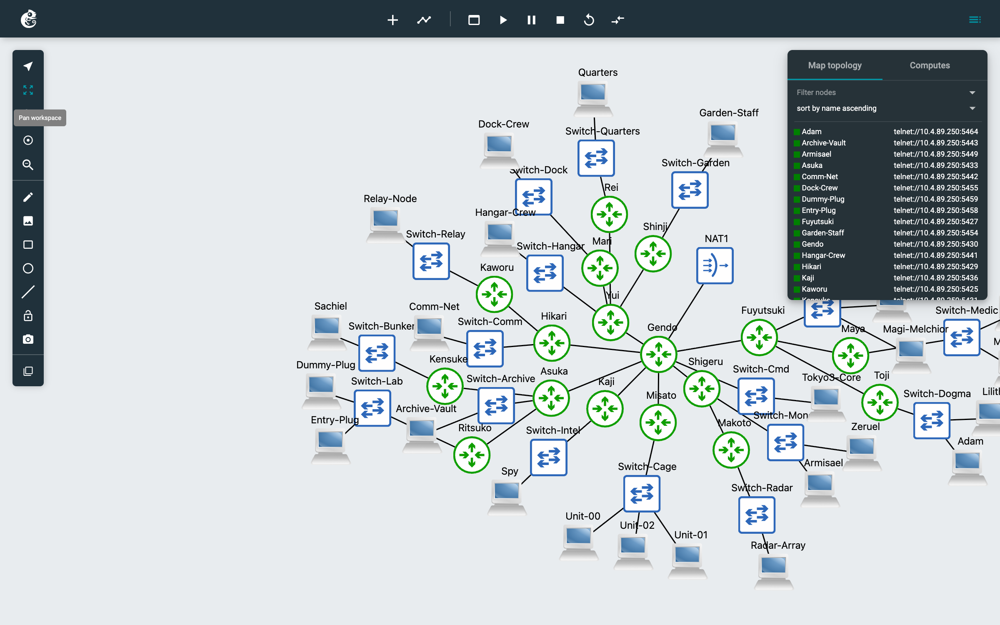

# Laporan Soal 6 — Alamat Permanen Semua Node Non-Router (K-48)

## 1. Ringkasan

| Item | Hasil |
|---|---|
| Node non-router | **25/25** mendapat IP statis + gateway sesuai VLSM |
| Aturan alamat | gateway = IP usable pertama; host berikutnya berurutan sesuai urutan nama di switch |
| `ip -br` + default route | **25/25 sesuai rencana** |
| Ping ke gateway | **25/25 berhasil, 0% packet loss** |
| Unit-01 → gateway `192.235.4.65` | **4/4, 0% packet loss** |
| Uji restart 25 host | **25/25 konfigurasi kembali otomatis** |
| DNS & internet | tetap berhasil setelah restart |
| Soal 3, 4, 5 | diverifikasi ulang, tetap lolos |

## 2. Aturan penomoran

Sesuai glosarium: gateway adalah IP usable pertama pada subnet, lalu node-node
di switch menerima IP usable berikutnya berurutan sesuai penulisan nama di
topologi (kiri → kanan). Ini sudah sesuai `vlsm_plan.json` yang dipakai sejak
soal 1.

Contoh:

| Node | IP | Gateway | Subnet |
|---|---|---|---|
| Unit-01 | `192.235.4.66/29` | `192.235.4.65` | `192.235.4.64/29` |
| Unit-02 | `192.235.4.67/29` | `192.235.4.65` | `192.235.4.64/29` |
| Quarters | `192.235.0.2/23` | `192.235.0.1` | `192.235.0.0/23` |
| Comm-Net | `192.235.2.2/24` | `192.235.2.1` | `192.235.2.0/24` |
| Magi-Casper | `192.235.4.58/29` | `192.235.4.57` | `192.235.4.56/29` |
| Armisael | `192.235.4.83/29` | `192.235.4.81` | `192.235.4.80/29` |

Tabel lengkap 25 node: `dokumen/soal6/verify/ip_br_all.txt`, salinan script per node:
`dokumen/soal6/configs/init_<nama>.sh`.

## 3. Cara agar bertahan setelah restart

Image `alpinet`/`debinet` menjalankan `/etc/alpinet-init.sh` atau
`/etc/debinet-init.sh`, yang memanggil **`/root/init.sh`** jika ada dan executable.
Maka pada tiap host dibuat `/root/init.sh` berisi:

- `ip link set eth0 up`, `ip addr flush dev eth0`
- `ip addr add <IP>/<prefix> dev eth0`
- `ip route replace default via <gateway>`
- penulisan `/etc/resolv.conf` (DNS dari soal 4)
- penulisan blok statis `/etc/network/interfaces`

Script ini juga dijalankan sekali saat konfigurasi dipasang. Setelah itu seluruh
25 host di-**restart** lewat API GNS3 dan langsung diperiksa ulang: 25/25 IP,
gateway, dan `/root/init.sh` masih benar (`dokumen/soal6/verify/restart_hosts.txt`).

## 4. Pembuktian

Dari konsol **Unit-01**:

```
ip -br a show eth0        → 192.235.4.66/29
ip route show default     → default via 192.235.4.65 dev eth0
ping -c 4 192.235.4.65    → 4/4, 0% packet loss
```

Log lain: `dokumen/soal6/verify/ping_gateway_all.txt` (25 host), `dokumen/soal6/verify/apply_hosts.txt`,
`dokumen/soal6/verify/restart_hosts.txt`, `dokumen/soal6/summary.json`.

## 5. Bukti screenshot (asli, diambil saat pengerjaan)

| File | Isi |
|---|---|
| `assets/soal6/01-topologi-gns3.png` | Web UI GNS3 |
| `assets/soal6/02-unit01-ip-route.png` | `ip -br` + gateway Unit-01 |
| `assets/soal6/03-unit01-ping-gateway.png` | ping Unit-01 ke gateway `192.235.4.65` |
| `assets/soal6/04-unit01-init-script.png` | isi `/root/init.sh` Unit-01 |
| `assets/soal6/05-quarters-ip.png` | IP `/23` Quarters + gateway |
| `assets/soal6/06-magi-ip-dns.png` | IP Magi-Casper + resolusi DNS |
| `assets/soal6/07-armisael-after-restart.png` | IP Armisael masih benar setelah restart |
| `assets/soal6/08-commnet-ip.png` | IP `/24` Comm-Net + gateway |

Semuanya tangkapan layar langsung dari Web UI/konsol GNS3, bukan gambar generate.

## 6. Reproduksi

```bash
python3 build_soal6.py all       # apply + restart + verify
./capture_bukti.sh <file.png> <node> "<perintah>"
```

Ringkasan mesin: `dokumen/soal6/summary.json` (`fail: []`).

---

## Galeri bukti screenshot

Semua gambar di bawah adalah **tangkapan layar asli** yang diambil
saat pengerjaan (Web UI GNS3 dan konsol node), bukan gambar generate.

### 1. Web UI GNS3



### 2. `ip -br` + gateway Unit-01


### 3. ping Unit-01 ke gateway `192.235.4.65`


### 4. isi `/root/init.sh` Unit-01


### 5. IP `/23` Quarters + gateway


### 6. IP Magi-Casper + resolusi DNS


### 7. IP Armisael masih benar setelah restart


### 8. IP `/24` Comm-Net + gateway


