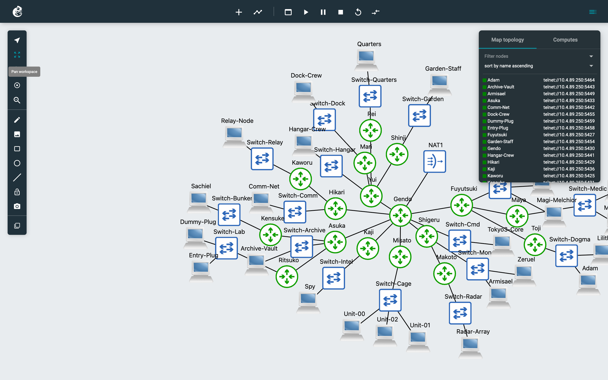

# Laporan Soal 7 — Membangunkan MAGI (K-48)

## 1. Ringkasan

| Item | Hasil |
|---|---|
| Node MAGI | Casper, Balthasar, Melchior (Switch-Terminal) |
| Paket dipasang | **`iptables`** + **`netcat-traditional`** di ketiga node |
| Skrip instalasi | **`/root/<nama>.sh`** (mis. `/root/Magi-Casper.sh`) |
| Listener | Casper `:5000`; Balthasar `:5000` dan `:5001`; Melchior `:5000` |
| Pesan dari Lilith | **4/4 terkirim** (RC=0) |
| Pesan diterima | **4/4 terbaca di node tujuan** |
| `fail` | `[]` |

Sesuai glosarium: Casper 5000, Balthasar 5000 + 5001, Melchior 5000.

## 2. Konfigurasi

Tiap node MAGI mendapat `/root/<nama>.sh` yang:

1. `apt-get update` + `apt-get install -y iptables netcat-traditional`
   (`DEBIAN_FRONTEND=noninteractive`).
2. Memilih biner `nc.traditional` (fallback `nc`).
3. Membersihkan listener lama, lalu membuat loop listener dengan
   `nohup sh -c 'while true; do nc.traditional -l -p <port> >> /root/magi_<port>.log 2>&1; done' &`.
4. Mencetak `ss -ltnp` sebagai pembuktian port aktif.

`nc.traditional` dipakai karena listener OpenBSD `nc` akan berhenti setelah
satu koneksi; loop `while true` menjaga listener tetap hidup untuk pengiriman
berikutnya.

Salinan skrip: `dokumen/soal7/configs/Magi-Casper.sh`, `dokumen/soal7/configs/Magi-Balthasar.sh`,
`dokumen/soal7/configs/Magi-Melchior.sh`.

## 3. Pengiriman dari Lilith

| Tujuan | Port | Pesan | Status |
|---|---|---|---|
| Magi-Casper | 5000 | `HALO CASPER DARI LILITH` | diterima |
| Magi-Balthasar | 5000 | `HALO BALTHASAR PORT 5000 DARI LILITH` | diterima |
| Magi-Balthasar | 5001 | `HALO BALTHASAR PORT 5001 DARI LILITH` | diterima |
| Magi-Melchior | 5000 | `HALO MELCHIOR DARI LILITH` | diterima |

Log lengkap: `dokumen/soal7/verify/install.txt`, `dokumen/soal7/verify/listeners.txt`, `dokumen/soal7/verify/send.txt`,
`dokumen/soal7/verify/received.txt`, ringkasan: `dokumen/soal7/summary.json`.

## 4. Bukti screenshot (asli, diambil saat pengerjaan)

| File | Isi |
|---|---|
| `assets/soal7/01-topologi-gns3.png` | Web UI GNS3 |
| `assets/soal7/02-casper-install-listener.png` | paket terpasang + listener `:5000` di Casper |
| `assets/soal7/03-casper-pesan.png` | pesan diterima di Casper |
| `assets/soal7/04-balthasar-listener.png` | listener `:5000` dan `:5001` di Balthasar |
| `assets/soal7/05-balthasar-5000.png` | pesan diterima di Balthasar port 5000 |
| `assets/soal7/06-balthasar-5001.png` | pesan diterima di Balthasar port 5001 |
| `assets/soal7/07-melchior-pesan.png` | pesan diterima di Melchior |
| `assets/soal7/08-lilith-kirim.png` | keempat `nc` dari Lilith, `RC=0` |

Semua file di `bukti/` adalah tangkapan layar langsung dari Web UI GNS3 dan
konsol node GNS3 yang sedang berjalan, bukan gambar generate.

## 5. Reproduksi

```bash
python3 build_soal7.py all
./capture_bukti.sh <file.png> <node> "<perintah>"
```

---

## Galeri bukti screenshot

Semua gambar di bawah adalah **tangkapan layar asli** yang diambil
saat pengerjaan (Web UI GNS3 dan konsol node), bukan gambar generate.

### 1. Web UI GNS3



### 2. paket terpasang + listener `:5000` di Casper


### 3. pesan diterima di Casper


### 4. listener `:5000` dan `:5001` di Balthasar


### 5. pesan diterima di Balthasar port 5000


### 6. pesan diterima di Balthasar port 5001


### 7. pesan diterima di Melchior


### 8. keempat `nc` dari Lilith, `RC=0`


