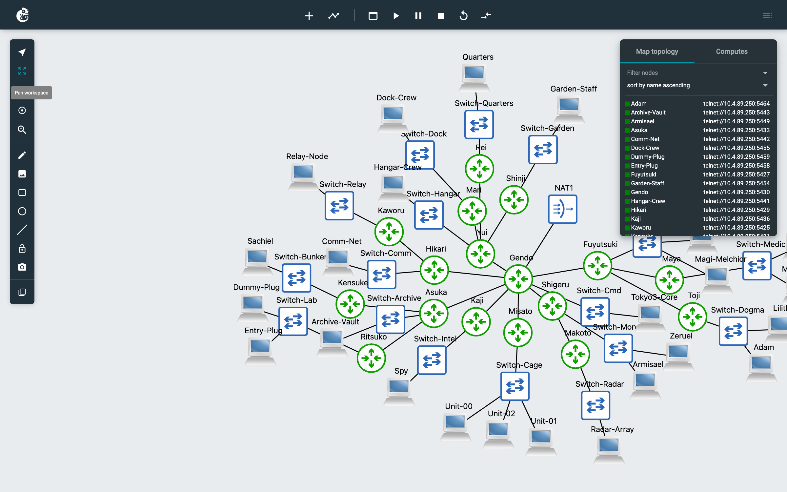

# Laporan Soal 8 — Kondisi Normal Pen-Pen & Tokyo3-Core (K-48)

## 1. Ringkasan

| Item | Hasil |
|---|---|
| Pen-Pen `:80` | `Welcome to Pen-Pen` |
| Tokyo3-Core `:80` | `Welcome to Tokyo3-Core` |
| Tokyo3-Core `:8080` | `syifa imutz` |
| `nc` dari Lilith ke 3 port | **3/3 berhasil, RC=0** |
| Port `:22` (tidak dilayani) | **Connection refused, RC=1, ±0.006 detik** |
| Skrip listener | `/root/Pen-Pen.sh`, `/root/Tokyo3-Core.sh` |
| `fail` | `[]` |

Ini adalah kondisi **sebelum** sabotase (soal 9/10/12), jadi kedua node sengaja
dibiarkan melayani tanpa proteksi.

## 2. Konfigurasi

Tiap node menjalankan `/root/<nama>.sh` yang memasang listener `nc` berulang:

```sh
start_listener() {
  port=$1
  text=$2
  nohup sh -c "while true; do printf '%s\n' \"$text\" | nc -N -l $port; done" >/dev/null 2>&1 &
}
start_listener 80 "Welcome to $(hostname)"
# Tokyo3-Core juga:
start_listener 8080 "syifa imutz"
```

`nc -N` menutup koneksi setelah stdin habis, sehingga setiap `nc` dari Lilith
mendapat satu baris jawaban lalu selesai. Loop `while true` membuat listener
tetap hidup untuk koneksi berikutnya. Salinan skrip: `dokumen/soal8/configs/`.

## 3. Pembuktian dari Lilith

| Perintah | Jawaban |
|---|---|
| `nc -w 3 192.235.3.194 80` | `Welcome to Pen-Pen` |
| `nc -w 3 192.235.4.106 80` | `Welcome to Tokyo3-Core` |
| `nc -w 3 192.235.4.106 8080` | `syifa imutz` |
| `nc -v -w 2 192.235.3.194 22` | `Connection refused`, `0.006 detik`, `RC=1` |
| `nc -v -w 2 192.235.4.106 22` | `Connection refused`, `0.006 detik`, `RC=1` |

Durasi ±0.006 detik (jauh di bawah `timeout 5`) membuktikan port tertutup
**langsung gagal**, bukan menggantung. Log: `dokumen/soal8/verify/nc_served.txt`,
`dokumen/soal8/verify/nc_closed.txt`, `dokumen/soal8/verify/servers.txt`, `dokumen/soal8/verify/listeners.txt`;
ringkasan: `dokumen/soal8/summary.json`.

## 4. Bukti screenshot (asli, diambil saat pengerjaan)

| File | Isi |
|---|---|
| `assets/soal8/01-topologi-gns3.png` | Web UI GNS3 |
| `assets/soal8/02-penpen-listener.png` | listener `:80` + skrip Pen-Pen |
| `assets/soal8/03-tokyocore-listener.png` | listener `:80` dan `:8080` Tokyo3-Core |
| `assets/soal8/04-lilith-penpen80.png` | `Welcome to Pen-Pen` dari Lilith |
| `assets/soal8/05-lilith-tokyocore80.png` | `Welcome to Tokyo3-Core` dari Lilith |
| `assets/soal8/06-lilith-tokyocore8080.png` | `syifa imutz` dari Lilith |
| `assets/soal8/07-lilith-port22.png` | `Connection refused` cepat di kedua node |
| `assets/soal8/08-tokyocore-script.png` | isi `/root/Tokyo3-Core.sh` |

Semua file di `bukti/` adalah tangkapan layar langsung dari Web UI GNS3 dan
konsol node yang sedang berjalan, bukan gambar generate.

## 5. Reproduksi

```bash
python3 build_soal8.py all
./capture_bukti.sh <file.png> <node> "<perintah>"
```

---

## Galeri bukti screenshot

Semua gambar di bawah adalah **tangkapan layar asli** yang diambil
saat pengerjaan (Web UI GNS3 dan konsol node), bukan gambar generate.

### 1. Web UI GNS3



### 2. listener `:80` + skrip Pen-Pen


### 3. listener `:80` dan `:8080` Tokyo3-Core


### 4. `Welcome to Pen-Pen` dari Lilith


### 5. `Welcome to Tokyo3-Core` dari Lilith


### 6. `syifa imutz` dari Lilith


### 7. `Connection refused` cepat di kedua node


### 8. isi `/root/Tokyo3-Core.sh`


