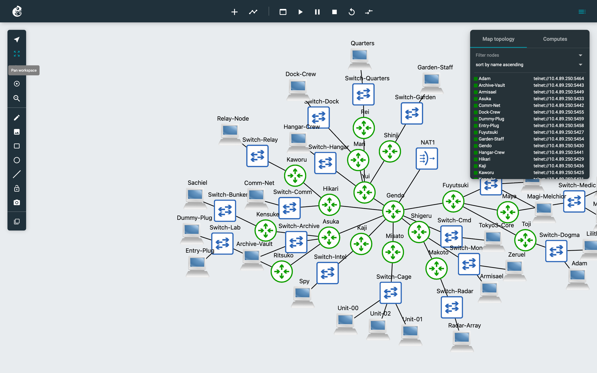
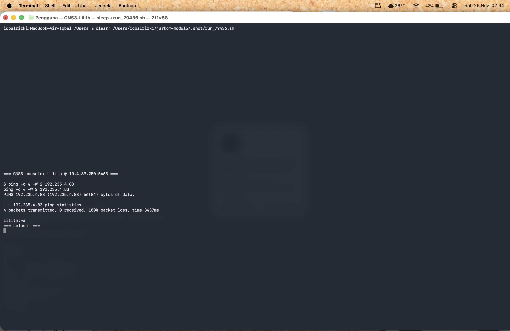
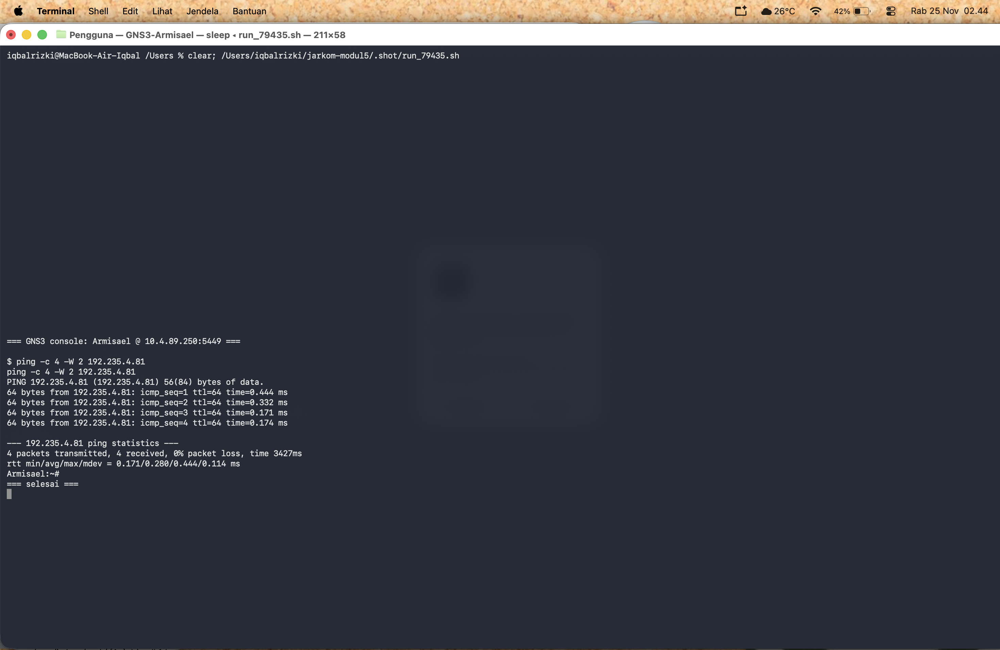
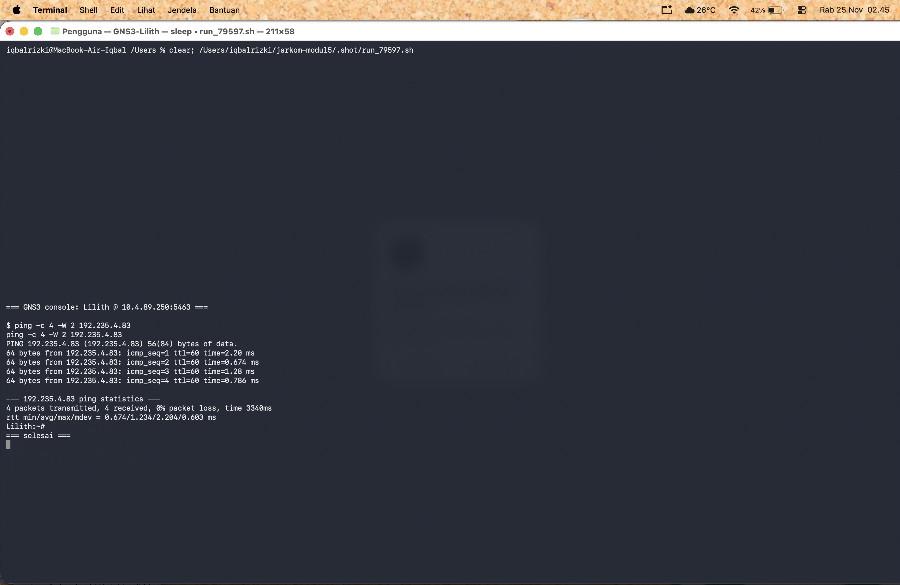

# Laporan Soal 9 — Jalur Belakang di Shigeru Disabotase (K-48)

## 1. Ringkasan

| Item | Hasil |
|---|---|
| Script sabotase | `break_routing.sh` dari asisten (Drive), SHA-256 `643d8498…5d68`, sama dengan file di `~/Downloads` |
| Eksekusi | dijalankan di **Shigeru** tanpa dibaca isinya → `Script sudah dirusak` |
| Gejala | Lilith → Armisael **100% packet loss**; Armisael → gateway tetap **4/4** |
| Penyebab ditemukan | **4** (lihat tabel below) |
| Perbaikan | `/root/soal9_fix.sh` (idempoten) |
| Setelah perbaikan | Lilith → Armisael **4/4, 0% loss**; Armisael → internet **4/4** |
| `fail` | `[]` |

## 2. Gejala sebelum perbaikan

- `ping -c 4 192.235.4.83` dari Lilith → 4 terkirim, 0 diterima (100% loss).
- `ping -c 4 192.235.4.81` dari Armisael → 4/4 diterima (gateway masih hidup).
- `ping -c 4 8.8.8.8` dari Armisael → `Destination Host Unreachable` dari `192.235.4.81`.

Artinya LAN Switch-Monolith masih sehat, tetapi Shigeru gagal meneruskan/merutekan.

## 3. Semua penyebab

| # | Kondisi yang ditemukan di Shigeru | Efek |
|---|---|---|
| 1 | `net.ipv4.ip_forward = 0` | Router tidak meneruskan paket antar interface → balasan Armisael tidak sampai ke Lilith. |
| 2 | `default via 192.235.4.162 dev eth2` | Default route mengarah ke **Makoto**, bukan ke Gendo (`192.235.4.129`). Traffic internet salah arah. |
| 3 | `blackhole 192.235.4.72/29` | Subnet Lilith sengaja di-blackhole → paket ke Lilith dibuang. |
| 4 | `ip rule 90: from all iif eth0 lookup 100` + `unreachable default` di **table 100** | Semua paket yang **masuk lewat eth0** (LAN tempat Armisael) kena lookup tabel 100 dan dijawab *unreachable*. Inilah sebabnya Armisael masih bisa ping gateway (tujuan lokal masuk tabel `local`, prioritas 0) tetapi gagal ke internet, dan balasannya ke Lilith juga gagal. |

Keempatnya saling memperparah; memperbaiki satu saja tidak cukup.

## 4. Perbaikan

`/root/soal9_fix.sh` melakukan:

```sh
sysctl -w net.ipv4.ip_forward=1
ip route del blackhole 192.235.4.72/29
ip rule del iif eth0 lookup 100
ip route del default table 100
ip route replace default via 192.235.4.129 dev eth1
ip route replace 192.235.4.88/29 via 192.235.4.162 dev eth2
```

Rute Makoto (`192.235.4.88/29 via 192.235.4.162`) dipertahankan karena memang
rute bawah Shigeru dari soal 3. Salinan: `dokumen/soal9/configs/soal9_fix.sh`.

## 5. Pembuktian akhir

| Uji | Hasil |
|---|---|
| Lilith → Armisael `192.235.4.83` | **4/4, 0% packet loss** |
| Armisael → gateway `192.235.4.81` | **4/4, 0% packet loss** |
| Armisael → `8.8.8.8` | **4/4, 0% packet loss** |
| `ip rule` Shigeru | hanya `local`, `main`, `default` (_rule 100 hilang_) |
| `ip_forward` Shigeru | `1` |

Log: `dokumen/soal9/verify/break_run.txt`, `dokumen/soal9/verify/sabotage_state.txt`,
`dokumen/soal9/verify/repair_run.txt`, `dokumen/soal9/verify/final.txt`; ringkasan: `dokumen/soal9/summary.json`.

## 6. Bukti screenshot (asli, diambil saat pengerjaan)

| File | Isi |
|---|---|
| `assets/soal9/01-topologi-gns3.png` | Web UI GNS3 |
| `assets/soal9/02-break-script-run.png` | eksekusi `break_routing.sh` di Shigeru |
| `assets/soal9/03-sabotage-state.png` | blackhole, `ip_forward=0`, rule 90 + `unreachable default` table 100 |
| `assets/soal9/04-lilith-gagal.png` | Lilith → Armisael 100% loss saat sabotase |
| `assets/soal9/05-armisael-gateway-ok.png` | Armisael → gateway tetap 4/4 saat sabotase |
| `assets/soal9/06-fix-script.png` | isi `/root/soal9_fix.sh` |
| `assets/soal9/07-after-fix-state.png` | route + rule + `ip_forward` setelah perbaikan |
| `assets/soal9/08-lilith-pulih.png` | Lilith → Armisael 4/4, 0% loss |

Semuanya tangkapan layar langsung dari Web UI GNS3/konsol node, bukan gambar generate.
Script asisten tidak pernah dibaca isinya; diagnosis dilakukan murni dari gejala
dan state router.

## 7. Reproduksi

```bash
python3 build_soal9.py sabotage   # butuh break_routing.sh di workspace
python3 build_soal9.py diagnose
python3 build_soal9.py repair
python3 build_soal9.py verify
```

---

## Galeri bukti screenshot

Semua gambar di bawah adalah **tangkapan layar asli** yang diambil
saat pengerjaan (Web UI GNS3 dan konsol node), bukan gambar generate.

### 1. Web UI GNS3



### 2. eksekusi `break_routing.sh` di Shigeru


### 3. blackhole, `ip_forward=0`, rule 90 + `unreachable default` table 100


### 4. Lilith → Armisael 100% loss saat sabotase



### 5. Armisael → gateway tetap 4/4 saat sabotase



### 6. isi `/root/soal9_fix.sh`


### 7. route + rule + `ip_forward` setelah perbaikan


### 8. Lilith → Armisael 4/4, 0% loss



